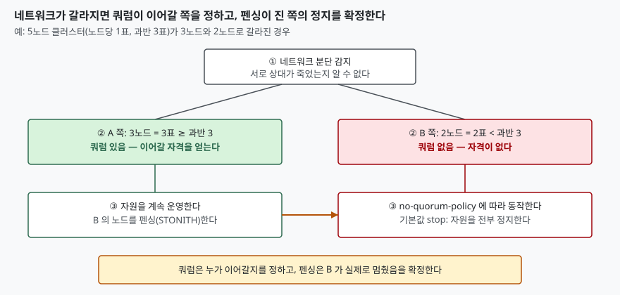

> **실행 검증 없음.** 이 글은 Pacemaker·Corosync 공개 문서를 근거로 정리했다.
> 클러스터를 구성해 돌린 출력이나 측정값은 싣지 않는다.

## 들어가며

HA 클러스터는 한 서버가 멈추면 다른 서버가 서비스를 이어받는 구성이다. 시험에서는 "장애 조치(failover)" 로 묻고, 실무에서는 이어받는 순간의 판단이 문제가 된다. 두 서버 사이 네트워크가 끊겼을 때 각 서버는 상대가 죽은 것인지 선이 끊긴 것인지 구분할 수 없다. 둘 다 "상대가 죽었다"고 판단해 서비스를 이어받으면 같은 디스크에 두 서버가 동시에 쓰게 되고, 데이터가 깨진다. 이 상황을 막는 장치가 쿼럼과 펜싱이며, 시험에서는 둘의 **역할 구분**을 묻는다.

## Ⅰ. 정의

- **스플릿 브레인**(split brain): 노드들이 서로 통신하지 못하지만 각자 자원을 계속 운영할 수 있는 상태. Pacemaker 문서가 펜싱이 필요한 이유로 든다.
- **쿼럼**(quorum): 클러스터가 동작해도 되는 자격으로, 전체 표의 **과반**(50% + 1)을 가진 분할만 얻는다. Corosync votequorum 매뉴얼이 단순 과반으로 설명한다.
- **펜싱**(fencing, 별칭 STONITH — Shoot The Other Node In The Head): 응답 없는 노드가 자원을 운영할 수 없도록 **강제로 만드는** 것. Pacemaker 문서의 정의는 응답하지 않는 노드도 자원을 돌리지 못하게 한다는 데 있다.

## Ⅱ. 등장 배경

하트비트(주기적 생존 신호)가 끊긴 것만으로 상대가 죽었다고 판단하면, 선 하나가 끊긴 것과 서버가 멈춘 것을 구분하지 못한다. **상대가 정말 멈췄는지를 확인하지 않고 이어받는** 방식은 같은 자원을 두 곳에서 쓰는 사고로 이어질 수 있다. 이를 막으려고 ① 누가 이어받을 자격이 있는지를 정하는 규칙(쿼럼)과 ② 상대를 확실히 멈추는 수단(펜싱)이 따로 생겼다.

## Ⅲ. 구성 — 두 장치의 동작 절차 (4단계)

> **출처**: [Pacemaker Explained — Fencing §8.2 Why is Fencing Necessary](http://clusterlabs.org/projects/pacemaker/doc/2.1/Pacemaker_Explained/html/fencing.html#why-is-fencing-necessary), [§8.11 Fencing and Quorum](http://clusterlabs.org/projects/pacemaker/doc/2.1/Pacemaker_Explained/html/fencing.html#fencing-and-quorum), [votequorum(5)](https://github.com/corosync/corosync/blob/main/man/votequorum.5)

① 분단을 감지한다. ② 각 분할이 자기 표를 세어 과반 여부로 쿼럼을 판정한다. ③ 쿼럼이 있는 쪽은 자원을 이어 운영하면서 진 쪽 노드를 펜싱한다. 쿼럼이 없는 쪽은 `no-quorum-policy` 설정대로 동작한다. ④ 펜싱된 노드는 응답이 없어도 자원을 운영할 수 없는 상태가 되므로 진 쪽의 자원을 안전하게 다른 곳에서 운영할 수 있다(Pacemaker 문서의 펜싱 정의에서 이끌어낸 해석).

Pacemaker 문서는 일반적으로 **쿼럼이 있고 `stonith-enabled` 가 켜져 있는 분할만** 펜싱할 수 있다고 한다. 예외는 세 가지다. `stonith_admin` 이나 DLM 같은 외부 응용이 시작한 펜싱은 이 제한을 받지 않고, 쿼럼 없는 분할이 자기 노드를 스스로 펜싱할 수 있으며(`suicide` 가 이 경우다), `no-quorum-policy=ignore` 면 쿼럼 없이도 펜싱한다.

### 쿼럼 계산

과반은 `floor(N/2) + 1` 표다(이 글의 계산). votequorum 매뉴얼은 8노드에 노드당 1표면 쿼럼이 5라는 예를 든다.

| 노드 수 N | 쿼럼 | 견딜 수 있는 동시 장애 |
|---|---|---|
| 2 | 2 | 0 |
| 3 | 2 | 1 |
| 4 | 3 | 1 |
| 5 | 3 | 2 |

노드가 3에서 4로 늘어도 견디는 장애 수가 그대로다. 그래서 쿼럼 구성은 홀수 노드가 효율적이다.

### no-quorum-policy 값 (6가지)

쿼럼을 잃은 분할이 하는 일이다. 기본값은 `stop` 이다(Pacemaker 2.1 문서 기준).

| 값 | 동작 |
|---|---|
| `ignore` | 쿼럼과 무관하게 모든 자원 관리를 계속한다 |
| `freeze` | 이미 도는 자원은 유지하되 분할 밖 노드의 자원은 복구하지 않는다 |
| `stop` | 그 분할의 자원을 전부 정지한다 |
| `demote` | 승격 가능한 자원은 강등하고 나머지는 정지한다 (2.0.5부터) |
| `fence` | 그 분할의 노드를 전부 펜싱한다 (2.1.9부터) |
| `suicide` | `fence` 와 같고 2.1.9부터 사용 중단 예정 |

## Ⅳ. 비교 — 쿼럼과 펜싱

| 구분 | 쿼럼 | 펜싱 |
|---|---|---|
| 답하는 질문 | 누가 이어갈 자격이 있는가 | 진 쪽이 정말 멈췄는가 |
| 성격 | 논리적 판정(표 세기) | 물리적 조치(전원·접근 차단) |
| 판정 기준 | 과반 표 | 펜싱 장치의 성공 응답 |
| 없으면 | 갈라진 양쪽이 모두 이어갈 수 있다 | 진 쪽이 여전히 쓰는 중일 수 있다 |
| 설정 | `no-quorum-policy` | `stonith-enabled`(기본 켜짐) |

쿼럼만 있으면 진 쪽이 **스스로 멈추기를 기대**해야 하고, 멈추려는 순간 네트워크만 끊긴 게 아니라 노드가 먹통이면 멈추지 못한다. 펜싱만 있으면 양쪽이 서로를 펜싱하는 상황이 생긴다. 둘이 같이 있어야 안전하다.

## Ⅴ. 2노드 클러스터와 쿼럼 장치

2노드는 쿼럼이 2표다. 한 노드가 떨어지면 남은 노드는 1표뿐이라 쿼럼을 잃는다. 이를 풀려고 votequorum 의 `two_node: 1` 은 **쿼럼을 인위적으로 1로 둔다**. 한 노드만 남아도 계속 돌 수 있다. 대신 두 가지가 따른다. 같은 설정에서 `wait_for_all` 이 자동으로 켜져, 시작 직후에는 모든 노드를 한 번 함께 본 뒤에야 쿼럼이 생긴다. 그리고 분단 시 각 노드가 자기 쪽에 쿼럼이 있다고 판단하므로(쿼럼이 1이므로 이 글의 추론) **서로 펜싱하려는 경쟁**이 남고, 이를 막을 것은 펜싱 설정뿐이다.

더 안전한 방법은 제3자 중재자를 두는 것이다. `corosync-qdevice` 는 각 노드에서 돌며 중재 서버(`corosync-qnetd`)의 판단에 따라 쿼럼에 표를 더한다. 매뉴얼은 짝수 노드 클러스터에 권하고 2노드에는 특히 권한다. 알고리즘은 두 가지다.

- **ffsplit**: 활성 노드가 가장 많은 분할에 정확히 1표를 준다. 동률이면 점수·연결 수·`tie_breaker` 순으로 가른다.
- **lms**(last man standing): 중재 서버를 볼 수 있는 마지막 노드에 표를 돌려준다. 분할되면 휴리스틱 점수·분할 크기·`tie_breaker` 순으로 가른다.

`auto_tie_breaker`(노드 ID 가 가장 낮은 쪽에 쿼럼을 주는 옵션)와 `last_man_standing` 은 쿼럼 장치와 함께 쓸 수 없고, 켜면 쿼럼 장치가 꺼진다고 votequorum 매뉴얼에 적혀 있다.

## Ⅵ. 적용 시 고려사항 (5가지)

1. **운영 환경에서 `stonith-enabled=false` 로 두지 않는다.** 펜싱 없이는 응답 없는 노드가 자원을 쓰는지 알 수 없다. Pacemaker 문서도 운영 환경에 부적절하다고 쓴다.
2. **펜싱 경로를 하트비트 경로와 분리한다.** 같은 네트워크가 끊겨 펜싱 장치에도 닿지 못하면 이어받기를 확정할 수 없다. (설계 판단)
3. **홀수 노드 또는 쿼럼 장치를 쓴다.** 표 계산상 짝수 노드는 홀수보다 장애 허용이 늘지 않는다.
4. **`wait_for_all` 의 비용을 안다.** 과반 분할이 시작 직후 아직 켜지지 않은 노드를 죽은 것으로 보고 펜싱하는 경쟁을 막지만, 모든 노드가 한 번은 함께 떠 있어야 클러스터가 시작된다.
5. **버전을 확인한다.** `demote` 는 2.0.5, `fence` 는 2.1.9부터이므로 오래된 Pacemaker 에서는 값을 못 쓴다.

## 정리 — 암기 단서

- 스플릿 브레인 = 통신은 끊겼는데 각자 자원은 운영하는 상태.
- 쿼럼 = **누가** 이어가나(과반 `floor(N/2)+1`), 펜싱 = 진 쪽이 **정말 멈췄나**. "자격은 쿼럼, 확인은 펜싱".
- `no-quorum-policy` 6가지: ignore · freeze · stop(기본) · demote · fence · suicide.
- 2노드는 `two_node` 로 쿼럼을 1로 두거나 QDevice(ffsplit·lms)로 제3 표를 얻는다.

끝

## 참고 자료

- [Pacemaker Explained 2.1 — Fencing](http://clusterlabs.org/projects/pacemaker/doc/2.1/Pacemaker_Explained/html/fencing.html) (문서 하단 저작권 표기 2009-2024)
- [Pacemaker Explained 2.1 — Cluster-Wide Configuration](http://clusterlabs.org/projects/pacemaker/doc/2.1/Pacemaker_Explained/html/cluster-options.html#cluster-options)
- [Pacemaker Clusters from Scratch 2.1 — Configure Fencing](http://clusterlabs.org/projects/pacemaker/doc/2.1/Clusters_from_Scratch/html/fencing.html#what-is-fencing)
- [votequorum(5)](https://github.com/corosync/corosync/blob/main/man/votequorum.5) — 2018-12-14판
- [corosync-qdevice(8)](https://github.com/corosync/corosync-qdevice/blob/main/man/corosync-qdevice.8) — 2025-10-16판
