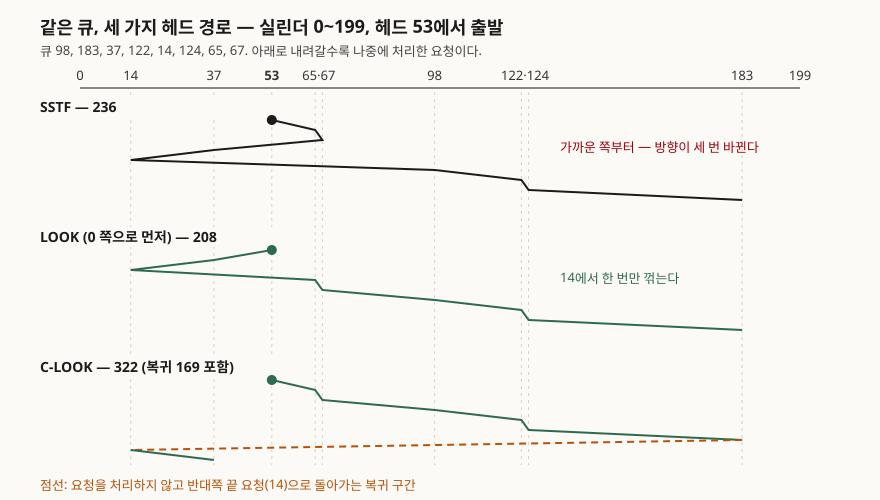

## 들어가며

디스크 스케줄링은 운영체제 문항 가운데 페이지 교체와 함께 **숫자로 답하는** 주제다. 요청 큐와 헤드 위치를 주고
알고리즘별 헤드 이동 거리를 구하게 하거나, SSTF의 기아와 SCAN·C-SCAN의 대기 시간 차이를 설명하게 한다.
실무에서는 하드디스크가 줄었지만, 리눅스 I/O 스케줄러를 고르거나 SSD에 스케줄러가 왜 필요 없는지 판단할 때 같은 틀을 쓴다.
이 글은 교재 예제를 코드로 다시 세어 답안에 쓸 숫자를 검산했다. 그 과정에서 교재 슬라이드의 SCAN 수치가
정의와 다른 경로의 값이라는 것이 드러났다.

## 정의

**디스크 스케줄링**: 대기 중인 디스크 I/O 요청 집합을 보고 **다음에 처리할 요청을 고르는 일**이다(OSTEP "Disk Scheduling" 절).
목표는 탐색 시간(seek time, 헤드가 목표 트랙까지 움직이는 시간)을 줄이고 디스크 대역폭을 높이는 것이다.
Silberschatz는 탐색 시간이 탐색 거리에 비례한다고 보고, 알고리즘을 **헤드 이동 실린더 수**로 비교한다.

## 등장 배경

하드디스크 한 번의 I/O는 탐색과 회전 지연이 대부분을 차지한다. 요청이 하나뿐이면 고를 것이 없지만, 교재가 짚듯
**큐가 있을 때만 최적화가 의미를 갖는다.** 요청을 들어온 순서(FCFS)로 처리하면 헤드가 디스크 양 끝을 오가며
같은 구간을 여러 번 지난다. OSTEP은 디스크 요청은 작업 길이를 모르는 CPU 스케줄링과 달리 탐색·회전 시간을
추정할 수 있어서, **SJF(최단 작업 우선)에 가깝게 고를 수 있다**고 설명한다. 다만 가까운 것만 고르면 먼 요청이
굶는다(기아). 이 두 힘 사이에서 여러 변형이 나왔다.

## 구성요소 — 알고리즘 6가지

| 알고리즘 | 다음에 고르는 요청 | 교재가 짚는 성질 |
|---|---|---|
| FCFS | 도착 순서 | 공정하지만 이동이 길다 |
| SSTF | 현재 헤드에서 탐색 거리가 가장 짧은 요청 | SJF의 한 형태. **기아**가 생길 수 있다 |
| SCAN | 한 방향으로 쓸며 지나는 요청. **디스크 끝**에서 방향을 바꾼다 | 엘리베이터 알고리즘. 가운데 트랙이 유리하다 |
| C-SCAN | 한 방향으로만 쓸며 처리하고, 끝에 닿으면 **처리 없이 처음으로 돌아간다** | 실린더를 원형 목록으로 본다. 대기 시간이 고르다 |
| LOOK | SCAN과 같되 **마지막 요청**에서 방향을 바꾼다 | 끝까지 가는 헛걸음이 없다 |
| C-LOOK | C-SCAN과 같되 마지막 요청까지만 가고 반대쪽 첫 요청으로 돌아간다 | C-SCAN의 헛걸음을 없앤다 |

정의 근거: SSTF·SCAN·C-SCAN은 Silberschatz 슬라이드와 OSTEP 37.5절이 같은 뜻으로 적는다. C-LOOK은 1998년판
슬라이드가 "C-SCAN의 한 변형으로, 각 방향의 마지막 요청까지만 간다"고 정의한다. LOOK의 정의 문장은 확인한 두 슬라이드에
없어서, C-LOOK의 규칙(마지막 요청에서 꺾는다)을 SCAN에 적용한 것으로 적었다. 같은 슬라이드가 기본 알고리즘으로
"SSTF나 LOOK"을 드는 것은 확인했다.

OSTEP은 여기에 두 가지를 더 든다. **F-SCAN**은 한 번 쓰는 동안 큐를 얼려 그사이 들어온 요청을 다음 바퀴로 미루고,
**SPTF**(최단 위치 결정 시간 우선)는 탐색뿐 아니라 회전 지연까지 따져 고른다. 시험에서 6가지를 묻는 경우가 많아
표에는 넣지 않았다.

## 도식



> **출처**: 예제 큐와 헤드 위치는 [Silberschatz OSC 10th ed. Ch.11 슬라이드 11.19 Disk Scheduling (Cont.)](https://www.cs.hunter.cuny.edu/~sweiss/course_materials/csci340/slides/chapter11.pdf), C-LOOK 정의는 [Silberschatz·Galvin (1998) Ch.13 슬라이드 13.12 C-LOOK](https://courses.cs.umbc.edu/undergraduate/421/Fall99/Burt/bell-labs/mod13.2.pdf). 경로와 거리는 `code/disk_scheduling.py`로 계산했다.

답안지에는 위쪽에 실린더 축을 긋고 요청 위치에 눈금을 찍은 뒤, 처리 순서대로 한 칸씩 내려가며 꺾은선을 그리면 된다.
C-LOOK처럼 복귀 구간이 있으면 점선으로 구분한다.

## 검산 — 교재 예제

큐 98, 183, 37, 122, 14, 124, 65, 67, 헤드 53, 실린더 0~199. 전체 소스: [`code/`](code/) · 돌린 기록: [`code/output.txt`](code/output.txt)

```text
  FCFS                640  순서 [98, 183, 37, 122, 14, 124, 65, 67]
  SSTF                236  순서 [65, 67, 37, 14, 98, 122, 124, 183]
  SCAN  (0 쪽으로)       236  순서 [37, 14, 65, 67, 98, 122, 124, 183]
  SCAN  (199 쪽으로)     331  순서 [65, 67, 98, 122, 124, 183, 37, 14]
  LOOK  (0 쪽으로)       208  순서 [37, 14, 65, 67, 98, 122, 124, 183]
  LOOK  (199 쪽으로)     299  순서 [65, 67, 98, 122, 124, 183, 37, 14]
  C-SCAN 복귀 포함        382  순서 [65, 67, 98, 122, 124, 183, 14, 37]
  C-SCAN 복귀 제외        183  순서 [65, 67, 98, 122, 124, 183, 14, 37]
  C-LOOK 복귀 포함        322  순서 [65, 67, 98, 122, 124, 183, 14, 37]
  C-LOOK 복귀 제외        153  순서 [65, 67, 98, 122, 124, 183, 14, 37]
```

FCFS 640과 SSTF 236은 슬라이드 수치와 같다. **SCAN은 달랐다.**

```text
  FCFS: 슬라이드 640 / 계산 640  일치=True
  SSTF: 슬라이드 236 / 계산 236  일치=True
  SCAN: 슬라이드 208 / 계산 236  일치=False
  208 과 같은 값이 나오는 경로: LOOK(0 쪽으로) = 208
```

슬라이드는 SCAN을 "디스크 끝까지 간 뒤 방향을 바꾼다"고 정의하면서 이동 거리를 208로 적는다. 정의대로 0번 실린더까지
가면 53 + 183 = 236이다. 208은 0까지 가지 않고 **14에서 바로 꺾는** 경우(39 + 169)와 같은 값이다. 1998년판과 2018년판
슬라이드 모두 208이다. 그림이 이미지라 실제로 어디서 꺾었는지는 볼 수 없어서, 확인한 것은 "정의대로 세면 236"이라는
사실까지다. 답안에서 SCAN 거리를 쓸 때는 **끝 실린더까지 간다는 가정과 처음 방향**을 함께 적어야 채점자가 숫자를
따라갈 수 있다. 같은 큐에서 방향만 바꿔도 SCAN은 236과 331로 갈린다.

C-SCAN·C-LOOK은 **복귀 구간을 세느냐**가 또 하나의 갈림길이다. 10판 슬라이드는 C-SCAN 쪽에 "Total number of cylinders?"라고
물음만 남긴다. 복귀를 세면 382·322, 빼면 183·153이다. 복귀는 요청을 처리하지 않지만 헤드가 실제로 움직이므로,
답안에는 어느 쪽으로 셌는지 밝힌다.

### SSTF 기아와 SCAN의 대기 편차

헤드 100에 190번 요청 하나를 두고, 요청을 하나 처리할 때마다 헤드 바로 옆(±3)에 새 요청이 들어오게 했다.

```text
  SSTF: 190번 요청이 처리된 순번 = None  (200회 안에 처리 못 하면 None)
  LOOK: 190번 요청이 처리된 순번 = 3  (200회 안에 처리 못 하면 None)
```

SSTF는 200번을 처리하는 동안 190번에 한 번도 가지 않았다. LOOK은 방향을 정해 두므로 등 뒤에 들어온 요청을 미루고
세 번째에 190번에 닿았다. OSTEP이 SSTF의 둘째 문제로 드는 기아가 이것이다.

SCAN이 가운데를 편애한다는 것은 위치별 최대 대기로 보인다. 헤드가 쉬지 않고 왕복한다고 보고(1칸 이동 = 1),
한 위치를 지나간 뒤 다시 오기까지 걸리는 최대 거리를 계산했다.

```text
  위치 | SCAN 최대 대기 | C-SCAN 최대 대기(복귀 199칸 포함)
     0 |            398 | 398
    50 |            298 | 398
   100 |            200 | 398
   150 |            300 | 398
   199 |            398 | 398
```

SCAN은 가운데(100)가 200, 양 끝이 398로 두 배 가까이 벌어진다. 끝을 지나면 반대쪽 끝까지 갔다 와야 하기 때문이다.
C-SCAN은 위치와 무관하게 한 바퀴가 지나야 다시 오므로 값이 같다. 교재가 C-SCAN을 "더 고른 대기 시간"으로 소개하는
이유이고, 대신 최대 대기의 하한이 올라간다.

## 비교

| 구분 | FCFS | SSTF | SCAN / LOOK | C-SCAN / C-LOOK |
|---|---|---|---|---|
| 고르는 기준 | 도착 순서 | 가장 가까운 요청 | 진행 방향의 다음 요청 | 한 방향의 다음 요청 |
| 예제 이동 거리 | 640 | 236 | 236 / 208 (0 쪽으로) | 382 / 322 (복귀 포함) |
| 기아 | 없음 | 있음 | 줄어든다 (교재: "가능하긴 하다") | 줄어든다 |
| 대기 시간 편차 | 큐 길이에 따른다 | 크다 | 가운데 유리 | 위치와 무관 |
| 적합한 부하 | 가벼운 부하 | 일반 | 부하가 큰 시스템 | 부하가 크고 공정성이 필요할 때 |

SSTF는 CPU 스케줄링의 SJF와 같은 자리에 두면 외우기 쉽다. OSTEP이 디스크 스케줄러가 SJF 원리를 따르려 한다고
설명하고, 두 슬라이드도 SSTF를 "SJF의 한 형태"로 적는다. 기아라는 약점까지 그대로 따라온다.

## 적용 시 고려사항

1. **실제 스케줄링은 장치 안에서 한다.** 10판 슬라이드는 예전엔 운영체제가 헤드 스케줄링을 했지만 지금은 장치·컨트롤러에
   들어가 있고, 운영체제는 LBA만 넘긴다고 적는다. OSTEP도 운영체제가 드라이브 기하 구조를 모르므로 SSTF 대신
   **가장 가까운 블록 주소(NBF)**를 쓴다고 설명한다. 실린더 번호로 계산하는 문제는 원리 설명용이다.
2. **기아를 막는 장치는 따로 둔다.** 리눅스 deadline 스케줄러는 LBA 순(본질적으로 C-SCAN) 큐와 FCFS 큐를 읽기·쓰기 각각
   두고, FCFS 큐에 기본 500ms보다 오래 기다린 요청이 있으면 그 요청이 든 묶음을 먼저 보낸다(10판 슬라이드 11.25).
   읽기를 우선하는 이유는 프로세스가 쓰기보다 읽기에서 더 자주 멈추기 때문이다.
3. **NVM(SSD)에서는 헤드가 없다.** 10판 슬라이드는 NVM에 탐색·회전 지연이 없어 RHEL 7이 NOOP(스케줄링 없음)를 쓰되
   인접 LBA 요청은 합친다고 적는다. 대신 쓰기 증폭(쓰기 한 번이 가비지 컬렉션으로 여러 읽기·쓰기를 낳는 것)이 성능 차이를
   줄일 수 있다고 짚는다. SSD에 SCAN 계열을 권하는 답안은 틀린다.
4. **회전 지연을 무시하면 SJF가 아니다.** OSTEP은 탐색이 회전보다 훨씬 빠르면 SSTF가 오히려 나쁜 선택이 된다는 예를 들고
   SPTF를 해법으로 제시한다. 탐색과 회전의 상대 크기는 드라이브만 알기 때문에, 1번의 "장치 안 스케줄링"과 이어진다.
5. **파일 배치가 요청 분포를 바꾼다.** 1998년판 슬라이드는 요청이 파일 할당 방식에 영향을 받는다고 적고, 스케줄러를
   교체 가능한 별도 모듈로 두라고 권한다. 10판 슬라이드도 RHEL 7에서 deadline·NOOP·CFQ를 고를 수 있고 기본값이
   장치에 따라 다르다고 적는다.

## 정리

- 디스크 스케줄링 **6가지**: FCFS · SSTF · SCAN · C-SCAN · LOOK · C-LOOK. 앞의 C는 Circular, LOOK은 "끝까지 안 가고 마지막 요청에서 꺾는다".
- 교재 예제(53, 0~199) 숫자: **FCFS 640 · SSTF 236 · SCAN 236(정의대로) · LOOK 208 · C-LOOK 322(복귀 포함)**.
  슬라이드의 SCAN 208은 LOOK과 같은 값이다.
- SSTF = SJF → **기아**. SCAN = 엘리베이터 → **가운데 유리**. C-SCAN = 원형 → **대기 고름**.
- 답안에는 **처음 방향, 끝까지 가는지, 복귀를 세는지** 세 가지 가정을 적는다.
- 현실: 스케줄링은 장치 안으로 들어갔고, SSD는 NOOP + 병합, 리눅스 deadline은 C-SCAN + 만료 시간.

## 참고 자료

- [Silberschatz·Galvin·Gagne, Operating System Concepts 10th ed. Ch.11 Mass-Storage Systems 슬라이드 (S. Weiss 개정판)](https://www.cs.hunter.cuny.edu/~sweiss/course_materials/csci340/slides/chapter11.pdf) — 11.19 예제 큐, 11.20 FCFS 640, 11.21 SCAN 208, 11.23 C-SCAN, 11.25 알고리즘 선택과 deadline 스케줄러, 11.26 NVM Scheduling
- [Silberschatz·Galvin, Operating System Concepts (1998) Ch.13 슬라이드](https://courses.cs.umbc.edu/undergraduate/421/Fall99/Burt/bell-labs/mod13.2.pdf) — 13.6 SSTF 236, 13.12 C-LOOK, 13.14 Selecting a Disk-Scheduling Algorithm
- [Arpaci-Dusseau, Operating Systems: Three Easy Pieces v1.10, Ch.37 Hard Disk Drives](https://pages.cs.wisc.edu/~remzi/OSTEP/file-disks.pdf) — 37.5 Disk Scheduling: SSTF·NBF·기아, Elevator(SCAN·F-SCAN·C-SCAN), SPTF
