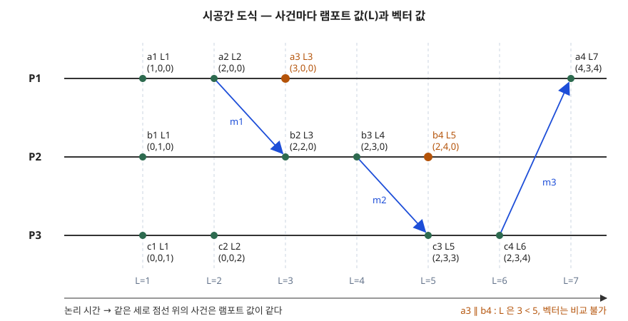

## 들어가며

분산 시스템에는 모든 노드가 함께 보는 시계가 없다. 노드마다 물리 시계가 조금씩 어긋나므로 "A 서버의 로그가 B 서버의 로그보다 먼저인가"를 시각만으로 판단하면 틀릴 수 있다. 논리 시계는 물리 시간 대신 **메시지가 오간 관계**로 사건의 순서를 정하는 방법이고, 분산 상호 배제·스냅샷·복제본 충돌 감지의 바탕이 된다. 시험에서는 "램포트 시계와 벡터 시계를 비교하라" 또는 "주어진 시공간 도식에 시계 값을 매기라"는 형태로 묻는다. 이 글은 두 시계를 원 논문의 규칙대로 직접 계산해 검산했다.

## 정의

**사건 선행 관계**(happened-before, →): Lamport 는 시스템의 사건 집합 위에서 아래 세 조건을 만족하는 **가장 작은 관계**로 정의한다. 어느 쪽으로도 →가 성립하지 않는 두 사건은 **동시**(concurrent, ∥)라고 한다.

**논리 시계**(logical clock): 프로세스 Pi 마다 사건에 수 Ci(a)를 매기는 함수로, 물리 시간과의 관계는 가정하지 않는다. Lamport 는 이것을 실제 시간 장치 없이 카운터로 구현할 수 있다고 적는다. 시계가 올바르려면 **Clock Condition**, 즉 "a → b 이면 C(a) < C(b)"를 만족해야 한다.

**벡터 시계**(vector clock): 프로세스 수 n 만큼의 칸을 가진 벡터를 각 프로세스가 들고 다니는 논리 시계다. Mattern 은 i번째 칸을 Pi 의 사건 수로, 나머지 칸을 Pi 가 메시지로 전해 들은 다른 프로세스의 시간으로 채운다. 이렇게 하면 → 와 벡터 대소 비교가 정확히 일치한다.

## 등장 배경

Lamport 는 물리 시간으로 순서를 정의하면 시스템이 실제 시계를 가져야 하고, 그 시계도 정확하지 않다는 점을 문제로 든다. 그래서 시스템 안에서 관측할 수 있는 사건(같은 프로세스 안의 순서, 메시지 송수신)만으로 순서를 정의했다. 분산 시스템에서는 두 사건 중 어느 쪽이 먼저인지 말할 수 없는 경우가 있어 이 관계는 **부분 순서**가 되고, 사람들이 이 사실을 의식하지 않아서 문제가 생긴다고 적는다.

램포트 시계에는 한계가 남는다. Mattern 은 C(e) < C(e′)만 보고는 e → e′인지 e ∥ e′인지 결정할 수 없다는 점을 "중요한 결함"이라 부른다. 원인은 사건 집합을 일직선의 수로 옮기면서 동시라는 구조가 지워진다는 데 있고, 이를 고치려고 시간 자체를 벡터로 확장했다.

## 구성요소 / 절차

### happened-before 3조건 (Lamport, The Partial Ordering)

| 번호 | 조건 |
|---|---|
| ① | 같은 프로세스에서 a 가 b 보다 앞이면 a → b |
| ② | a 가 메시지 송신이고 b 가 그 메시지의 수신이면 a → b |
| ③ | a → b 이고 b → c 이면 a → c (추이) |

### 램포트 시계 구현 규칙 2가지 (Lamport, Logical Clocks)

| 규칙 | 내용 | 지키는 조건 |
|---|---|---|
| IR1 | 같은 프로세스의 연속한 두 사건 사이에 Ci 를 증가시킨다 | C1 (같은 프로세스 순서) |
| IR2 | (a) 송신 시 메시지에 Tm = Ci(a)를 싣는다 (b) 수신 시 Ci 를 현재 값 이상이면서 Tm 보다 크게 맞춘다 | C2 (송수신 순서) |

이 글의 예제는 수신 때 `Ci = max(Ci, Tm) + 1` 로 구현했다. IR1(현재 값보다 크게)과 IR2(b)(Tm 보다 크게)를 함께 만족하는 가장 작은 정수다.

### 벡터 시계 규칙 3단계 (Mattern, §7 Vector time)

1. **증가**: 사건마다 자기 칸을 1 올린다 — `Ci[i] := Ci[i] + 1`
2. **첨부**: 메시지를 보낼 때 벡터 전체를 타임스탬프로 싣는다
3. **병합**: 받을 때 자기 벡터와 받은 벡터를 칸마다 큰 값으로 합친다 — `Ci := sup(Ci, t)`

### 순서 판정 2가지

- **벡터 비교** (Mattern, Definition 4·Theorem 10): u ≤ v 는 모든 칸이 작거나 같음, u < v 는 u ≤ v 이고 u ≠ v. **e → e′ ⟺ V(e) < V(e′)**, **e ∥ e′ ⟺ 서로 < 가 아님**
- **전순서 ⇒** (Lamport, Ordering the Events Totally): C(a) < C(b) 이거나, 같으면 프로세스에 정해 둔 임의의 순서로 가른다. → 를 지키는 전순서이지만 유일하지 않다

## 도식



> **출처**: [Lamport, Time, Clocks, and the Ordering of Events in a Distributed System (CACM 21(7), 1978) — The Partial Ordering, Logical Clocks, Fig. 1·3](https://lamport.azurewebsites.net/pubs/time-clocks.pdf) · [Mattern, Virtual Time and Global States of Distributed Systems (1989) — §7 Vector time, §8 Theorem 10](https://www.vs.inf.ethz.ch/publ/papers/VirtTimeGlobStates.pdf)

가로는 논리 시간, 가로선은 프로세스, 파란 화살표는 메시지다. 램포트 값이 같은 사건을 같은 세로선에 놓았는데, Lamport 가 눈금선을 곧게 펴서 다시 그린 그림 3과 같은 방식이다. 답안지에는 프로세스 선 3개, 메시지 화살표 3개, 사건마다 (L, 벡터) 한 쌍을 적으면 된다.

## 계산과 검산

전체 소스: [`code/`](code/) · 수행 기록: [`code/output.txt`](code/output.txt)

**① 시계 값 매기기.** 프로세스 P1·P2·P3 에 사건을 4개씩 두고, 메시지 m1(a2→b2)·m2(b3→c3)·m3(c4→a4)를 보냈다.

```text
  사건 | 프로세스 | 종류       | 램포트 | 벡터
  a2   | P1       | send m1    |      2 | (2, 0, 0)
  b2   | P2       | recv m1    |      3 | (2, 2, 0)
  b3   | P2       | send m2    |      4 | (2, 3, 0)
  c3   | P3       | recv m2    |      5 | (2, 3, 3)
  c4   | P3       | send m3    |      6 | (2, 3, 4)
  a4   | P1       | recv m3    |      7 | (4, 3, 4)
```

a4 를 손으로 풀면 램포트는 max(3, 6) + 1 = 7 이다. 벡터는 자기 칸을 올려 (4, 0, 0)이 된 뒤 받은 (2, 3, 4)와 칸마다 큰 값을 취해 (4, 3, 4)가 된다. 전체 12개 사건 값은 도식과 `output.txt` 에 있다.

**② 정답 관계.** 시계와 무관하게 3조건으로 사건 그래프를 만들고 추이 폐포를 구했다. 사건 12개에서 나오는 66쌍 가운데 인과 41쌍, 동시 25쌍이었다.

**③ 램포트 시계 검산.**

```text
  a→b 인 41쌍 모두 L(a)<L(b) (Clock Condition): True
  동시 25쌍 중 램포트 값이 다른 쌍: 19  같은 쌍: 6
```

Clock Condition 은 41쌍 모두 성립했다. 눈여겨볼 것은 그 아래 줄이다. 동시인 25쌍 가운데 **19쌍이 서로 다른 램포트 값**을 받아, 값만 보면 순서가 있는 것처럼 보인다. 예를 들어 a3(L=3)과 b4(L=5)는 아무 메시지 경로로도 이어지지 않는다. 역이 성립하지 않는다는 것은 논문에도 있는 내용이지만, 사건 12개짜리 작은 예에서도 동시 쌍의 4분의 3이 이렇게 보였다. 램포트 값이 같은 6쌍은 동시라고 단정할 수 있다. Clock Condition 의 대우(C(a) ≥ C(b)이면 a → b 가 아님)를 양쪽에 적용하면 되기 때문이다.

**④ 벡터 시계 검산.**

```text
  66쌍 비교 · 정답과 다른 쌍: 0
    a3(3, 0, 0) ∥ b4(2, 4, 0)
    a1(1, 0, 0) → c4(2, 3, 4)
```

66쌍 모두 벡터 비교 결과가 정답과 같았다. Mattern 정리 10을 이 예에서 확인한 것이다. a3 과 b4 는 첫 칸은 a3 이, 둘째 칸은 b4 가 커서 어느 쪽도 작지 않으므로 동시다.

**⑤ 전순서.** 램포트 값으로 줄 세우고 같으면 P1 < P2 < P3 으로 가르면 `a1 ⇒ b1 ⇒ c1 ⇒ a2 ⇒ c2 ⇒ a3 ⇒ b2 ⇒ …` 가 되고, 인과 41쌍은 모두 이 순서를 지켰다. 동시인 a3 과 b2 가 이 순서에서는 a3 이 앞서는데, 프로세스 번호로 정한 순서일 뿐 의미는 없다.

## 비교

| 구분 | 물리 시계 | 램포트 시계 | 벡터 시계 |
|---|---|---|---|
| 값 | 실제 시각 | 정수 1개 | 정수 n개 (프로세스 수) |
| 메시지에 싣는 크기 | 시각 1개 | 정수 1개 | 벡터 1개, 프로세스 수에 비례 |
| a → b 이면 | 시계가 맞을 때만 t(a) < t(b) | 항상 L(a) < L(b) | 항상 V(a) < V(b) |
| 역방향 판정 | 불가 | 불가 (L(a) < L(b)여도 동시일 수 있다) | 가능 (V(a) < V(b) ⟺ a → b) |
| 동시 판정 | 불가 | 값이 같을 때만 확실 | 가능 |
| 전순서 | 시각 + 동점 처리 | 값 + 프로세스 번호 | 직접 만들지 않는다 (부분 순서) |
| 대표 용도 | 사람이 읽는 로그 시각 | 분산 상호 배제의 요청 순서 (Lamport 논문의 예) | 분산 디버깅, 복제본 갱신 충돌 감지 (Mattern §10) |

## 적용 시 고려사항

1. **벡터 크기가 프로세스 수에 비례한다.** 모든 메시지에 n칸 벡터를 실어야 하므로 참여 노드가 많으면 메시지 크기와 저장 공간이 함께 늘어난다. 램포트 시계는 정수 하나로 끝난다. 인과 판정이 꼭 필요한지 먼저 따진다.
2. **참여 프로세스가 바뀌는 경우를 설계한다.** 벡터의 칸은 프로세스와 1:1 이므로 노드가 추가·제거되면 칸 배정을 어떻게 할지 정해야 한다. Mattern 의 모델은 프로세스 수 n 이 고정된 상황을 다룬다.
3. **전순서의 동점 처리는 임의 규칙이다.** 램포트 전순서는 프로세스 번호 같은 임의 순서로 동점을 가르므로, 같은 결과라도 시계 체계가 다르면 다른 전순서가 나온다고 Lamport 가 적는다. "먼저 요청한 쪽"이라는 업무 의미를 이 순서에 싣지 않는다.
4. **사용자가 시스템 밖에서 본 순서와 어긋날 수 있다.** Lamport 는 이 알고리즘이 만든 순서가 사용자가 인지한 순서와 다르면 이상 동작이 생길 수 있고, 이를 막으려면 물리 시계를 도입해야 한다고 적는다. 전화로 "방금 요청했다"고 알린 것처럼 시스템 밖 경로로 전해진 인과는 논리 시계가 볼 수 없다.
5. **사건의 단위를 먼저 정한다.** 무엇을 사건 하나로 볼지(함수 실행, 명령어 하나)는 응용이 정하고, 이 선택이 프로세스 안의 순서를 바꾼다고 Lamport 가 각주로 적는다.

## 정리

- **정의 3개**: happened-before(→)는 부분 순서, 논리 시계는 Clock Condition(a → b ⇒ C(a) < C(b))을 지키는 수 매김, 벡터 시계는 n칸으로 → 를 정확히 표현
- **조건·규칙 개수**: → 3조건(프로세스 순서·송수신·추이), 램포트 규칙 2개(IR1·IR2), 벡터 규칙 3단계(증가·첨부·병합)
- **핵심 차이 1줄**: 램포트는 "→ 이면 작다"만, 벡터는 "→ 일 때만 작다"까지 보장
- 암기 단서: "**램포트는 한 방향, 벡터는 양방향 — 칸 수만큼 비싸다**"

## 참고 자료

- [Leslie Lamport, Time, Clocks, and the Ordering of Events in a Distributed System, Communications of the ACM 21(7), 1978](https://lamport.azurewebsites.net/pubs/time-clocks.pdf) — The Partial Ordering(3조건, Fig. 1), Logical Clocks(Clock Condition, C1·C2, IR1·IR2, Fig. 3), Ordering the Events Totally(⇒)
- [Friedemann Mattern, Virtual Time and Global States of Distributed Systems, Parallel and Distributed Algorithms, 1989](https://www.vs.inf.ethz.ch/publ/papers/VirtTimeGlobStates.pdf) — §6 램포트 시계의 결함, §7 Vector time(갱신 규칙, Definition 4), §8 Theorem 10·11, §10 Application of vector time
