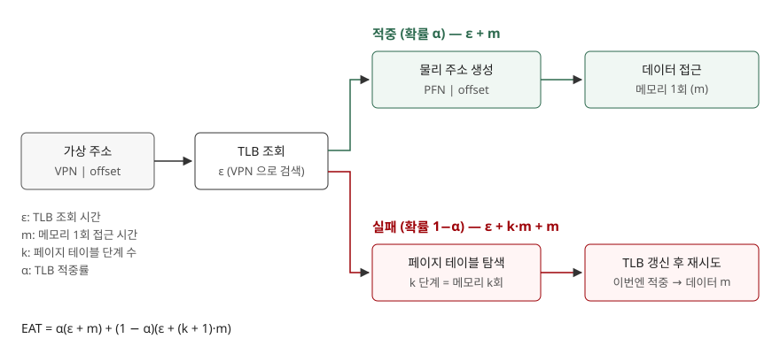

## 들어가며

페이징을 쓰면 프로그램이 메모리를 한 번 읽을 때마다 주소를 바꾸기 위해 페이지 테이블을 먼저 읽어야 한다. 페이지 테이블이 여러 단계면 그만큼 메모리 접근이 늘어, 변환 비용이 실제 데이터 접근보다 커진다. 이 비용을 줄이는 하드웨어가 **TLB**이고, 시험에서는 "적중률과 접근 시간을 주고 유효 접근 시간을 구하라"는 계산형으로 자주 나온다. 이 글은 공식을 단계 수 k 로 일반화해 직접 계산하고, TLB 를 코드로 흉내 내 교재 예제의 적중률을 재현해 검산했다.

> 시간 값(TLB 20ns, 메모리 100ns)은 계산을 보이기 위한 **가정값**이다. 특정 하드웨어의 측정값이 아니다.

## 정의

**TLB**(Translation Lookaside Buffer, 변환 색인 버퍼): CPU 의 메모리 관리 장치(MMU) 안에 있으며, **자주 쓰는 가상 페이지 번호 → 물리 프레임 번호 변환을 담아 두는 하드웨어 캐시**다. OSTEP 은 이 장치를 "주소 변환 캐시"라고 부르는 편이 더 정확하다고 적는다(19장 도입부).

**유효 메모리 접근 시간**(EAT, Effective Access Time): TLB 적중과 실패를 확률로 가중해 구한 **메모리 접근 1회의 평균 시간**이다.

$$\text{EAT} = \alpha(\varepsilon + m) + (1-\alpha)\big(\varepsilon + (k+1)\,m\big)$$

α 는 TLB 적중률, ε 는 TLB 조회 시간, m 은 메모리 1회 접근 시간, k 는 페이지 테이블 단계 수다. 적중이면 데이터만 읽고(m), 실패면 페이지 테이블을 단계마다 한 번씩 읽은 뒤(k·m) 데이터를 읽는다. 문제에서 TLB 조회 시간을 주지 않으면 ε = 0 으로 둔다.

## 등장 배경

OSTEP 19장은 문제를 이렇게 세운다. 페이지 테이블은 물리 메모리에 있으므로, 페이징은 프로그램이 만드는 가상 주소마다 **메모리를 한 번 더 읽어야** 한다. 명령어를 가져올 때와 데이터를 읽고 쓸 때마다 이 접근이 붙으면 너무 느리다.

여기에 페이지 테이블 크기 문제가 겹친다. 선형 페이지 테이블은 주소 공간 전체 크기만큼 연속된 메모리를 차지하므로, 이를 줄이려고 **다단계 페이지 테이블**을 쓴다. OSTEP 20장은 이것을 시간-공간 맞바꿈으로 설명한다. 테이블은 작아졌지만 TLB 실패 때 2단계면 메모리를 두 번 읽어야 한다. x86-64 리눅스는 48비트 주소에 4단계, 57비트 주소에 5단계 페이지 테이블을 쓴다(리눅스 커널 x86_64 메모리 맵 문서). 단계가 늘수록 TLB 실패 한 번의 값이 비싸지므로 TLB 의 중요성도 커진다.

## 구성요소 / 절차

### TLB 항목의 구성 4가지 (OSTEP 19.4, 19.5)

| 항목 | 역할 |
|---|---|
| VPN | 검색 키. 완전 연관 구조라 모든 항목을 병렬로 비교한다 |
| PFN | 변환 결과. offset 과 붙여 물리 주소가 된다 |
| 유효·보호 비트 | 항목이 유효한지, 읽기·쓰기·실행이 허용되는지 |
| ASID | 주소 공간 식별자. 어느 프로세스의 변환인지 구분한다 |

### 하드웨어 관리 TLB 의 변환 절차 6단계 (OSTEP 그림 19.1)

1. 가상 주소에서 VPN 을 뽑는다
2. TLB 에서 VPN 을 찾는다
3. **적중**: 보호 비트를 확인하고 PFN 과 offset 으로 물리 주소를 만들어 메모리에 접근한다
4. **실패**: 페이지 테이블 기준 레지스터(PTBR)에서 시작해 페이지 테이블 항목(PTE)을 읽는다
5. PTE 가 유효하고 접근이 허용되면 TLB 에 변환을 넣는다 (아니면 예외)
6. 명령을 다시 실행한다 — 이번에는 TLB 에 적중한다

## 도식



> **출처**: [OSTEP v1.10 Ch.19 §19.1 TLB Basic Algorithm, Figure 19.1](https://pages.cs.wisc.edu/~remzi/OSTEP/vm-tlbs.pdf) · [OSTEP v1.10 Ch.20 Paging: Smaller Tables, multi-level 의 TLB 실패 비용](https://pages.cs.wisc.edu/~remzi/OSTEP/vm-smalltables.pdf)

답안지에는 박스 5개(가상 주소, TLB, 물리 주소, 페이지 테이블, 메모리)와 두 갈래 화살표, 그리고 갈래마다 비용식을 적으면 된다.

## 계산과 검산

전체 소스: [`code/`](code/) · 수행 기록: [`code/output.txt`](code/output.txt)

**① 단계 수와 적중률에 따른 EAT** (ε = 20ns, m = 100ns)

```text
  적중률 | 1단계 | 2단계 | 4단계 | 5단계
     80% | 140.0 | 160.0 | 200.0 | 220.0
     90% | 130.0 | 140.0 | 160.0 | 170.0
     98% | 122.0 | 124.0 | 128.0 | 130.0
     99% | 121.0 | 122.0 | 124.0 | 125.0
  (TLB 가 없을 때 4단계: 500ns)
```

1단계·80% 를 손으로 풀면 0.8 × 120 + 0.2 × 220 = 96 + 44 = 140ns 다. 같은 80% 라도 4단계면 200ns 로 늘어난다. 실패 한 번에 메모리 접근이 k 번 붙으므로 **실패 비용이 단계 수에 비례**하기 때문이다. ε = 0 으로 두는 문제라면 1단계·80% 는 120ns 다.

**② 목표 EAT 를 지키는 최소 적중률.** 공식을 α 에 대해 풀면 α = 1 − (목표 − (ε + m)) / (k·m) 이다.

```text
  목표 130ns: 1단계 0.9000 · 2단계 0.9500 · 4단계 0.9750 · 5단계 0.9800
```

1단계에서 90% 면 되던 목표가 4단계에서는 97.5% 를 요구한다. 단계가 깊어질수록 허용되는 실패율이 1/k 로 줄어든다.

**③ OSTEP 배열 예제 재현.** 4바이트 정수 10개가 가상 주소 100 부터 놓이고 페이지가 16바이트인 예제다. 교재는 접근 결과를 "miss, hit, hit, miss, hit, hit, hit, miss, hit, hit"로, 적중률을 70% 로 적는다. 코드로 같은 조건을 돌리니 그대로 나왔다. 첫 접근에서만 실패하고 같은 페이지의 나머지는 적중하는 **공간 지역성** 때문이다.

**④ 접근 패턴별 적중률** (4KB 페이지, 64항목 LRU TLB)

```text
  순차 4바이트 간격               적중률  99.902%  EAT(4단계)  120.4 ns
  4KB 간격(매번 다른 페이지)        적중률   0.000%  EAT(4단계)  520.0 ns
  64개 페이지 안 무작위            적중률  99.968%  EAT(4단계)  120.1 ns
  65개 페이지 순환               적중률   0.000%  EAT(4단계)  520.0 ns
  1024개 페이지 안 무작위          적중률   6.316%  EAT(4단계)  494.7 ns
```

가장 눈여겨볼 줄은 **65개 페이지 순환**이다. 페이지가 TLB 보다 딱 하나 많을 뿐인데 적중률이 0% 가 됐다. LRU 는 가장 오래 안 쓴 항목을 내보내는데, 순환 접근에서는 그 항목이 바로 다음에 쓸 페이지다. OSTEP 19.6 이 "n 항목 TLB 에서 n+1 페이지를 순환하면 LRU 는 매번 실패한다"고 짚은 경우와 같다. 이때 EAT 는 520ns 로, TLB 가 아예 없을 때의 500ns 보다 **TLB 조회 시간만큼 느리다.**

**⑤ 문맥 교환.** 두 프로세스가 각자 32개 페이지를 쓰며 1000회마다 교대할 때, 교환마다 TLB 를 비우면 미스가 6,400회(적중률 96.800%), ASID 로 구분하면 64회(99.968%)였다. 비우는 쪽은 교대할 때마다 32번씩 다시 채운다(200회 × 32 = 6,400).

**⑥ 공식 검산.** 무작위 접근 10만 회에서 적중률 0.2494 를 재고 공식에 넣은 값과 접근마다 시간을 더해 평균 낸 값이 둘 다 420.240ns 로 일치했다. 공식이 "적중·실패 두 경우의 가중 평균"이라는 정의 그대로임을 확인한 것이다.

## 비교

**TLB 실패를 누가 처리하는가** (OSTEP 19.3)

| 구분 | 하드웨어 관리 TLB | 소프트웨어 관리 TLB |
|---|---|---|
| 실패 시 동작 | 하드웨어가 페이지 테이블을 직접 탐색 | 예외를 일으켜 OS 의 트랩 핸들러로 넘김 |
| 페이지 테이블 형식 | 하드웨어가 알아야 하므로 고정 | OS 가 자유롭게 정한다 |
| 테이블 위치 | 기준 레지스터(x86 은 CR3)가 가리킴 | OS 가 관리 |
| 교재가 든 예 | Intel x86 | MIPS R10k, SPARC v9 |

**문맥 교환 때 TLB 를 어떻게 다루는가** (OSTEP 19.5)

| 구분 | 교환마다 비우기(flush) | ASID 로 구분 |
|---|---|---|
| 방법 | 모든 항목의 유효 비트를 0 으로 | 항목마다 프로세스 식별자를 붙임 |
| 장점 | 하드웨어가 단순하다 | 교환 뒤에도 이전 변환을 재사용 |
| 비용 | 교환 직후 실패가 몰린다 (위 ⑤에서 미스 100배) | 항목마다 ASID 비트가 필요하다 (교재 예: MIPS 8비트) |

## 적용 시 고려사항

1. **단계 수가 늘면 같은 적중률로도 느려진다.** 4단계에서 5단계로 갈 때 TLB 실패 비용이 메모리 접근 1회만큼 커진다. 주소 공간을 넓히는 결정에는 TLB 실패 비용 증가가 따라온다.
2. **TLB 범위보다 넓게 무작위로 접근하는 작업은 적중률이 급격히 떨어진다.** 1024개 페이지 무작위 접근에서 6.316% 였다. 큰 페이지(대형 페이지)는 같은 TLB 항목 수로 더 넓은 주소를 덮는데, OSTEP 20장은 DBMS 같은 응용에서 큰 페이지를 쓰는 주된 이유가 TLB 부담을 줄이는 것이라고 적는다.
3. **교체 정책은 접근 패턴에 맞지 않으면 역효과를 낸다.** LRU 는 순환 접근에서 0% 가 됐다. OSTEP 은 이 경우 무작위 교체가 훨씬 낫다고 적는다.
4. **문맥 교환이 잦은 시스템은 ASID 지원 여부가 중요하다.** 비우기 방식은 교환 직후마다 실패가 몰려 EAT 를 끌어올린다.
5. **공식의 가정을 답안에 적는다.** 이 공식은 페이지 테이블 접근이 매번 메모리까지 가고, 페이지 부재는 없다고 가정한다. 페이지 부재까지 넣으려면 디스크 접근 항을 따로 더해야 한다.

## 정리

- **정의 2개**: TLB = 주소 변환 하드웨어 캐시, EAT = 적중·실패를 가중한 평균 접근 시간
- **공식 1개**: EAT = α(ε + m) + (1 − α)(ε + (k + 1)m) — k 를 바꾸면 다단계에 그대로 쓴다
- **TLB 항목 4가지**: VPN · PFN · 유효/보호 비트 · ASID
- **비교 2가지**: 실패 처리(하드웨어 / 소프트웨어), 문맥 교환(비우기 / ASID)
- 암기 단서: "**단계마다 m 하나, 실패율은 1/k 로 빡빡해진다**"

> 관련 기출 답안: [기출문제 — 가상메모리 관리기법과 단편화](../../exam/2026-10-22-virtual-memory-management-fragmentation/index.md)

## 참고 자료

- [Arpaci-Dusseau, Operating Systems: Three Easy Pieces v1.10, Ch.19 Paging: Faster Translations (TLBs)](https://pages.cs.wisc.edu/~remzi/OSTEP/vm-tlbs.pdf) — §19.1 기본 알고리즘, §19.2 배열 예제, §19.3 실패 처리 주체, §19.4 TLB 내용, §19.5 문맥 교환, §19.6 교체 정책
- [Arpaci-Dusseau, Operating Systems: Three Easy Pieces v1.10, Ch.20 Paging: Smaller Tables](https://pages.cs.wisc.edu/~remzi/OSTEP/vm-smalltables.pdf) — 다단계 테이블의 시간-공간 맞바꿈
- [The Linux Kernel documentation — x86_64 Memory Management](https://www.kernel.org/doc/html/latest/arch/x86/x86_64/mm.html) — 4단계·5단계 페이지 테이블
