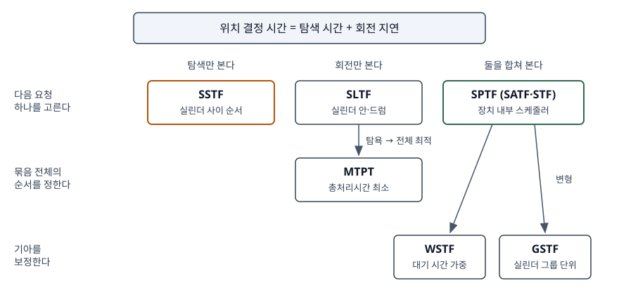

## 들어가며

디스크 스케줄링 문항은 대개 실린더 번호만 주고 헤드 이동 거리를 묻는다. 그런데 하드디스크 한 번의 접근에는
탐색 말고도 **회전 지연**(목표 섹터가 헤드 아래로 돌아올 때까지 기다리는 시간)이 들어 있고, 이 몫을 줄이는
기법이 따로 있다. 기출이 SSTF와 SLTF를 짝지어 묻는 것도 그래서다. 이 글은 회전을 고려하는 기법 세 가지를
1차 논문으로 정리하고, 같은 조건에서 순서가 어떻게 갈리는지 계산으로 확인했다.

> 계산 예제는 `code/rotational_scheduling.py`로 직접 돌렸다. 실행 기록: [`code/output.txt`](code/output.txt)

## 정의

**회전 위치 최적화**: 헤드의 실린더 위치뿐 아니라 **회전 각도까지 알고**, 탐색 시간과 회전 지연을 합한
위치 결정 시간(positioning time)이 줄어드는 순서로 요청을 처리하는 디스크 스케줄링이다.

| 기법 | 정의 | 근거 |
|---|---|---|
| SLTF | 지금 각도에서 **가장 먼저 헤드 아래로 오는** 요청을 고른다 | Fuller 요약본 초록·§1 |
| SPTF | 탐색과 회전을 합친 **위치 결정 시간이 가장 짧은** 요청을 고른다. SATF라고도 한다 | OSTEP 37.5 |
| MTPT | 요청 **묶음 전체의 총처리시간을 최소로** 하는 순서를 찾는다 | Fuller 요약본 §1 |

Seltzer 등은 SPTF와 같은 기법을 STF(Shortest Time First)라 부르고 "탐색과 회전 지연을 모두 포함한 I/O 시간"으로
정의한다(§5.1). 이름이 셋이므로 답안에는 병기한다.

## 등장 배경

SSTF는 탐색 거리만 잰다. OSTEP 37.5는 탐색이 회전보다 훨씬 느리면 SSTF로 충분하지만, **탐색이 회전보다
빠르면** 가까운 트랙의 요청이 한 바퀴를 다 돌아야 오는 경우 먼 트랙을 고르는 편이 낫다고 설명한다.
Seltzer 등도 디스크 기술이 회전 지연보다 탐색 시간을 더 빨리 줄여 왔으므로 **회전 지연의 비중이 커진다**고
보았다(§5.1). 회전을 따로 다루는 흐름은 그보다 앞서, 트랙마다 헤드가 붙어 탐색이 없는 **고정 헤드 드럼**에서
SLTF로 시작했다. Fuller는 SLTF가 한 요청씩 탐욕적으로 고르는 데서 생기는 손실을 문제 삼아 MTPT를 제안했다.

## 구성요소 — 기법 5가지

| 기법 | 보는 비용 | 판단 범위 | 성질 |
|---|---|---|---|
| ① SLTF | 회전 지연 | 다음 요청 하나 | 드럼 전체, 디스크에서는 실린더 안 |
| ② SPTF(SATF·STF) | 탐색 + 회전 | 다음 요청 하나 | 처리량이 가장 좋지만 기아가 있다 |
| ③ MTPT | 회전 + 전송 | 묶음 전체 | O(N log N) 알고리즘이 있다 |
| ④ GSTF | 탐색 + 회전 | 실린더 그룹 안 | 그룹을 다 처리한 뒤 다음 그룹으로 |
| ⑤ WSTF | 탐색 + 회전에 대기 가중 | 다음 요청 하나 | 최대 응답 시간을 강제한다 |

④·⑤는 Seltzer 등이 STF의 기아를 줄이려고 제안한 변형이다(§5.1.1·§5.1.2). WSTF는 실제 시간 Treal에
가중치를 곱한다. 최대 허용 응답 시간을 M, 도착 뒤 지난 시간을 E라 하면 **TW = Treal × (M − E) / M**이다.
오래 기다릴수록 가중 시간이 작아져 먼저 뽑힌다.

## 도식



> **출처**: SPTF·SATF와 장치 내부 스케줄링은 [OSTEP v1.10 Ch.37 §37.5 Disk Scheduling](https://pages.cs.wisc.edu/~remzi/OSTEP/file-disks.pdf), SLTF·MTPT는 [Fuller, MTPT Drum and Disk Scheduling Disciplines 요약본 §1·§4](https://static.aminer.org/pdf/20170130/pdfs/sosp/h4lthzfrdb0eavkyqmjobmrnuqc7gcj2.pdf), STF·GSTF·WSTF는 [Seltzer·Chen·Ousterhout, Disk Scheduling Revisited §5.1](https://web.eecs.umich.edu/~pmchen/papers/seltzer90.pdf)

답안에는 가로축에 "탐색 / 회전 / 둘 다", 세로축에 "하나씩 / 묶음 / 기아 보정"을 두고 칸에 이름만 적으면 된다.

## 검산

### SLTF가 탐욕이라서 잃는 것

드럼 둘레를 1로 두고 헤드가 각도 0에 있다. 1/8 격자에서 시작 각도가 서로 다른 레코드 3개를 전부 훑어
SLTF와 MTPT의 차이가 가장 큰 묶음을 골랐다. MTPT는 모든 순서를 대입해 구했고, Fuller의 O(N log N) 알고리즘은
구현하지 않았다.

```text
  A: 시작 1/8  끝 1/4
  B: 시작 1/4  끝 1/2
  C: 시작 3/8  끝 1/4
  SLTF: A → B → C  총처리시간 9/4 바퀴
  MTPT: A → C → B  총처리시간 3/2 바퀴
```

A가 끝난 1/4에서 B는 기다림 없이 바로 시작하므로 SLTF는 B를 고른다. 그런데 B가 1/2까지 읽는 사이 C의
시작 3/8이 지나가 버려 **거의 한 바퀴(7/8)를 기다린다.** MTPT는 1/8만 기다려 C를 먼저 읽고, C가 끝나는
1/4에서 B가 바로 이어진다. **레코드 길이 때문에** 생기는 손실이고, 회전 지연만 보는 SLTF는 이를 보지 못한다.

시작 각도는 균등, 길이는 평균 1/2 지수분포(Fuller 요약본 §3의 가정)로 레코드 5개짜리 묶음을 2,000개 만들어
새 요청 도착 없이 비교했다.

```text
  SLTF 가 MTPT 보다 길었던 묶음: 1073개 (53.6%)
  길었던 묶음의 평균 차이: 0.269 바퀴  최대 차이: 0.969 바퀴
```

절반 넘게 SLTF가 더 길었지만, 차이는 이 실험에서 한 바퀴를 넘지 않았다. 다만 요청이 계속 도착하는 경우는
다르다. Fuller는 고정 헤드 드럼에서 대부분 **SLTF가 낫다**고 결론 냈다. 새 요청이 올 때마다 MTPT 순서를 다시
계산해야 하고, MTPT0 알고리즘은 그때 순서가 크게 바뀌기 때문이다(§3). 반대로 이동 헤드 디스크의 **실린더 안**
스케줄링에서는 부하가 클수록 MTPT가 일관되게 나았다(§4·§5).

### SSTF와 SPTF가 갈리는 지점

트랙당 12섹터(섹터 하나 = 시간 1). 헤드는 실린더 0, 섹터 6 시작 위치에 있다. X는 실린더 1 섹터 5,
Y는 실린더 2 섹터 9다. 탐색 중에도 디스크는 돈다.

```text
  1칸 탐색 | X 탐색+회전 | Y 탐색+회전 | SSTF | SPTF
       0.5 |  0.5 + 10.5 = 11.0 |  1.0 +  2.0 =  3.0 |  X   |  Y
         1 |    1 +   10 =   11 |    2 +    1 =    3 |  X   |  Y
         2 |    2 +    9 =   11 |    4 +   11 =   15 |  X   |  X
         3 |    3 +    8 =   11 |    6 +    9 =   15 |  X   |  X
         4 |    4 +    7 =   11 |    8 +    7 =   15 |  X   |  X
         6 |    6 +    5 =   11 |   12 +    3 =   15 |  X   |  X
```

SSTF는 언제나 가까운 X를 고른다. SPTF는 탐색이 빠를 때 Y를 고르고, 1칸 탐색이 2를 넘어 Y의 섹터 9를
놓치게 되자 X로 돌아선다. OSTEP의 "탐색과 회전의 상대 크기에 달렸다"는 말이 이 표다.

### 기아와 WSTF

큐를 20개로 유지하며 요청 20,000개를 처리했다(실린더 100, 탐색 = 1 + 0.1×거리, WSTF의 M = 3000).

```text
  정책 | 요청당 처리 시간 | 평균 응답 | 99% 응답 | 최대 응답
  SSTF |             7.62 |     152.2 |    486.0 |     833.0
  SPTF |             4.47 |      89.2 |    429.0 |    1115.0
  WSTF |             4.47 |      89.3 |    398.0 |     747.0
```

SPTF는 요청당 처리 시간을 SSTF보다 41% 줄였지만 최대 응답은 가장 나빴다. WSTF는 처리 시간을 SPTF와 같게
유지하면서 최대 응답을 1115에서 747로 낮췄다. Seltzer 등도 WSTF의 평균 I/O 시간이 STF의 1~2% 안에 있으면서
최대 응답 시간은 크게 떨어졌다고 보고했다(§5.1.2).

## 비교

| 구분 | SSTF | SLTF | SPTF | MTPT |
|---|---|---|---|---|
| 줄이는 비용 | 탐색 | 회전 지연 | 탐색 + 회전 | 묶음의 총처리시간 |
| 판단 | 탐욕 | 탐욕 | 탐욕 | 묶음 전체 최적 |
| 필요한 정보 | 실린더 번호 | 회전 각도 | 실린더 + 각도 + 탐색 곡선 | 각도 + 레코드 길이 |
| 구현 위치 | 운영체제도 가능 | 장치 | 장치 | 장치 |
| 기아 | 있다 — 먼 실린더 | 탐색이 없어 먼 실린더 문제는 없다 | 있다 → WSTF·GSTF | 도착이 잦으면 순서가 흔들린다 |
| 대응 CPU 기법 | SJF | SJF | SJF | 묶음 최적 스케줄 |

## 적용 시 고려사항

1. **운영체제는 회전 각도를 모른다.** OSTEP은 운영체제가 트랙 경계와 헤드의 회전 위치를 잘 모르므로 SPTF를
   드라이브 안에서 수행한다고 설명한다. 운영체제는 좋아 보이는 요청 몇 개(예: 16개)를 한꺼번에 넘기고,
   드라이브가 정확한 헤드 위치로 순서를 정한다. 설계 문항에서는 **큐 깊이를 장치에 넘기는 것**이 해법이다.
2. **병합은 운영체제 몫이다.** 같은 절은 인접 블록 요청을 하나로 합치는 I/O 병합이 장치로 가는 요청 수를
   줄이므로 운영체제 단계에서 특히 중요하다고 적는다.
3. **처리량과 최대 응답을 따로 잰다.** 위 실험처럼 SPTF는 평균이 좋아도 꼬리가 길다. 서비스 수준 목표가
   최대 응답에 걸려 있으면 WSTF처럼 상한을 강제하는 변형을 쓴다.
4. **레코드 길이 분포를 본다.** Fuller는 레코드가 짧을수록 MTPT가 SLTF보다 불리해지고, 길이 편차가 작을수록
   MTPT가 유리해진다고 보고했다(§3). 길이가 일정하면 페이징 드럼 구성이 네 기법보다 낫다고도 적었다.
5. **SSD에는 해당이 없다.** 헤드도 회전도 없으므로 위치 결정 시간이 0에 가깝다. 이 계열은 하드디스크와
   그 내부 펌웨어 이야기다.

## 정리

- 위치 결정 시간 = **탐색 + 회전**. SSTF는 앞쪽, SLTF는 뒤쪽, **SPTF는 둘 다** 본다.
- 하나씩 고르면 탐욕(SLTF·SPTF), 묶음 전체를 보면 **MTPT**. 레코드 길이 때문에 탐욕이 한 바퀴 가까이 잃는다.
- SPTF 별명 셋: **SATF(OSTEP)·STF(Seltzer)**. 기아 보정 둘: **WSTF(대기 가중)·GSTF(실린더 그룹)**.
- 회전 각도는 장치만 안다 → 운영체제는 **여러 요청을 넘기고 병합**, 순서는 **드라이브가** 정한다.

> 기출 답안: [기출문제 — CPU·디스크 스케줄링, SJF와 SRT, SSTF와 SLTF](../../exam/2026-11-13-cpu-disk-scheduling-sjf-srt-sstf-sltf/index.md)
>
> 관련 개념: [디스크 스케줄링 — FCFS·SSTF·SCAN·C-SCAN·LOOK·C-LOOK](../2026-11-06-disk-scheduling-six-algorithms/index.md)

## 참고 자료

- [Arpaci-Dusseau, *Operating Systems: Three Easy Pieces* v1.10, Ch.37 Hard Disk Drives](https://pages.cs.wisc.edu/~remzi/OSTEP/file-disks.pdf) — 37.5 Disk Scheduling: SPTF(SATF), 탐색과 회전의 상대 크기, 장치 내부 스케줄링, I/O 병합
- [Samuel H. Fuller, "Minimal-Total-Processing-Time Drum and Disk Scheduling Disciplines" 요약본, ACM SOSP (1973) pp.54–57](https://static.aminer.org/pdf/20170130/pdfs/sosp/h4lthzfrdb0eavkyqmjobmrnuqc7gcj2.pdf) — §1 MTPT 정의와 O(N log N), §3 고정 헤드 드럼, §4 이동 헤드 디스크, §5 결론
- [Margo Seltzer, Peter Chen, John Ousterhout, "Disk Scheduling Revisited", USENIX Winter 1990](https://web.eecs.umich.edu/~pmchen/papers/seltzer90.pdf) — §5.1 STF, §5.1.1 GSTF, §5.1.2 WSTF
- 전체 소스: [`code/rotational_scheduling.py`](code/rotational_scheduling.py) · 실행 기록: [`code/output.txt`](code/output.txt)
