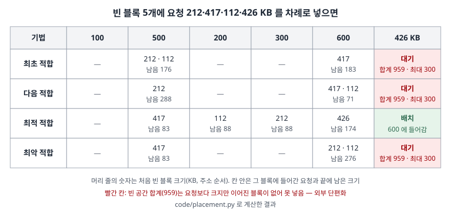

## 들어가며

연속 할당은 페이징 이전의 메모리 관리 방식이지만 시험에서는 여전히 계산형으로 나온다. "빈 블록 크기와 요청 크기를 주고 기법마다 어디에 배치되는지 쓰라"는 문제다. 실무에서도 같은 문제가 사용자 공간 힙 할당기, 디스크 연속 할당, 데이터베이스의 빈 공간 관리에서 반복된다. 이 글은 기법 4가지를 정의하고, 계산 문제와 50% 규칙을 코드로 직접 돌려 검산했다.

## 정의

**연속 메모리 할당**(contiguous memory allocation): 프로세스 하나에 **물리 메모리의 이어진 영역 하나**를 내주는 방식이다. 그중 **가변 분할**은 프로세스가 요구한 크기만큼 영역을 잘라 주며, 비어 있는 영역을 **홀**(hole, 빈 블록)이라 부른다. Silberschatz 9장 슬라이드(9.20)는 홀이 메모리 곳곳에 여러 크기로 흩어져 있고, 프로세스가 끝나면 그 영역을 풀어 이웃한 빈 영역과 합친다고 설명한다.

**동적 기억장치 할당 문제**(dynamic storage-allocation problem): 홀 목록에서 크기 n 인 요청을 어느 홀로 채울지 정하는 문제다(같은 슬라이드 9.21).

## 등장 배경

고정 분할은 분할 수만큼만 프로세스를 올릴 수 있고, 분할보다 작은 프로세스가 들어가면 남는 공간을 버린다. 가변 분할은 프로세스 크기에 맞춰 잘라 주므로 그 낭비가 없지만, 프로세스가 들어오고 나가기를 반복하면 메모리가 크고 작은 홀로 잘게 나뉜다. 그러면 **빈 공간 합계는 충분한데 이어진 공간이 없어** 요청을 못 받는 일이 생긴다. 이것이 **외부 단편화**이고, 어느 홀을 고르느냐(배치 기법)가 단편화의 정도와 탐색 시간을 함께 정한다.

## 구성요소 / 절차

### 배치 기법 4가지

| 기법 | 고르는 홀 | 탐색 범위 | 근거 |
|---|---|---|---|
| **최초 적합**(first-fit) | 처음 만나는 충분히 큰 홀 | 찾으면 멈춤 | Silberschatz 9.21, OSTEP 17.3 |
| **다음 적합**(next-fit) | 최초 적합과 같되, **지난번 멈춘 자리부터** 찾음 | 찾으면 멈춤 | OSTEP 17.3 |
| **최적 적합**(best-fit) | 충분히 큰 홀 중 **가장 작은** 홀 | 목록 전체 (크기순 정렬이면 예외) | Silberschatz 9.21, OSTEP 17.3 |
| **최악 적합**(worst-fit) | **가장 큰** 홀 | 목록 전체 | Silberschatz 9.21, OSTEP 17.3 |

Silberschatz 슬라이드는 최적 적합이 가장 작은 나머지를, 최악 적합이 가장 큰 나머지를 남긴다고 적고, **속도와 저장 공간 활용 모두에서 최초·최적 적합이 최악 적합보다 낫다**고 정리한다(9.21). OSTEP 은 다음 적합이 목록 앞부분이 잘게 쪼개지는 것을 피하려고 탐색 시작점을 옮긴다고 설명한다.

### 단편화 2가지 (Silberschatz 9.22)

| 구분 | 정의 | 생기는 자리 |
|---|---|---|
| **외부 단편화** | 빈 공간 합계는 요청을 채울 만큼 있으나 이어져 있지 않다 | 할당된 영역 **사이** |
| **내부 단편화** | 내준 영역이 요청보다 조금 커서 분할 **안**에 쓰이지 않는 공간이 생긴다 | 할당된 영역 **안** |

### 외부 단편화를 줄이는 방법 3가지

1. **압축**(compaction): 메모리 내용을 옮겨 빈 공간을 큰 블록 하나로 모은다. **재배치가 동적이고 실행 시간에 이뤄질 때만** 가능하다. 입출력 중인 프로세스는 메모리에 고정하거나 OS 버퍼로만 입출력하게 해야 한다(Silberschatz 9.23).
2. **병합**(coalescing): 해제된 블록을 주소상 이웃한 빈 블록과 합친다(9.20, OSTEP 17.2).
3. **비연속 할당**: 프로세스의 논리 주소 공간을 연속이 아니게 둔다. 페이징이 이 방식이다.

## 도식

계산 문제 하나를 네 기법으로 풀었다. 전체 소스는 [`code/placement.py`](code/placement.py), 수행 기록은 [`code/output.txt`](code/output.txt) 에 있다. 빈 블록은 주소 순서로 100·500·200·300·600 KB 이고, 요청은 212·417·112·426 KB 순서로 온다.

> **출처**: 기법의 정의는 [Silberschatz OSC 10th ed. Ch.9 슬라이드 9.21 Dynamic Storage-Allocation Problem](https://www.cs.hunter.cuny.edu/~sweiss/course_materials/csci340/slides/chapter09.pdf)과 [OSTEP Ch.17 Free-Space Management §17.3 Basic Strategies](https://pages.cs.wisc.edu/~remzi/OSTEP/vm-freespace.pdf), 외부 단편화 정의는 같은 슬라이드 9.22. 칸 안의 배치와 남은 크기는 `code/placement.py` 로 계산했다.

답안에는 행 하나(최초 적합)와 마지막 칸만 그려도 외부 단편화를 보일 수 있다. 빈 공간 959 KB 가 있는데 426 KB 가 대기하는 모습이다.

## 비교

### 계산 문제의 결과 (실습 [2])

| 기법 | 배치 | 426 KB | 끝에 남은 빈 블록 | 살펴본 빈 블록 |
|---|---|---|---|---|
| 최초 적합 | 212→500, 417→600, 112→500의 나머지 288 | 대기 | 100, 176, 200, 300, 183 | 14 |
| 다음 적합 | 212→500, 417→600, 112→600의 나머지 183 | 대기 | 100, 288, 200, 300, 71 | 12 |
| 최적 적합 | 212→300, 417→500, 112→200, 426→600 | 배치 | 100, 83, 88, 88, 174 | 20 |
| 최악 적합 | 212→600, 417→500, 112→600의 나머지 388 | 대기 | 100, 83, 200, 300, 276 | 20 |

이 예제에서는 최적 적합만 네 요청을 다 받았다. 최초 적합은 212 KB 를 500 KB 홀에 넣어 417 KB 가 들어갈 자리를 600 KB 홀로 밀어냈고, 그 결과 426 KB 를 받을 홀이 남지 않았다. 최악 적합은 가장 큰 600 KB 홀을 처음부터 쪼갰다. 탐색 비용은 반대로, 끝까지 훑는 최적·최악 적합이 20개로 가장 많았다.

실패한 세 기법 모두 빈 공간 합계는 959 KB 로 426 KB 보다 크고, 가장 큰 홀은 300 KB 였다. 압축으로 959 KB 를 한 블록으로 모으면 426 KB 가 들어간다(실습 [4]).

### 꽉 찬 메모리에서 오래 돌렸을 때 (실습 [5])

메모리 100,000 단위에 크기 1~1000 의 요청을 넣고, 한 단계에서 30% 확률로 무작위 블록을 풀었다. 자리가 없으면 무작위 블록을 풀어 가며 다시 시도한다. 20만 단계 중 앞 2만 단계는 버리고 평균을 냈다.

| 기법 | 빈 블록 / 할당 블록 | 빈 공간 비율 | 할당 1회당 살펴본 빈 블록 | 첫 시도 실패 횟수 |
|---|---|---|---|---|
| 최초 적합 | 0.498 | 0.136 | 92.4 | 21,294 |
| 다음 적합 | 0.500 | 0.159 | 65.2 | 22,553 |
| 최적 적합 | 0.469 | 0.107 | 131.4 | 16,965 |
| 최악 적합 | 0.503 | 0.226 | 122.1 | 31,129 |

Silberschatz 슬라이드는 최초 적합을 분석하면 블록 N 개를 할당할 때 0.5N 개가 단편화로 사라지고, 그래서 **메모리의 1/3 이 쓸 수 없게 될 수 있다**고 적는다. 이것을 **50% 규칙**이라 부른다(9.22). 모의 실험에서 최초 적합의 빈 블록 수는 할당 블록 수의 0.498배로 이 규칙과 맞았다. 그러나 **빈 공간 비율은 1/3(0.333)이 아니라 0.136** 이었다. 1/3 은 N 개의 블록과 0.5N 개의 홀이 **평균 크기가 같다고 볼 때** 나오는 값인데(0.5N ÷ 1.5N), 이 실험에서는 홀이 블록보다 작았다. 50% 규칙은 **개수**에 대한 규칙이고, 빈 공간의 양은 요청 크기 분포에 따라 달라진다.

기법 사이의 순서는 슬라이드의 정리와 같았다. 최적 적합이 빈 공간 비율과 실패 횟수가 가장 낮고, 최악 적합이 가장 높았다. 탐색 비용은 최초 적합이 최적 적합보다 적었다. 다음 적합은 탐색이 가장 적었지만 빈 공간과 실패는 최초 적합보다 조금 많았다.

## 적용 시 고려사항

1. **기법의 우열은 요청 순서와 크기 분포에 달려 있다.** 계산 문제에서 최적 적합이 이겼지만, OSTEP 은 요청과 해제가 임의로 오므로 어떤 기법이든 나쁜 입력에서는 크게 나빠질 수 있다고 적는다(17.3). 실제 요청 기록으로 모의 실험을 돌려 고른다.
2. **최적 적합의 비용은 탐색이다.** 실습 [5]에서 할당 1회당 131개 홀을 봤다(최초 적합 92개). 홀을 크기순 자료구조로 관리하면 전체 탐색을 피할 수 있지만, 해제 때 정렬을 유지하는 비용이 붙는다.
3. **최적 적합은 아주 작은 홀을 남긴다.** OSTEP 예제처럼 30 대신 20 을 쪼개면 5 가 남고, 이런 홀은 다음 요청을 받지 못한다. 계산 문제에서도 83·88·88 KB 홀이 남았다. 최소 할당 단위를 두어 남는 조각이 일정 크기 이하면 통째로 내주는 방법이 있다. 이때는 내부 단편화가 생긴다.
4. **압축은 재배치 지원이 전제다.** 주소가 적재 시점에 고정되는 시스템에서는 쓸 수 없고, 쓸 수 있어도 메모리 복사 비용과 입출력 중인 영역 처리 문제가 있다(9.23). 외부 단편화 자체를 없애려면 페이징 같은 비연속 할당으로 간다.
5. **같은 문제가 다른 층에서 반복된다.** 슬라이드는 보조 기억장치도 같은 단편화 문제를 가진다고 덧붙인다(9.23). 사용자 공간 힙 할당기의 크기별 목록이나 버디 시스템은 탐색 비용과 단편화를 다른 방식으로 맞바꾼 설계다.

## 정리

- 배치 기법 **4가지**: 최초(처음 맞는 것)·다음(멈춘 자리부터)·최적(가장 작은 것)·최악(가장 큰 것). 앞의 둘은 찾으면 멈추고, 뒤의 둘은 전체를 훑는다
- 단편화 **2가지**: 외부(블록 사이, 합계는 충분하나 이어지지 않음)·내부(블록 안, 요청보다 크게 내줌)
- 외부 단편화 대책 **3가지**: 압축(동적 재배치 전제)·병합·비연속 할당(페이징)
- 50% 규칙: 최초 적합에서 홀 수 ≈ 0.5 × 블록 수. **개수 규칙**이며 "1/3 손실"은 홀과 블록의 평균 크기가 같을 때의 값이다
- 암기 단서: **"처·다·적·악 — 멈추는 둘, 훑는 둘"**

> 같은 주제의 기출 답안: [기출문제 — 가상메모리 관리기법과 단편화](../../exam/2026-10-22-virtual-memory-management-fragmentation/index.md)

## 참고 자료

- [Silberschatz·Galvin·Gagne, *Operating System Concepts* 10th ed. Ch.9 Main Memory 슬라이드 (S. Weiss 2020 개정판)](https://www.cs.hunter.cuny.edu/~sweiss/course_materials/csci340/slides/chapter09.pdf) — 9.20 가변 분할과 홀, 9.21 최초·최적·최악 적합과 비교, 9.22 외부·내부 단편화와 50% 규칙, 9.23 압축의 조건
- [Arpaci-Dusseau, *Operating Systems: Three Easy Pieces* v1.10 Ch.17 Free-Space Management](https://pages.cs.wisc.edu/~remzi/OSTEP/vm-freespace.pdf) — 17.3 최적·최악·최초·다음 적합의 정의와 10·30·20 예제
- [버디 시스템과 슬랩 할당기 — 단편화를 나눠 맡는 두 층](../2026-10-27-buddy-system-and-slab-allocator/index.md) — 같은 저장소에서 크기를 2의 거듭제곱으로 나눠 탐색 비용을 줄이는 방식을 다룬 글
- [동적 메모리 할당기의 구조 — brk·mmap과 아레나](../2026-11-04-dynamic-memory-allocator-brk-mmap-arena/index.md) — 같은 문제가 사용자 공간 힙에서 나타나는 모습
