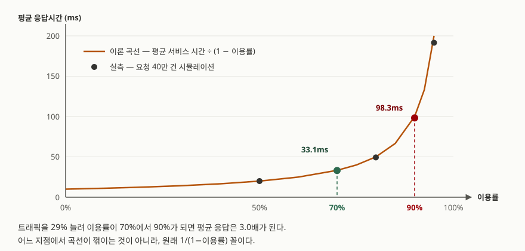

## 들어가며

용량 산정 회의에 들어간다. 지표를 띄워 보니 서버 CPU가 평소 70% 언저리다. 다음 달
프로모션으로 트래픽이 30% 늘어날 예정인데, 남은 30%로 받아 내자는 결론이 난다.
산술적으로는 맞는 말처럼 들린다. 70에 30을 더하면 100이니 딱 맞는다.

이 계산이 암묵적으로 깔고 있는 전제는 **이용률이 올라가도 응답시간은 그대로**라는
것이다. 지표 어디에도 그런 보장은 없다. 실제로는 이용률 70%에서 90%로 가는 동안
평균 응답시간이 3배가 되고, 그 사이 어디서도 "여기서부터 느려진다"는 경계는
나타나지 않는다. 느려지는 일은 95%에서 갑자기 시작되는 것이 아니라 **처음부터
진행되고 있었다.**

## 개념 — 이용률과 대기

필요한 용어는 셋뿐이다.

- **서비스 시간** `E[S]` — 요청 하나를 실제로 처리하는 데 걸리는 시간. 큐가 비어
  있을 때 재면 이 값이 나온다.
- **이용률** `ρ` — 서버가 일하고 있는 시간의 비율. 도착률 × 서비스 시간이다.
  초당 70건이 오고 하나에 10ms가 걸리면 `70 × 0.01 = 0.7`이다.
- **응답시간** — 대기시간 + 서비스 시간. 사용자가 겪는 것은 이쪽이다.

대기행렬은 Kendall이 1953년 논문에서 도입한 `도착/서비스/서버수` 표기로 부른다.
`M/M/1`은 도착 간격과 서비스 시간이 모두 지수분포이고 서버가 하나라는 뜻이고,
`M/D/1`은 서비스 시간이 고정(Deterministic)이라는 뜻이다. 이 글은 이 두 가지와
변동이 큰 경우 하나를 쓴다.

## 구조 — 이용률이 응답시간을 어떻게 밀어 올리는가



> **출처**: 이 글의 실행 기록 [`code/output.txt`](code/output.txt)의 `1.` 표 — 요청 40만 건 시뮬레이션. 이론 곡선은 M/M/1의 평균 체류시간 `E[S] / (1 − ρ)`이고, `M/M/1` 표기는 [Kendall, *Stochastic Processes Occurring in the Theory of Queues…* (1953)](https://doi.org/10.1214/aoms/1177728975)가 도입했다.

곡선에 **무릎이 없다.** 어느 지점에서 성질이 바뀌는 것이 아니라 `1 / (1 − ρ)` 꼴을
그대로 따른다. 50%에서 2배, 90%에서 10배, 95%에서 20배다. 분모가 0으로 가니까
끝에서 수직으로 서는 것뿐이다.

여기서 용량 계획의 흔한 오해가 나온다. **"80%까지는 안전하다"는 경계선은 없다.**
있는 것은 "이 응답시간을 감당할 수 있는가"라는 질문뿐이고, 답은 서비스마다 다르다.

## 동작 원리 — 왜 하필 1/(1−ρ)인가

요청이 고르게 오면 큐가 생기지 않는다. 큐는 **도착이 몰릴 때** 생기고, 몰린 뒤에
줄어들려면 그동안 서버가 한가해야 한다. 이용률이 높다는 것은 **줄일 기회가 적다**는
뜻이다. 그래서 한 번 쌓인 줄이 평소 수준으로 돌아오는 데 걸리는 시간이 길어지고,
그 긴 시간 동안 도착한 요청이 모두 그 줄을 겪는다.

단일 서버 FCFS는 이 과정이 Lindley 점화식 한 줄로 그대로 쓰인다. 1952년 논문에서
나온 식이다.

```python
# W: 이번 요청이 기다린 시간, S: 이번 요청의 서비스 시간, gap: 다음 요청까지의 간격
wait = max(0.0, wait + service - gap)
```

앞 요청이 끝나기 전에 다음이 오면(`service > gap`) 그 차이가 쌓이고, 늦게 오면
깎인다. 다만 **0 아래로는 안 내려간다.** 이 `max(0, …)` 하나가 비대칭을 만든다.
한가한 시간은 저축되지 않고 버려지는데, 밀린 시간은 그대로 다음으로 넘어간다.
이용률이 올라갈수록 깎을 기회가 줄어드니 쌓인 쪽만 남는다.

## 실습 예제

이 점화식으로 단일 서버를 40만 건씩 돌렸다. 평균 서비스 시간은 전부 10ms로 같고
시드를 고정했다. 빈 큐에서 출발한 초기 4만 건은 버렸다.
전체 소스: [`code/`](code/) · 돌린 기록: [`code/output.txt`](code/output.txt)

```text
  이용률 | 평균응답 | 이론평균 |    p50 |    p90 |    p99 |  p99.9 | 이론 p99 | p99/평균
  ---------------------------------------------------------------------------------------
     50% |     20.0 |     20.0 |   13.9 |   46.4 |   91.5 |  134.8 |     92.1 |    4.57배
     70% |     33.1 |     33.3 |   23.2 |   76.1 |  149.4 |  209.8 |    153.5 |    4.51배
     80% |     49.3 |     50.0 |   34.8 |  112.6 |  221.3 |  318.7 |    230.3 |    4.49배
     90% |     98.3 |    100.0 |   69.4 |  222.4 |  451.3 |  654.1 |    460.5 |    4.59배
     95% |    191.5 |    200.0 |  138.2 |  431.0 |  834.9 | 1086.2 |    921.0 |    4.36배
```

트래픽을 29% 늘려 이용률이 70%에서 90%가 되자 평균이 33.1ms에서 98.3ms로 **3.0배**,
대기시간만 보면 23.1ms에서 88.3ms로 **3.8배**가 됐다. 서버는 그대로다.

이용률 95% 행에서 실측(191.5ms)이 이론(200.0ms)보다 4% 낮다. 40만 건이 모자란
것이다. **혼잡할수록 평균이 자리를 잡는 데 더 오래 걸린다.** 짧은 부하 테스트가
높은 이용률 구간을 낙관적으로 보고하는 이유가 여기 있다.

### 예상과 달랐던 것 — p99도 똑같이 3.0배였다

p99는 평균보다 더 가파르게 나빠질 것이라고 봤다. 아니었다. 평균이 3.0배가 될 때
p99도 3.0배가 됐고, p50도 3.0배였다. 맨 오른쪽 열이 그 이유를 보여 준다.
**`p99 / 평균`이 이용률과 무관하게 4.5배 언저리에 머문다.**

M/M/1의 체류시간은 지수분포이므로 이 비는 `-ln(0.01) = 4.61`로 정해져 있다.
이용률은 분포의 **모양을 바꾸지 않고 전체를 같은 배수로 늘린다.** 그러니 p99가
평균보다 나쁜 정도는 이용률이 정하는 것이 아니다.

### 그러면 무엇이 정하는가 — 서비스 시간의 흔들림

이용률을 70%로 고정하고 서비스 시간의 분포만 바꿔 다시 쟀다. 세 경우 모두 평균
서비스 시간은 10ms로 같다. `C²`는 변동계수의 제곱으로, 0이면 모든 요청이 똑같이
걸리고 클수록 들쭉날쭉하다는 뜻이다.

```text
  서비스 시간 분포    |   C^2 | 평균대기 | 이론대기 | 평균응답 |    p99 | p99/평균
  -------------------------------------------------------------------------------
  고정 (M/D/1)          |  0.00 |     11.8 |     11.7 |     21.8 |   75.8 |    3.48배
  지수 (M/M/1)          |  1.00 |     23.1 |     23.3 |     33.1 |  149.4 |    4.51배
  95%는 5ms·5%는 105ms  | 10.38 |    126.5 |    132.7 |    136.5 |  910.1 |    6.67배
```

**같은 이용률, 같은 평균 서비스 시간인데 p99가 75.8ms와 910.1ms로 12배 벌어진다.**
세 번째 줄은 요청의 95%가 5ms에 끝나는, 겉보기에 더 빠른 서버다. 나머지 5%가
105ms를 쓴다는 것 하나로 전체가 이렇게 된다.

이론대기 열은 M/G/1 대기시간 공식 `ρ·E[S]·(1 + C²) / (2(1 − ρ))`로 계산한 값이다.
식에 `C²`가 그대로 들어 있다. **대기시간은 이용률과 변동성의 곱으로 정해지고,
둘 중 하나만 봐서는 아무것도 모른다.**

## 실무에서 주의할 점

- **"CPU 70%니까 30% 더"는 계산이 성립하지 않는다.** 이용률 30%p를 더 쓰는 대가는
  응답시간 3배다. 용량 계획의 입력은 "몇 %까지 쓸 것인가"가 아니라 **"어느 응답시간
  까지 허용할 것인가"**여야 하고, 거기서 거꾸로 이용률 상한이 나온다.
- **p99를 낮추고 싶으면 분포의 꼬리를 먼저 본다.** 이용률을 낮추면 p99가 같은
  배수로 내려가지만, 그러려면 서버를 늘려야 한다. 반면 느린 5%가 왜 느린지를
  찾아 고치면 — 캐시 미스, 특정 쿼리, GC, 콜드 스타트 — 서버를 늘리지 않고도
  p99가 내려간다. 위 표에서 `C²`를 10.38에서 1로 줄인 효과가 p99 910ms → 149ms다.
- **평균이 같다고 같은 시스템이 아니다.** 위 세 경우의 평균 응답은 21.8 / 33.1 /
  136.5ms로 다르지만, 더 중요한 것은 같은 평균을 가진 두 시스템도 꼬리가 전혀 다를
  수 있다는 점이다. 평균만 알림에 걸어 두면 꼬리가 길어지는 변화를 놓친다.
- **부하 테스트는 높은 이용률 구간에서 오래 돌린다.** 95%에서 40만 건도 이론값에
  4% 못 미쳤다. 5분짜리 테스트로 "90%에서도 괜찮다"는 결론을 내면 그 결론은
  측정이 모자라서 나온 것일 수 있다.
- **여러 서버에 걸친 요청은 꼬리가 합쳐진다.** 한 요청이 백엔드 100곳을 부르면
  그중 하나라도 p99에 걸릴 확률이 올라간다. 이 구조는 Dean과 Barroso가
  *The Tail at Scale*에서 정리했다. 구성요소의 p99가 전체의 평균을 지배하게 된다.

## 정리

- 평균 응답시간은 `E[S] / (1 − ρ)`를 따른다. 안전한 이용률 경계선 같은 것은 없고,
  처음부터 계속 올라가고 있다.
- 이용률 70% → 90%는 트래픽 29% 증가인데 평균·p50·p99가 모두 3.0배가 됐다.
- **이용률은 분포 전체를 같은 배수로 밀어 올린다.** p99가 평균의 몇 배인지는
  바꾸지 않는다 (M/M/1에서 4.6배로 고정).
- **p99와 평균의 비를 정하는 것은 서비스 시간의 변동성 `C²`다.** 같은 이용률에서
  `C²`만 0 → 10.38로 바뀌자 p99가 75.8ms에서 910.1ms가 됐다.
- 그래서 조치가 갈린다. 전체를 내리려면 이용률을, 꼬리를 자르려면 변동성을 건드린다.

## 참고 자료

- Kendall, D. G., [Stochastic Processes Occurring in the Theory of Queues and their Analysis by the Method of the Imbedded Markov Chain](https://doi.org/10.1214/aoms/1177728975), *The Annals of Mathematical Statistics* 24(3), 1953, pp. 338–354 — `M/M/1` 표기와 M/G/1 분석
- Lindley, D. V., [The theory of queues with a single server](https://doi.org/10.1017/S0305004100027638), *Mathematical Proceedings of the Cambridge Philosophical Society* 48(2), 1952, pp. 277–289 — 이 글의 시뮬레이션이 쓴 점화식
- Dean, J. and Barroso, L. A., [The Tail at Scale](https://research.google/pubs/pub40801/), *Communications of the ACM* 56, 2013, pp. 74–80
- Python 공식 문서, [`random.expovariate`](https://docs.python.org/3/library/random.html#random.expovariate)
