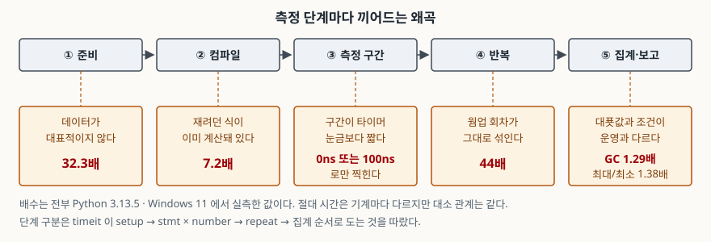

## 들어가며

새 구현이 기존 것보다 빠른지 확인해야 할 때가 있다. 직렬화 라이브러리를 바꾸거나,
루프를 컴프리헨션으로 고치거나, 캐시를 하나 끼우고 나서다. 보통은 `time.perf_counter()`
로 앞뒤를 감싸 몇 번 돌려 보고, 숫자가 작은 쪽을 고른다.

문제는 그 숫자가 **재려던 것을 재지 않았을 때도 아무 티가 안 난다**는 점이다. 코드가
터지지도 않고 경고도 없다. "2.3배 빨라졌다"는 한 줄이 회의록에 들어가고, 배포 뒤에
지표가 그대로이면 그때 가서 원인을 찾는다. 그 시점에는 측정을 다시 설계해야 하고,
처음에 10분이면 될 일이 이틀짜리가 된다.

여기서는 **같은 코드로 다른 숫자를 만들어 내는 방법 다섯 가지**를 일부러 써서
보인다. 전부 Python 3.13.5에서 실제로 돌린 값이다.

## 개념 — 측정 단계마다 왜곡이 다르다

벤치마크를 한 덩어리로 보면 "느리게 나왔다 / 빠르게 나왔다"밖에 말할 수 없다.
`timeit` 이 도는 순서를 보면 단계가 나뉜다. **setup을 한 번 돌리고, 문장을 `number`
번 반복해 그 전체 시간을 재고, 그 묶음을 `repeat` 번 되풀이한 뒤, 나온 벡터를
집계한다.**

각 단계가 망가뜨리는 방식이 다르다. 준비 단계는 **대상 데이터**를 틀리게 하고,
컴파일 단계는 **대상 코드**를 없애 버리고, 측정 구간은 **재는 행위 자체의 비용**을
섞고, 반복은 **한 번만 내는 비용**을 n번에 분배하고, 집계는 **어느 숫자를 고르느냐**로
결론을 바꾼다.

## 구조



> **출처**: 단계 구분은 [Python `timeit` — `Timer.timeit(number)`](https://docs.python.org/3/library/timeit.html#timeit.Timer.timeit) 와 [`Timer.repeat(repeat, number)`](https://docs.python.org/3/library/timeit.html#timeit.Timer.repeat) 의 실행 순서를 따랐다. 배수는 [`code/output.txt`](code/output.txt) 의 실측값이다.

## 동작 원리와 실습 예제

전체 소스: [`code/`](code/) · 돌린 기록: [`code/output.txt`](code/output.txt)

### ① 준비 — 데이터가 대표적이지 않다

30만 개짜리 리스트를 `list.sort()` 로 정렬한다. 입력만 바꿨다.

| 입력 | 중앙값 |
|---|---|
| 무작위 실수 30만 개 | 34.290 ms |
| 같은 값을 미리 정렬해 둔 것 | 1.061 ms |

**32.3배다.** 코드는 같은 `list.sort()` 한 줄이다. CPython의 정렬은 이미 정렬된
구간을 찾아 활용하므로, 정렬된 입력을 넣으면 비교 횟수가 급감한다. 테스트 픽스처를
만들 때 `range(n)` 이나 정렬된 조회 결과를 그대로 쓰면 이 함정에 그대로 들어간다.

이 실험을 처음 짤 때 사본 만들기(`list(data)`)를 측정 구간 안에 두는 실수를 했는데,
그랬더니 32.3배가 7.0배로 줄었다. 복사 비용이 양쪽에 똑같이 깔리면서 차이를 덮은
것이다. **준비 작업은 측정 구간 밖에 둔다**가 그래서 규칙이다.

### ② 컴파일 — 재려던 식이 이미 계산돼 있다

```python
timeit.repeat("2 ** 20", number=1_000_000)     # 0.0044 s
timeit.repeat("x ** 20", setup="x = 2", ...)   # 0.0319 s
```

리터럴 쪽이 **7.2배 빠르다**. 거듭제곱이 빨라진 것이 아니라 아예 일어나지 않았다.
바이트코드를 보면 바로 보인다.

```text
--- compile('2 ** 20') ---
0           RESUME                   0
1           RETURN_CONST             0 (1048576)
--- compile('x ** 20') ---
0           RESUME                   0
1           LOAD_NAME                0 (x)
            LOAD_CONST               0 (20)
            BINARY_OP                8 (**)
            RETURN_VALUE
```

리터럴만 있는 식은 컴파일 단계에서 접혀 `1048576` 이라는 상수가 되고, 남은 것은
그 상수를 반환하는 명령 하나다. **그 0.0044초는 `RETURN_CONST` 100만 번의 시간이다.**
마이크로 벤치마크를 짤 때 입력을 상수로 박아 두면 이 일이 조용히 일어난다. 의심되면
`dis.dis(compile(...))` 로 한 번 찍어 본다.

### ③ 측정 구간 — 타이머 눈금보다 짧다

`x + 1` 한 번을 `perf_counter()` 두 번으로 감싸 2,001회 쟀다.

| | 값 |
|---|---|
| `perf_counter` 해상도 | 100.0 ns |
| `perf_counter()` 호출 한 번 | 43.0 ns |
| `x + 1` 을 한 번만 재기 (중앙값) | 100.0 ns |
| 100만 번 돌려 나누기 | 10.5 ns |

한 번만 재면 **9.6배로 부풀려진다.** 더 볼 만한 것은 그 2,001개 값의 분포다.

```text
     0 ns :   970회
   100 ns :   952회
   200 ns :    61회
   300 ns :    17회
   400 ns :     1회
```

**0 아니면 100ns다.** 값이 연속으로 퍼져 있지 않고 눈금에 달라붙어 있다.
`time.get_clock_info('perf_counter')` 가 알려주는 해상도가 1e-07, 곧 100ns이기
때문이다. 10.5ns짜리 연산은 이 시계로 볼 수 있는 대상이 아니다. 절반은 "0초 걸렸다"고
나오고 절반은 "100ns 걸렸다"고 나온다. 이 둘을 평균 내면 숫자는 나오지만, 그 숫자는
연산이 아니라 **눈금의 성질**이다.

그래서 마이크로 단위 측정은 반복으로 분할 상환한다. `timeit` 의 `number` 인자가
있는 이유가 이것이다.

### ④ 반복 — 웜업 회차가 그대로 섞인다

```text
캐시를 비운 뒤 첫 re.search :    35.30 us
바로 다음 re.search        :     0.80 us
```

**44배다.** `re.search` 는 패턴 문자열을 컴파일해 모듈 내부 캐시에 넣는다. 첫 호출만
그 비용을 내고 다음부터는 캐시를 쓴다. `re.purge()` 로 캐시를 비워 "처음"을 반복해서
만들어 측정했다.

반복 횟수가 적을수록 이 한 번이 결과를 밀어 올린다. 다섯 번 재서 평균을 내면 첫 회가
전체의 5분의 1을 차지한다. 그래서 측정 전에 **몇 회를 버린다.** 몇 회를 버릴지는
앞쪽 회차를 찍어 보고 안정되는 지점에서 정한다.

### ⑤ 집계 — 대푯값과 측정 조건

같은 작업(4만 개 dict 생성) 60회의 분포다.

| 평균 | 중앙값 | 최소 | 최대 |
|---|---|---|---|
| 9.209 ms | 8.787 ms | 8.138 ms | 11.256 ms |

**최대가 최소의 1.38배다.** 평균은 중앙값보다 4.8% 높다. 위쪽 꼬리가 평균을 끌어
올린 것인데, 그 꼬리는 파이썬이 느려진 게 아니라 다른 프로세스가 끼어든 시간이다.
`timeit` 문서가 이 점을 명시적으로 적는다. 높은 값들은 보통 파이썬 속도의 변동이
아니라 측정을 방해한 다른 프로세스 때문이므로, **결과 벡터에서 볼 만한 값은 `min()`
정도**라는 것이다.

조건 쪽에도 한 가지가 있다. 같은 문서가 **`timeit()` 은 측정 중 가비지 컬렉션을
일시적으로 꺼 둔다**고 적는다. 실제로 재 보면 이렇다.

| | 중앙값 |
|---|---|
| GC 켜짐 (운영에서 도는 조건) | 18.265 ms |
| GC 꺼짐 (`timeit` 기본 조건) | 14.205 ms |

**1.29배다.** 컨테이너를 많이 만드는 코드일수록 벌어진다. 운영 수치를 추정하려는
측정이라면 setup에 `gc.enable()` 을 넣어 조건을 맞춘다.

## 실무에서 주의할 점

- **"몇 배 빨라졌다"를 쓰기 전에 무엇을 쟀는지 한 줄로 적을 수 있는지 본다.**
  적을 수 없으면 ②번(상수 접기)처럼 아무것도 안 잰 상태일 수 있다. `dis` 로 찍거나,
  결과를 받아 쓰는 쪽을 만들어 두면 대부분 걸러진다.
- **최소값과 중앙값을 같이 적는다.** 최소값은 "이 기계가 방해 없이 낼 수 있는 속도",
  중앙값은 "보통 겪는 속도"다. 평균 하나만 적으면 둘 다 아닌 숫자가 된다.
  분포가 궁금하면 최대/최소 비율을 함께 적는다. 여기서는 1.38배였다.
- **비교 대상 두 쪽에 같은 데이터를 쓴다.** 그리고 그 데이터가 운영과 닮았는지
  따로 확인한다. ①번에서 32배가 났다. 벤치마크에서 이긴 구현이 운영에서 지는
  가장 흔한 경로가 여기다.
- **마이크로 벤치마크는 `timeit` 에 맡긴다.** 손으로 감싼 `perf_counter` 는 ③번처럼
  눈금과 호출 비용을 같이 잰다. 다만 `timeit` 이 GC를 끈다는 것은 알고 쓴다.
- **측정 환경을 결과와 함께 남긴다.** 파이썬 버전, OS, 반복 횟수, 대푯값 종류,
  GC 설정까지다. 여기 숫자도 Python 3.13.5 · Windows 11의 값이고, 다른 기계에서는
  절대 시간이 다르게 나온다. **배수와 대소 관계만 같으면 재현된 것이다.**

## 정리

- 준비 단계: 입력만 바꿔 같은 `list.sort()` 를 **32.3배** 차이로 만들었다.
- 컴파일 단계: `2 ** 20` 은 상수로 접혀 `RETURN_CONST` 하나가 된다. **7.2배** 차이는
  거듭제곱이 아니라 접기의 결과다.
- 측정 구간: `perf_counter` 해상도가 100ns라 10.5ns 연산은 **0 아니면 100ns**로만
  찍힌다. 2,001회 중 970회가 0이었다.
- 반복: 정규식 캐시가 비어 있는 첫 호출이 **44배** 느리다. 앞 몇 회를 버린다.
- 집계: 최대가 최소의 **1.38배**이고, `timeit` 이 GC를 꺼 두면 **1.29배** 빨라 보인다.

## 참고 자료

- [Python 표준 라이브러리 — `timeit`](https://docs.python.org/3/library/timeit.html) — `Timer.timeit`, `Timer.repeat`, 그리고 GC를 끄는 동작과 `min()` 권고
- [Python 표준 라이브러리 — `time.get_clock_info()`](https://docs.python.org/3/library/time.html#time.get_clock_info) — 시계의 해상도·단조성·구현을 돌려준다
- [Python 표준 라이브러리 — `dis`](https://docs.python.org/3/library/dis.html) — 바이트코드 역어셈블
- [Python 표준 라이브러리 — `gc`](https://docs.python.org/3/library/gc.html)
