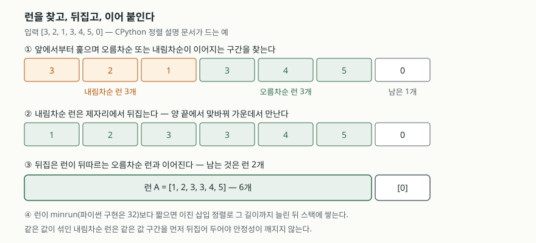
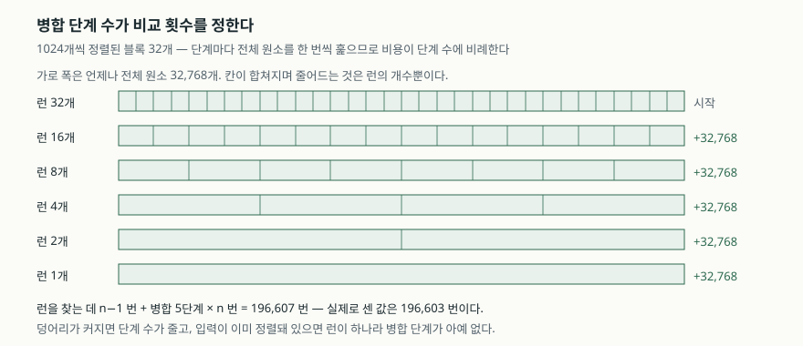

## 들어가며

로그 집계 배치를 짜다 보면 이런 모양이 된다. 서버 서른 대가 하루치 로그를
각각 시각 순으로 남겼고, 배치는 파일 서른 개를 읽어 한 리스트에 담은 뒤
`sort()`를 부른다. 조각마다 이미 정렬돼 있다는 것은 아는데, 그 사실을 정렬이
알아주는지는 모른다.

그래서 리뷰에서 이런 말이 오간다. "이미 정렬돼 있으니 `heapq.merge`로
합치는 게 낫지 않나." "정렬은 n log n이니 어차피 비슷하다." 양쪽 다 재 보지
않은 말이다. 원소가 3만 개면 n log₂ n은 49만 번이고, 비교 한 번에 날짜
문자열을 파싱하는 키라도 끼어 있으면 이 숫자가 그대로 체감 시간이 된다.
49만 번이 필요한지 3만 번이면 끝나는지는 재면 알 수 있다.

파이썬의 `list.sort()`는 **Timsort**다. 핵심은 이미 정렬된 구간을 찾아
그대로 쓴다는 데 있다. 얼마나 쓰는지를 비교 횟수로 세어 보자.

## 개념

Timsort는 **자연 런(run) 탐지 + 병합 정렬**이다. 입력을 처음부터 훑으며
이미 오름차순이거나 내림차순인 구간을 찾아 그 구간은 정렬하지 않고
그대로 쓴다. 이렇게 모은 구간들을 병합해 하나로 합친다.

여기서 **런**은 이미 정렬된 연속 구간을 말한다. 입력이 완전히 정렬돼 있으면
런이 하나뿐이라 병합할 것이 없고, 무작위면 런이 잘게 쪼개져 병합이 많아진다.
"정렬된 입력에서 빠르다"는 성질을 **적응적(adaptive)** 이라고 부른다.

같은 알고리즘이 파이썬에만 있는 것은 아니다. 자바 표준 라이브러리의
객체 배열 정렬도 구현 노트에 "Tim Peters의 파이썬 리스트 정렬에서 가져왔다"고
적고, 거의 정렬된 입력에서는 약 n번의 비교로 끝난다고 밝힌다. 아래 측정은
파이썬에서만 했으므로 수치는 파이썬 기준이다.

비교 횟수를 재는 쪽이 시간을 재는 쪽보다 낫다. 시간은 장비·캐시·백그라운드
작업에 흔들리지만, 비교 횟수는 구현이 같으면 어디서 돌려도 같은 값이
나온다. 아래 측정은 `__lt__` 호출을 직접 세어 얻은 것이다.

## 구조



> **출처**: [CPython 3.13.5 — Objects/listsort.txt, "Intro" 및 "Runs" 절](https://github.com/python/cpython/blob/v3.13.5/Objects/listsort.txt)



> **출처**: [CPython 3.13.5 — Objects/listsort.txt, "Merge Pattern" 절](https://github.com/python/cpython/blob/v3.13.5/Objects/listsort.txt) (수치는 아래 측정 결과)

## 동작 원리

런을 찾는 함수는 구간이 **비감소**이면 오름차순 런으로, **감소**이면
내림차순 런으로 본다. 내림차순 런은 제자리에서 뒤집는데, 양 끝에서 원소를
맞바꿔 가운데서 만나는 방식이다. 이 뒤집기는 같은 값이 섞여 있으면 상대
순서를 흐트러뜨리므로, 같은 값으로 이루어진 구간을 먼저 뒤집어 두어
나중에 전체를 뒤집었을 때 원래 순서가 복원되게 한다. 안정 정렬이라는
보장은 이렇게 지켜진다.

찾은 런이 너무 짧으면 그대로 두지 않는다. **minrun** 길이까지 이진 삽입
정렬로 늘린다. 설명 문서는 16·32·64·128이 비슷하게 잘 동작했고 8은 함수
호출이, 256은 삽입 정렬의 데이터 이동이 불리해서 **32**를 골랐다고 적는다.
런 개수가 2의 거듭제곱이 되도록 맞추는 이유는 병합이 고르게 갈라지게
하기 위해서다.

런은 바로 합치지 않고 스택에 쌓인다. 각 런에는 병합 트리에서의 깊이에
해당하는 값이 매겨지고, **스택에 쌓인 값이 아래에서 위로 엄격히 감소**하도록
유지된다. 이 조건이 깨지려 하면 그 자리에서 인접한 두 런을 병합한다.

병합 중에는 한쪽 런이 연속으로 이기는 일이 생긴다. 연속 승리가 7회에
이르면 한 칸씩 비교하는 대신 **갤로핑(galloping)** 으로 바꿔, 이진 탐색으로
건너뛸 구간을 한 번에 찾는다. 양쪽 탐색이 모두 7개보다 짧은 구간만 찾아내면
다시 한 칸씩 비교하는 모드로 돌아온다.

## 실습 예제

전체 소스: [`code/`](code/) · 실행 기록: [`code/output.txt`](code/output.txt)

원소 32,768개를 다섯 가지 모양으로 만들어 비교 횟수를 셌다.

| 입력 모양 | 비교 횟수 | n log₂ n 대비 | 가장 빠른 회차 |
|---|---:|---:|---:|
| 무작위 | 450,413 | 91.6% | 2.95 ms |
| 오름차순 | 32,767 | 6.7% | 0.07 ms |
| 내림차순 | 32,767 | 6.7% | 0.09 ms |
| 거의 오름차순 (1% 흐트러짐) | 50,588 | 10.3% | 0.24 ms |
| 1,024개씩 정렬된 블록 32개 | 196,599 | 40.0% | 1.15 ms |

예상과 달랐던 것은 **내림차순 줄**이다. 역순 입력이 오름차순 입력과 똑같이
32,767번, 즉 n−1번으로 끝났다. 전부 뒤집힌 배열은 가장 나쁜 입력일 것
같지만, 런 탐지에게는 "내림차순 런 하나"일 뿐이다. 뒤집는 데 비교가 들지
않으므로 비용이 오름차순과 같다.

1% 흐트러진 입력도 50,588번으로, 완전 정렬의 1.5배에 그친다. 완전히
정렬된 데이터가 아니어도 런 탐지의 이득은 거의 그대로 남는다.

### 비교 횟수는 병합 단계 수로 설명된다

덩어리 크기를 바꿔 가며 세어 보면 규칙이 보인다. 런을 찾는 데 n−1번,
병합은 단계마다 전체 원소를 한 번씩 훑으므로 n번. 그러면 전체는
**(n−1) + n × log₂(덩어리 수)** 가 된다.

| 덩어리 크기 | 덩어리 수 | 비교 횟수 | 모형값 | 차이 |
|---:|---:|---:|---:|---:|
| 16 | 2,048 | 419,866 | 393,215 | +26,651 |
| 32 | 1,024 | 359,702 | 360,447 | −745 |
| 64 | 512 | 327,307 | 327,679 | −372 |
| 256 | 128 | 262,057 | 262,143 | −86 |
| 1,024 | 32 | 196,603 | 196,607 | −4 |
| 4,096 | 8 | 131,067 | 131,071 | −4 |
| 32,768 | 1 | 32,767 | 32,767 | 0 |

1,024 줄이 앞 표의 196,599와 네 번 다른 것은 난수 상태가 달라
블록 내용이 다르기 때문이고, 구조는 같다.

덩어리가 32 이상이면 모형과 0.2% 안쪽으로 맞는다. 어긋나는 쪽은 덩어리가
작을수록 조금씩 **적게** 나오는데, 갤로핑이 비교를 건너뛴 몫이다.

반대로 어긋나는 줄이 맨 위 하나 있다. 덩어리 16은 모형보다 26,651번
**많다.** minrun이 32라서 16짜리 런은 이진 삽입 정렬로 32까지 늘려야 하고,
그 삽입 비용이 더해지기 때문이다. 입력을 16개씩 정렬해 두는 것은 파이썬
정렬에 아무 이득이 없다.

### 안정성과 key 호출 횟수

안정 정렬이라 **정렬을 두 단계로 나눌 수 있다.** 보조 키로 먼저 정렬하고
주 키로 다시 정렬하면, 주 키가 같은 묶음 안에 앞 단계의 순서가 남는다.

```text
원본 순서: ['A', 'B', 'C', 'D', 'E']
이름 → 점수 내림차순 순으로 두 번 정렬:
   95  D  (나팀)
   90  A  (가팀)
   90  B  (나팀)
   90  E  (가팀)
   70  C  (가팀)
점수가 같은 90점 묶음의 순서: ['A', 'B', 'E']
```

`key` 함수는 원소마다 **정확히 한 번** 불린다. 32,768개를 정렬할 때 호출은
32,768회였다. 비교 함수를 `cmp_to_key`로 감싸면 이야기가 달라진다.

```text
key=  로 정렬      → 함수 호출    32,768회 ·   4.9ms
cmp_to_key 로 정렬 → 함수 호출   450,479회 ·  33.0ms
```

비교 함수는 **비교할 때마다** 불리므로 호출이 13.7배가 된다. 450,479라는
숫자가 무작위 입력의 비교 횟수 450,413과 거의 같다는 점이 이 구조를
그대로 보여 준다.

## 실무에서 주의할 점

**이미 정렬된 조각을 쪼개 두지 않는다.** 서른 개 파일을 각각 정렬된 채로
이어 붙이고 한 번 정렬하는 쪽이, 파일을 섞어 읽은 뒤 정렬하는 쪽보다
병합 단계가 적다. 읽는 순서만 바꿔도 덩어리 수가 달라진다.

**덩어리를 minrun보다 짧게 만들 이유는 없다.** 16개씩 정렬해 두면 오히려
비교가 늘었다. 미리 정렬해 두는 전처리를 넣는다면 덩어리를 수백~수천 단위로
잡는다.

**비교 함수 대신 `key`를 쓴다.** 로캘 비교처럼 `key`로 바꾸기 어려운
경우가 아니면 `cmp_to_key`는 피한다. 호출 횟수가 n에서 비교 횟수로
바뀌므로, 함수가 무거울수록 차이가 벌어진다.

**역순 정렬에 키를 음수화하지 않는다.** `reverse=True`는 안정성을
유지하지만, `key=lambda r: -r.score` 같은 변환은 문자열에 쓸 수 없고
두 단계 정렬과 섞이면 순서가 꼬인다.

**비교 횟수와 시간의 비율을 같게 보지 않는다.** 위 표에서 무작위 대비
오름차순은 비교가 13.7배 적은데 시간은 42배 짧았다. 비교 횟수는 구현이
같으면 어디서나 같은 값이 나오지만, 시간에는 비교 한 번의 비용과 메모리
이동이 함께 들어가므로 장비마다 다르다. 두 표의 비교 횟수는 그대로 옮겨
쓸 수 있고, 시간 열은 이 환경의 값이다.

## 정리

- 파이썬 정렬은 이미 정렬된 구간(런)을 찾아 그대로 쓴다. 완전히 정렬된
  입력은 n−1번 비교로 끝난다
- **역순 입력도 n−1번**이다. 내림차순 런을 뒤집는 데는 비교가 들지 않는다
- 비교 횟수는 **(n−1) + n × log₂(덩어리 수)** 로 거의 설명된다.
  덩어리가 32 이상이면 모형과 0.2% 안쪽이다
- minrun이 32라서 그보다 짧은 덩어리는 이진 삽입 정렬 비용이 더 붙는다
- `key`는 원소마다 한 번, 비교 함수는 비교마다 불린다. 호출 수가 한 자릿수
  배 이상 벌어진다

## 참고 자료

- [CPython 3.13.5 — Objects/listsort.txt (Timsort 설계 문서)](https://github.com/python/cpython/blob/v3.13.5/Objects/listsort.txt)
- [Python 3.13 — Sorting Techniques, Sort Stability and Complex Sorts](https://docs.python.org/3.13/howto/sorting.html#sort-stability-and-complex-sorts)
- [Python 3.13 — Sorting Techniques, Key Functions](https://docs.python.org/3.13/howto/sorting.html#key-functions)
- [Java SE 21 API — java.util.Arrays.sort(Object[]) 구현 노트](https://docs.oracle.com/en/java/javase/21/docs/api/java.base/java/util/Arrays.html)
