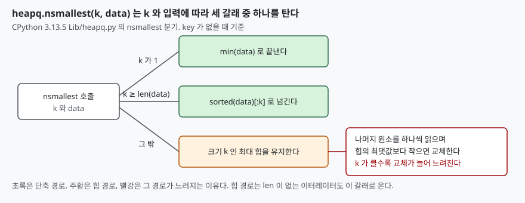

## 들어가며

주문 20만 건에서 금액이 작은 순으로 일부만 화면에 보여 주면 된다. 보통은 `sorted(orders)[:k]`
로 쓴다. 누군가 코드 리뷰에서 "상위 k개만 필요하니 전체를 정렬하지 말고 `heapq.nsmallest`
를 쓰라"고 하면 맞는 말처럼 들려서 바꾼다. 정렬은 n log n 이고 힙은 n log k 이니
이론으로는 힙이 낫다. 그런데 `sorted` 는 C 로 구현돼 있고 `nsmallest` 의 반복문은 파이썬이다.
이론의 차이가 실제 시간에서도 그대로 나는지, 나온다면 k 가 얼마일 때까지인지 잰 적은
많지 않다. 이 글은 그 경계를 실측한다.

## 개념

`sorted(data)[:k]` 는 전체를 정렬한 뒤 앞에서 k개를 자른다. 비용은 k 와 무관하다.
`heapq.nsmallest(k, data)` 는 크기 k 의 힙을 유지하며 데이터를 한 번 훑는다. 비용은 k 가
커질수록 늘어난다. 공식 문서도 `nsmallest` 가 n 이 작을 때 가장 잘 동작하고 큰 값에서는 `sorted`
가 더 효율적일 수 있다고 적는다. 그러니 "어느 k 부터 뒤집히는가"가 질문이다.

## 구조



> **출처**: [Python 3.13 heapq.nsmallest 문서](https://docs.python.org/3/library/heapq.html#heapq.nsmallest), [CPython 3.13.5 Lib/heapq.py](https://github.com/python/cpython/blob/v3.13.5/Lib/heapq.py)

도식은 3.13.5 에 설치된 `heapq.nsmallest` 소스를 `inspect.getsource` 로 읽어 그린 것이다.
k 가 1이면 `min` 을, `k` 가 `len(data)` 이상이면 `sorted` 를 쓰는 단축 경로가 있고, 그 밖에는 힙을
쓴다. 단축 경로는 입력에 `len` 이 있을 때만 탄다.

## 동작 원리

힙 경로는 처음 k개로 최대 힙을 만들고, 나머지 원소를 하나씩 읽으며 힙의 최댓값보다 작으면
그 값을 빼고 새 원소를 넣는다. 최댓값보다 크거나 같은 원소는 비교 한 번으로 지나간다.
k 가 작으면 대부분의 원소가 그냥 지나가서 비용이 선형 탐색에 가깝다. k 가 커지면 힙이
커서 한 번의 교체가 비싸지고, 교체가 일어나는 횟수도 늘어난다.

`key` 를 넘기면 두 방식 모두 원소마다 `key` 를 한 번 부르는 비용이 붙는다. 다만 `nsmallest` 는
`(키, 순번, 원소)` 튜플을 만들어 비교하는 일반 경로로 들어가 더 무겁다.

## 실습 예제

시드를 고정한 20만 개 정수로 `sorted(data)[:k]` 와 `heapq.nsmallest(k, data)` 를 5번씩 재어
가장 빠른 값을 적었다. 전체 소스는 [`code/`](code/)에 있고, 출력은 `code/output.txt` 에서 가져왔다.

```text
         k |     k/n |    sorted | nsmallest | 빠른 쪽
  ---------+---------+-----------+-----------+--------
         1 |  0.00% |    25.9ms |     1.0ms | nsmallest
       100 |  0.05% |    24.8ms |     2.1ms | nsmallest
     1,000 |  0.50% |    25.3ms |     3.6ms | nsmallest
    10,000 |  5.00% |    24.3ms |    16.3ms | nsmallest
    15,000 |  7.50% |    26.3ms |    23.0ms | nsmallest
    20,000 | 10.00% |    24.2ms |    30.6ms | sorted
    30,000 | 15.00% |    25.8ms |    39.6ms | sorted
   100,000 | 50.00% |    25.3ms |    98.1ms | sorted
   199,999 | 100.00% |    27.7ms |   118.2ms | sorted
   200,000 | 100.00% |    27.0ms |    26.5ms | nsmallest
```

**손익분기는 7.5%와 10% 사이였다.** `sorted` 는 k 와 상관없이 25ms 안팎으로 평평하다. 반면
`nsmallest` 는 k 에 거의 비례해 늘어 1,000개에서 3.6ms, 10만 개에서 98ms 가 됐다. k 가 전체의
수 퍼센트라면 힙이, 1할을 넘으면 정렬이 낫다. 이 수치는 이 기계의 균일 난수 정수 기준이며,
다른 분포나 크기에서는 경계가 움직일 수 있다.

**예상과 달랐던 것은 마지막 두 줄이다.** k 가 199,999이면 `nsmallest` 는 118ms 로 sorted 의 4배가
넘는데, k 가 200,000이면 26.5ms 로 `sorted` 와 같아진다. 전체 개수 이상이면 `sorted` 로 넘어가는
단축 경로를 타기 때문이다. 하나가 모자라면 경로가 바뀌어 4배 이상 느려진다. 같은 조건에서 리스트
대신 `iter(data)` 를 넘기면 `len` 이 없어 단축 경로를 못 타고 125.9ms 가 걸렸다.

`key` 를 준 경우(`key=lambda x: -x`)도 구조는 같았다. 1,000개까지는 `nsmallest` 가 10ms 안팎으로
`sorted` 의 45ms 를 앞섰고, 10%인 20,000개에서 41.7ms 대 41.3ms 로 뒤집혔다. 큰 k 에서는 격차가 더
커져 199,999개에서 267ms 대 50ms 였다.

## 실무에서 주의할 점

1. **k 가 전체의 몇 퍼센트인지 먼저 본다.** 이 실험에서는 7.5%까지 힙이 낫고 10%부터 정렬이 낫다.
   "상위 k개니까 힙"이라는 규칙을 k 가 큰 곳에도 적용하면 오히려 3~4배 느려진다.
2. **k 를 정할 수 없으면 `sorted` 가 안전하다.** `sorted` 는 k 에 둔감해서 최악이 25~50ms 로
   고정이다. `nsmallest` 의 최악은 k 에 따라 수백 ms 까지 간다.
3. **`nsmallest` 에 이터레이터를 넘기면 단축 경로가 사라진다.** 데이터가 이미 리스트라면
   그대로 리스트를 넘긴다.
4. **스트림에서 상위 k개만 필요하면 힙의 값이 다르다.** 데이터가 메모리에 다 들어가지 않으면
   `sorted` 는 쓸 수 없다. 이 경우는 속도가 아니라 메모리 때문에 힙을 고른다. 이 글은 메모리를
   재지 않았다.
5. **측정값은 환경마다 다르다.** 경계 비율은 기계, 파이썬 버전, 데이터 분포에 따라 달라진다.
   자기 데이터로 `code/topk_bench.py` 의 크기와 k 를 바꿔 다시 재 본다.

## 정리

- `sorted(data)[:k]` 의 시간은 k 와 무관하고, `heapq.nsmallest` 는 k 에 거의 비례해 늘었다
- 20만 개 균일 난수에서 손익분기는 k 가 전체의 7.5%와 10% 사이였다
- `nsmallest` 는 k 가 1이면 `min`, `len` 이상이면 `sorted` 로 넘어가는 단축 경로가 있다
- k 가 전체보다 하나 모자라면 단축 경로를 못 타 4배 이상 느려졌다
- k 가 작지 않다면 먼저 재 보고, 자신이 없으면 `sorted` 를 쓴다

## 참고 자료

- [Python 3.13 heapq 문서](https://docs.python.org/3/library/heapq.html)
- [CPython 3.13.5 Lib/heapq.py](https://github.com/python/cpython/blob/v3.13.5/Lib/heapq.py)
