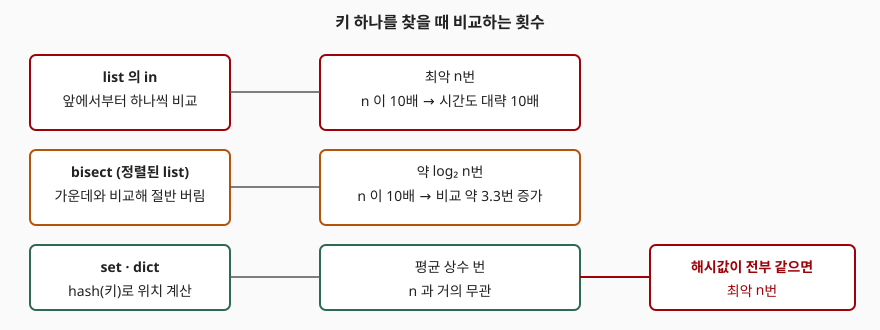

## 들어가며

차단할 사용자 ID 목록을 리스트로 들고 있다가 요청마다 `if user_id in blocked:` 로 확인하는 코드는 흔하다. 목록이 100개일 때는 아무도 신경 쓰지 않는다. 그런데 목록이 몇십만 건으로 불어난 뒤 요청마다 이 줄이 도는 서비스에서 응답 시간이 올라가기 시작하면, 프로파일러는 이 한 줄을 가리킨다. 리스트의 `in` 은 앞에서부터 하나씩 비교하므로 목록이 10배 커지면 요청당 비교도 10배가 된다. 이 글은 `list`, `bisect`, `set`·`dict` 세 방식으로 같은 키를 찾아 크기가 커질 때 시간이 어떻게 달라지는지 재고, 해시 방식이 항상 빠른 것은 아니라는 반례까지 돌려 본다.

## 개념

탐색 방식은 "키 하나를 찾기 위해 몇 개와 비교하는가"로 나뉜다.

| 방식 | 전제 | 비교 횟수 |
|---|---|---|
| `x in list` | 없음 | 최악 n번 |
| `bisect` | 리스트가 정렬돼 있음 | 약 log₂ n번 |
| `x in set`, `x in dict` | 키가 해시 가능(hashable)함 | 평균 상수 번 |

해시 방식은 키의 해시 값(`hash(key)`, 키를 정수 하나로 바꾼 값)으로 저장 위치를 계산하므로 n 과 거의 무관하게 위치에 곧바로 닿는다. 대신 같은 해시 값을 가진 키끼리는 서로 `==` 로 비교해야 하고, 그 키가 몰리면 비교 횟수가 늘어난다. 파이썬 공식 위키의 시간 복잡도 표도 `dict` 와 `set` 의 조회를 평균 O(1), 최악 O(n) 으로 적는다.

## 구조



> **출처**: [Python Wiki — TimeComplexity](https://wiki.python.org/moin/TimeComplexity), [Python 문서 — bisect](https://docs.python.org/3/library/bisect.html)

## 동작 원리

`bisect_left` 는 정렬된 리스트에서 키가 들어갈 위치를 이진 탐색으로 찾는다. 반환값이 위치일 뿐이므로, 키가 실제로 있는지는 그 위치의 값을 한 번 더 비교해야 한다. 해시 방식에는 약속이 하나 있다. 파이썬 데이터 모델은 서로 같다고 비교되는 객체는 같은 해시 값을 가져야 한다고 정한다. 이 약속을 지키는 한 해시 값이 다르면 비교할 필요가 없고, 해시 값이 같을 때만 `==` 가 호출된다. 아래 3번 측정은 이 때문에 생기는 최악의 경우를 일부러 만든다.

## 실습 예제

세 가지를 잰다. (1) 원소 수 1천~100만에서 없는 키를 찾는 시간, (2) 같은 리스트에서 키 위치별 시간, (3) 해시 값이 전부 같은 키로 dict 를 채우는 시간. 난수 시드는 고정했고, 호출 한 번당 시간은 5회 반복의 중앙값이다. 전체 소스: [`code/`](code/), 수행 기록: [`code/output.txt`](code/output.txt)

```text
Python 3.13.5 / Windows 11
free-threaded 빌드: 아니오

### 1. 없는 키를 찾는 시간 (호출 한 번당, ns)
          n |      list in |   bisect |     set |    dict
  ----------+--------------+----------+---------+--------
      1,000 |        5,044 |      178 |      34 |      32
     10,000 |       47,648 |      194 |      32 |      36
    100,000 |      909,918 |      210 |      28 |      30
  1,000,000 |   30,219,894 |      242 |      28 |      28
```

해시 방식은 원소가 1천 개일 때와 100만 개일 때 시간이 같다(34ns 대 28ns). `bisect` 는 178ns 에서 242ns 로, 1,000배 커지는 동안 36% 늘었다. 반면 `list in` 은 5µs 에서 30ms 로 약 6,000배가 됐다.

예상과 달랐던 점은 `list in` 이 정확히 10배씩 늘지 않았다는 것이다. 1만→10만은 약 19배, 10만→100만은 약 33배다. 이 측정만으로 원인을 가를 수는 없다. 다만 같은 n=100,000 에서 2번 측정의 정렬된 `range` 리스트는 아래처럼 447µs 로, 1번 표의 셔플된 리스트(910µs)의 절반이다. 리스트에 담긴 정수 객체의 메모리 배치 순서가 시간에 영향을 준다는 것까지만 이 데이터로 말할 수 있다.

```text
### 2. list 에서 키 위치별 시간 (n = 100,000, 호출 한 번당, ns)
  맨 앞    |         30
  가운데    |    238,276
  맨 뒤    |    452,568
  없음     |    446,844
```

키가 맨 앞이면 30ns, 가운데면 약 절반, 맨 뒤나 없는 키는 전체를 훑는 시간이다. 선형 탐색의 비용은 키가 어디 있느냐에 달려 있다.

```text
### 3. 해시가 전부 같은 키로 dict 를 채우는 시간 (ms)
       n | 같은 해시 | 정수 키
  -------+------------+---------
     500 |       6.11 |    0.024
   1,000 |      24.39 |    0.041
   2,000 |      99.39 |    0.095
   4,000 |     396.67 |    0.152
```

`__hash__` 가 항상 1 을 돌려주는 클래스를 키로 쓰면 원소 수가 2배가 될 때마다 삽입 시간이 약 4배가 된다(6.11→24.39→99.39→396.67ms). 원소를 하나 넣을 때마다 앞선 키와 비교하므로 전체 삽입이 n² 으로 늘어난다. 정수 키로 같은 크기를 채우면 4,000개에 0.152ms 다. 4,000개에서 약 2,600배 차이가 난다.

## 실무에서 주의할 점

1. **멤버십 검사가 반복되면 `set` 으로 바꾼다.** 변환에도 비용이 들지만(이 글은 재지 않았다), 같은 목록을 여러 번 검사한다면 한 번 만든 `set` 을 재사용하는 쪽이 유리하다. 한두 번 확인하고 버릴 목록이면 변환 비용이 더 클 수 있다.
2. **`bisect` 는 정렬 상태가 전제다.** 리스트에 `append` 한 뒤 정렬을 잊으면 틀린 위치를 돌려주고 에러도 나지 않는다. 자주 추가·삭제되는 데이터에는 쓰지 않는다.
3. **`__hash__` 를 직접 정의할 때는 `__eq__` 와 같은 필드로 계산한다.** 위 3번 측정처럼 해시가 몰리면 dict 가 리스트보다 느려질 수 있다. 상수를 돌려주는 해시는 올바르게 동작하지만 느리다.
4. **작은 목록에서는 차이가 없다.** 원소 1,000개 기준 `list in` 은 5µs 다. 요청당 한 번이면 문제가 되지 않으므로, 측정 없이 모든 리스트를 `set` 으로 바꾸지 않는다.
5. **이 수치는 이 환경의 것이다.** Python 3.13.5, Windows 11 에서 잰 값이며 절대값은 장비마다 다르다. 비교할 것은 크기가 늘 때의 배율이다.

## 정리

- `list in` 은 선형이라 n 이 커지면 시간이 그만큼 늘고, 1,000→1,000,000 에서 5µs 가 30ms 가 됐다.
- `bisect` 는 정렬이 전제이며 같은 구간에서 178ns→242ns 로 거의 늘지 않았다.
- `set`·`dict` 는 크기와 무관하게 약 30ns 였다.
- 해시가 전부 같은 키는 삽입 시간이 n² 으로 늘어, 4,000개에서 정수 키의 약 2,600배가 걸렸다.
- 측정은 값이 아니라 크기가 늘 때의 기울기로 읽는다.

## 참고 자료

- [Python Wiki — TimeComplexity](https://wiki.python.org/moin/TimeComplexity)
- [Python 문서 — bisect: 배열 이분법 알고리즘](https://docs.python.org/3/library/bisect.html)
- [Python 문서 — 데이터 모델: object.__hash__](https://docs.python.org/3/reference/datamodel.html#object.__hash__)
