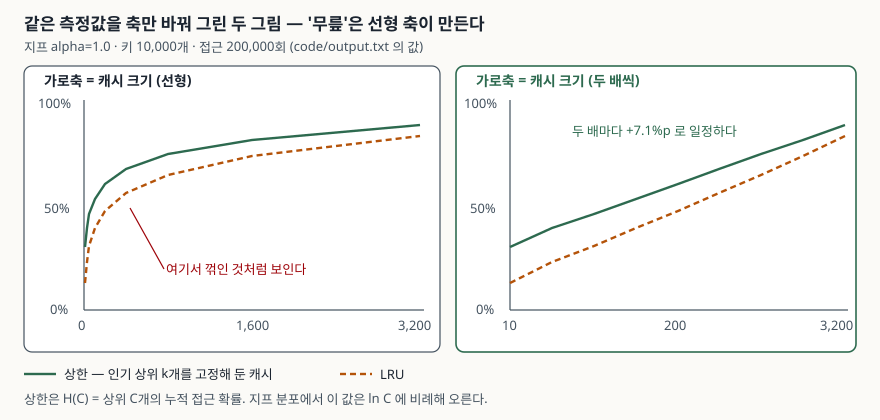

## 들어가며

캐시 서버 메모리를 늘려 달라는 요청은 대개 이런 모양으로 온다. "지금 적중률이
40%인데 메모리를 두 배로 하면 얼마나 오르나요." 답을 가진 사람이 없다. 그래서
보통은 두 배로 올려 두고 일주일 뒤 대시보드를 본다. 숫자가 기대만큼 안 올라도
되돌리기 번거로우니 그냥 둔다.

다음 분기에 같은 요청이 또 오면 같은 일을 반복한다. 한 번 해 볼 때마다 인스턴스
비용과 재기동 한 번이 드는 실험을, 예측 없이 두세 번씩 돌리는 셈이다.
그런데 접근 분포만 알면 이 곡선은 돌리기 전에 그려진다. 그려 보면 흔히 기대하는
모양과 다르다.

## 개념

캐시 적중률을 다룰 때 가장 많이 쓰는 모형이 **독립 참조 모델**(independent
reference model)이다. 각 요청이 고정된 확률 분포에서 독립적으로 뽑힌다고 본다.
웹 요청·키-값 조회의 인기 분포는 대개 **지프 분포**에 가깝다. 인기 순위 `i`인
항목의 접근 확률이 `1/i^α`에 비례하는 분포다.

이 모형에서 **크기 C인 캐시가 낼 수 있는 최선**은 인기 상위 C개를 고정해 두는
것이고, 그때 적중률은 상위 C개의 누적 접근 확률 `H(C)`가 된다. Breslau 외(1999)는
지프 분포에서 이 값이 `H(C) ≈ Ω·ln C` 로 **캐시 크기의 로그에 비례**해 오른다고
적는다. 로그라는 말은 **크기를 두 배로 할 때마다 같은 폭씩 오른다**는 뜻이다.

## 구조



> **출처**: [Breslau, Cao, Fan, Phillips, Shenker — *Web Caching and Zipf-like Distributions: Evidence and Implications*, §5 Finite Cache, Infinite Request Stream](https://pages.cs.wisc.edu/~cao/papers/zipf-implication/node5.html) (`H(C) = Σ P_N(i) ≈ Ω ln C`), 곡선의 값은 [`code/output.txt`](code/output.txt)

## 동작 원리

`H(C) ≈ Ω·ln C` 에서 `Ω`는 정규화 상수다. α=1인 지프 분포에서 순위 `i`의 확률은
`(1/i) / H_N` 이고, `H_N`은 `N`번째 조화수다. 그래서 캐시를 두 배로 늘릴 때
오르는 폭은 `Ω·ln 2 = ln 2 / H_N` 으로 **C와 무관한 상수**가 된다.

키 10,000개면 `H_N = 9.7876` 이므로 예측값은 `0.6931 / 9.7876 = 7.1%p` 다.
실제로 상위 k 누적 확률을 재 보면 이렇게 나온다.

```text
  상한(상위k 고정)이 두 배마다 오르는 폭: +7.0% +7.1% +7.1% +7.1% +7.1% +7.1%
  Breslau 외(1999)의 H(C) ≈ Ω·ln C 로 예측한 폭: +7.1%  (Ω = 1/H_N, H_N = 9.7876)
```

여섯 구간이 전부 7.1%p다. 이 분포에서 **적중률 곡선에는 꺾이는 지점이 없다.**
선형 축에 그리면 왼쪽이 가파르고 오른쪽이 평평해 보이지만, 그것은 가로축이
오른쪽으로 갈수록 한 칸에 더 많은 캐시를 담기 때문이다.

## 실습 예제

전체 소스: [`code/hit_ratio_curve.py`](code/hit_ratio_curve.py) · 돌린 기록: [`code/output.txt`](code/output.txt)

키 10,000개에 접근 200,000회, 시드 고정. α=1.0일 때다.

```text
  캐시 크기 | 키 공간 대비 | LRU 적중률 | LRU 뒷절반 | 상위k 고정 | 이론 누적비중 | 직전 대비
         10 |        0.1% |      13.1% |      13.1% |      29.9% |         29.9% |    +13.1%
        100 |        1.0% |      38.9% |      38.8% |      52.8% |         53.0% |     +8.1%
        400 |        4.0% |      55.6% |      55.5% |      67.0% |         67.1% |     +8.5%
      1,600 |       16.0% |      73.4% |      73.6% |      81.2% |         81.3% |     +9.1%
      3,200 |       32.0% |      82.7% |      83.2% |      88.3% |         88.4% |     +9.3%
```

예상과 달랐던 것이 둘이다.

**첫째, LRU와 상한의 격차가 컸다.** 캐시 100칸에서 상한은 52.8%인데 LRU는
38.9%에 그쳤다. 14%p 차이다. 같은 적중률을 LRU로 내려면 캐시가 200칸(47.0%)과
400칸(55.6%) 사이까지 커져야 한다. **메모리를 두세 배 쓰는 것과 교체 정책을
바꾸는 것이 같은 효과**라는 뜻이다. 처음에는 캐시가 비어 있던 초반 구간 탓인가
싶었는데, 뒤쪽 절반만 따로 센 값도 38.8%로 같았다. 예열 문제가 아니라 LRU가
원래 그만큼만 맞힌다.

**둘째, 분포가 평평해지면 곡선이 반대로 휜다.** α=0.7과 균등 분포에서는 두 배마다
오르는 폭이 줄기는커녕 커졌다.

| 두 배 구간 | α=1.0 상한 | α=0.7 상한 | 균등 상한 |
|---|---|---|---|
| 50 → 100 | +7.0%p | +5.0%p | +0.5%p |
| 400 → 800 | +7.1%p | +9.3%p | +4.0%p |
| 1,600 → 3,200 | +7.1%p | +14.1%p | +16.0%p |

균등 분포에서 적중률은 그냥 `캐시 크기 / 키 개수`다. 측정값도 32.0%(3,200/10,000)로
정확히 맞았다. 이 경우 **작은 캐시는 사실상 아무 일도 하지 않고**, 키 공간에
근접해야 비로소 쓸모가 생긴다. α=1.0일 때와 투자 판단이 정반대다.

## 실무에서 주의할 점

**무릎을 선형 축에서 찾지 않는다.** "여기서부터 효과가 없다"는 판단이 축 선택에서
나온 것일 수 있다. 적중률 곡선은 가로축을 두 배 간격으로 놓고 본다. 거기서도
기울기가 꺾인다면 그때는 진짜 변화다.

**크기를 늘리기 전에 분포 지수를 먼저 잰다.** 접근 로그에서 상위 1%·10% 키가
전체 요청의 몇 %를 차지하는지만 세어도 분포가 가파른지 평평한지 갈린다.
가파르면 작은 캐시부터 효과가 나고, 평평하면 어지간히 키워도 티가 안 난다.

**정책을 바꾸는 쪽이 더 쌀 수 있다.** α=1.0 측정에서 LRU는 상한에 6~17%p 못 미쳤고,
캐시가 작을수록 격차가 컸다.
접근 분포가 거의 변하지 않는 구간이라면, 인기 상위 키를 고정해 두는 계층을 앞에
두거나 빈도 기반 정책을 섞는 편이 메모리를 두 배 사는 것보다 싸게 먹힌다.

**상한은 분포가 변하지 않는다는 가정 위에 있다.** 독립 참조 모델은 인기 순위가
고정이라고 본다. 실제 트래픽에는 신규 콘텐츠 유입이나 하루 주기 같은 시간적
편중이 있고, 그 구간에서는 최근성을 보는 LRU가 고정 캐시보다 잘 맞힐 수 있다.
위 숫자는 "분포가 안정적일 때 LRU가 남겨 두는 여지"로 읽는 것이 맞다.

**예열 구간을 핑계로 삼지 않는다.** 적중률이 낮을 때 "아직 캐시가 안 찼다"는
설명이 먼저 나오기 쉽다. 전체 구간과 뒤쪽 절반을 따로 재면 1분 안에 갈린다.

## 정리

- 지프 분포에서 캐시 적중률 상한은 `H(C) ≈ Ω·ln C`, 즉 크기를 두 배 할 때마다 일정폭 오른다
- 키 10,000개 α=1.0에서 예측값 7.1%p와 측정값 7.0~7.1%p가 일치했다
- 선형 축에서 보이는 '무릎'은 축이 만든 착시다. 두 배 간격 축으로 다시 그린다
- LRU는 같은 크기의 상한에 6~17%p 못 미쳤고, 이는 예열 때문이 아니었다
- 분포가 평평할수록 곡선은 선형에 가까워져, 작은 캐시의 효과가 사라진다

## 참고 자료

- [Breslau, L., Cao, P., Fan, L., Phillips, G., Shenker, S. — *Web Caching and Zipf-like Distributions: Evidence and Implications*, IEEE INFOCOM 1999](https://pages.cs.wisc.edu/~cao/papers/zipf-implications.html)
- [같은 논문 §5 Finite Cache, Infinite Request Stream — `H(C) ≈ Ω ln C`](https://pages.cs.wisc.edu/~cao/papers/zipf-implication/node5.html)
- [Python 3.13 문서 — `collections.OrderedDict.move_to_end`](https://docs.python.org/3/library/collections.html#collections.OrderedDict.move_to_end)
- [Python 3.13 문서 — `random.Random.choices`](https://docs.python.org/3/library/random.html#random.choices)
