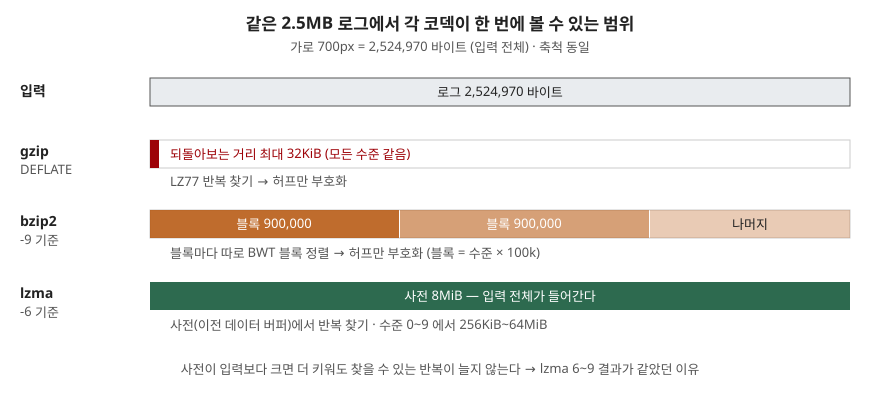

## 들어가며

로그 보관 배치를 만들거나 API 응답을 파일로 떨궈 둘 일이 생기면 압축을 붙이게 된다. 이때 대부분은
`gzip`을 그대로 쓰거나, "xz가 제일 잘 줄인다"는 말을 듣고 `lzma`에 최고 수준 9를 건다. 둘 다 근거는
없다. 하루 로그가 수백 개 파일이면 수준 하나 차이가 배치 시간을 몇 배로 늘리기도 하고, 반대로 아무리
시간을 들여도 크기가 한 바이트도 안 줄어드는 구간도 있다. 어느 쪽인지는 내 데이터로 재 보기 전에는
알 수 없다.

## 개념

파이썬 표준 라이브러리에는 성격이 다른 압축기 세 가지가 들어 있다.

- **gzip (DEFLATE)** — 앞에서 나온 문자열이 다시 나오면 "몇 바이트 앞, 몇 바이트 길이"로 바꿔 쓰는
  **LZ77**과 **허프만 부호화**를 합친 것이다. 되돌아볼 수 있는 거리는 최대 32KiB, 맞춘 길이는 최대
  258바이트다([RFC 1951 §2](https://www.rfc-editor.org/rfc/rfc1951.html#section-2)).
- **bzip2** — 입력을 **블록**으로 자르고, 블록마다 **BWT(Burrows-Wheeler 블록 정렬)**로 바이트를
  재배열한 뒤 허프만 부호화를 한다([bzip2 매뉴얼 §2.3](https://sourceware.org/bzip2/manual/manual.html#description)).
  수준 `-1`~`-9`는 블록 크기를 100k~900k로 정한다.
- **lzma (xz)** — gzip처럼 반복되는 바이트열을 찾지만, 찾는 범위인 **사전(dictionary)**이 수준에 따라
  256KiB에서 64MiB까지 커진다([xz(1) 프리셋 표](https://tukaani.org/xz/man/xz.1.html#OPTIONS:_Basic_file_format_and_compression_options)).

셋이 가장 크게 다른 것은 **한 번에 볼 수 있는 범위**다. 압축률은 결국 "얼마나 멀리 떨어진 반복까지
찾아내느냐"로 갈리므로, 이 범위가 입력 크기와 어떤 관계인지가 결과를 정한다.

## 구조



> **출처**: [RFC 1951 §2 Compressed representation overview](https://www.rfc-editor.org/rfc/rfc1951.html#section-2), [bzip2 manual §2.4 OPTIONS](https://sourceware.org/bzip2/manual/manual.html#options), [xz(1) — Basic file format and compression options](https://tukaani.org/xz/man/xz.1.html#OPTIONS:_Basic_file_format_and_compression_options)

## 동작 원리

gzip의 수준은 **32KiB 창 안에서 얼마나 끈질기게 찾느냐**만 바꾼다. 창 크기는 모든 수준이 같다.
zlib 소스의 설정표를 보면 수준 1~3은 지연 매칭을 하지 않는 `deflate_fast`, 4~9는 `deflate_slow`를
쓰고, 해시 체인을 따라가는 최대 횟수(`max_chain`)가 수준 7에서 256, 8에서 1024, 9에서 4096으로
늘어난다([zlib 1.3.1 deflate.c](https://github.com/madler/zlib/blob/v1.3.1/deflate.c)).
찾는 횟수를 네 배씩 늘려도 창이 그대로이므로 찾을 수 있는 반복의 총량은 그대로다.

bzip2는 블록 단위로 끊어서 정렬한다. 블록 경계를 넘는 반복은 이용하지 못하지만, 한 블록 안에서는
거리와 상관없이 같은 문맥의 바이트를 모아 준다.

lzma는 사전 안에 있는 이전 데이터 전체에서 반복을 찾는다. 사전이 입력보다 크면 입력 전체가 이미
사전 안에 들어가므로, 사전을 더 키워도 찾을 반복이 늘지 않는다. xz 매뉴얼도 압축 전 크기보다
큰 사전은 메모리 낭비라고 적는다.

## 실습 예제

전체 소스는 [`code/compare_codecs.py`](code/compare_codecs.py), 돌린 기록은
[`code/output.txt`](code/output.txt)에 있다. 입력은 시드를 고정해 만든 웹 서버 로그 3만 줄,
주문 JSON 1만 2천 줄, 그리고 그 로그를 zlib 수준 9로 미리 눌러 둔 바이너리다. 시간은 5회 중 최솟값이다.

```text
2. 명령행 도구의 기본 수준(gzip -6, bzip2 -9, xz -6)으로 세 입력 대조 (비율 = 압축 후 / 원본)
  입력         코덱       수준          크기      비율    압축 MB/s    해제 MB/s
  로그         gzip      6     498,872   0.198       53.1      435.8
  로그         bzip2     9     312,715   0.124       17.4       61.0
  로그         lzma      6     348,100   0.138        3.4      135.8
  JSON       gzip      6     309,058   0.121       98.6      563.8
  JSON       bzip2     9     179,252   0.070       13.9       64.5
  JSON       lzma      6     236,028   0.092        3.7      190.7
  압축된 바이너리   gzip      6     462,790   1.000       40.0      716.3
  압축된 바이너리   bzip2     9     464,786   1.005       14.4       25.6
  압축된 바이너리   lzma      6     462,708   1.000        7.6      710.0
```

**예상과 달랐던 첫 번째는 bzip2가 lzma보다 작았다는 것이다.** 로그에서 10%, JSON에서 24% 더
작았다. bzip2 매뉴얼은 LZ77/LZ78 계열보다 대체로 압축이 낫다고만 적고 lzma와는 비교하지 않는데,
적어도 이 2.5MB 텍스트에서는 그 우위가 lzma에 대해서도 나왔다. 다만 bzip2는 해제가 lzma의 절반 이하 속도였다. 한 번 쓰고 여러 번 읽는
데이터라면 이 차이가 크기 차이보다 비쌀 수 있다.

이미 압축된 입력에서는 세 코덱 모두 비율이 1.000 이상이었다. bzip2는 오히려 2,159바이트 커졌다.
lzma는 아무것도 줄이지 못하면서 7.6MB/s로 시간을 썼다.

다음은 로그 입력에서 수준만 올려 본 결과다. 시간은 이 기계에서 한 번 돈 값이라 다시 돌리면
흔들리지만, 크기는 바이트 단위까지 그대로 나온다.

```text
  [gzip]
    수준          크기      비율     압축 ms     해제 ms          직전 대비 줄어든 바이트
     6     498,872  0.1976      47.5       5.9                  7,976
     7     468,969  0.1857      66.5       5.6                 29,903
     8     462,734  0.1833     141.1       5.6                  6,235
     9     462,639  0.1832     147.2       5.6                     95
  [lzma]
     3     441,464  0.1748     189.5      19.4                 10,052
     4     443,788  0.1758     298.9      20.3                 -2,324
     5     372,904  0.1477     583.0      20.0                 70,884
     6     348,100  0.1379     751.4      18.6                 24,804
     7     348,100  0.1379     786.2      18.2                      0
     8     348,100  0.1379     852.5      25.7                      0
     9     348,100  0.1379    1241.1      24.5                      0
```

gzip은 7→8에서 압축 시간이 두 배가 됐는데 줄어든 것은 6,235바이트, 8→9는 95바이트였다.
`max_chain`이 256→1024로 늘어난 지점과 시간이 뛴 지점이 같다. 해제 시간은 수준과 무관하게 거의 같았다.

**두 번째로 예상과 달랐던 것은 lzma 6~9가 완전히 같은 크기라는 것이다.** 프리셋 표에서 6~9는
사전 크기(8·16·32·64MiB)만 다르고, 입력 2.5MB는 이미 8MiB 사전에 다 들어간다. 그런데 수준 9는 같은
결과를 내는 데 1.7배 시간이 걸렸다. 프리셋 표의 압축 메모리도 94MiB에서 674MiB로 늘어난다.

**세 번째는 lzma 4가 3보다 컸다는 것이다.** xz 매뉴얼은 프리셋 0~3이 `fast` 모드, 4~9가 `normal`
모드를 쓴다고 적는다. 3과 4의 사전은 똑같이 4MiB다. 모드가 바뀌는 경계에서 2,324바이트 커졌는데,
매뉴얼에 적힌 값만으로는 왜 커졌는지 설명할 수 없어 원인은 확인하지 못했다. 이어지는 4→5에서
70,884바이트가 줄어든 것도, 입력이 두 사전(4MiB·8MiB)보다 모두 작으므로 사전 크기로는 설명되지 않는다.

## 실무에서 주의할 점

- **파이썬 `gzip.compress()`의 기본 수준은 9다.** 명령행 `gzip`은 6이다
  ([Python 3.13 gzip.compress](https://docs.python.org/3.13/library/gzip.html#gzip.compress)).
  위 측정에서 6→9는 7.3% 작아지는 대신 압축 시간이 3배였다. 코드에서 수준을 생략하면 이 비용을 모르고 낸다.
- **사전·블록이 입력보다 크면 수준을 올려도 소용없다.** 작은 파일을 lzma 9로 누르면 시간과
  메모리만 더 든다. 파일 크기와 사전 크기(xz 프리셋 표)를 먼저 맞춰 본다.
- **이미 압축된 데이터는 다시 누르지 않는다.** 위 측정에서 zlib으로 한 번 누른 입력은 세 코덱
  모두 크기가 그대로이거나 커졌다. zip·gzip처럼 이미 압축된 파일은 확장자나 첫 바이트로 걸러
  저장 단계에서 압축을 건너뛴다.
- **해제 속도를 같이 본다.** bzip2는 이 측정에서 가장 작았지만 해제가 gzip의 1/7 수준이었다.
  자주 읽는 데이터는 압축률보다 해제 속도가 비용을 정한다.
- **재현이 필요하면 `mtime=0`을 준다.** gzip 헤더에는 압축 시각이 들어가서, 같은 입력도
  실행마다 다른 바이트열이 나온다. 해시로 중복을 걸러야 하는 파이프라인에서 문제가 된다.

## 정리

- 세 코덱의 차이는 한 번에 볼 수 있는 범위에서 시작된다. gzip은 32KiB 창, bzip2는 최대 900k 블록,
  lzma는 256KiB~64MiB 사전이다.
- 반복이 많은 2.5MB 텍스트에서는 bzip2가 가장 작았고, 해제는 gzip이 가장 빨랐다.
- gzip 8→9는 95바이트, lzma 6→9는 0바이트를 줄였다. 둘 다 시간만 늘었다.
- 수준은 기본값을 믿지 말고 내 데이터로 재서 정한다. 크기는 재현되고 시간은 흔들리므로 여러 번 잰다.

## 참고 자료

- [RFC 1951 — DEFLATE Compressed Data Format Specification §2 Compressed representation overview](https://www.rfc-editor.org/rfc/rfc1951.html#section-2)
- [bzip2 and libbzip2 1.0.8 manual §2.3 DESCRIPTION](https://sourceware.org/bzip2/manual/manual.html#description)
- [bzip2 and libbzip2 1.0.8 manual §2.4 OPTIONS](https://sourceware.org/bzip2/manual/manual.html#options)
- [xz(1) — Basic file format and compression options](https://tukaani.org/xz/man/xz.1.html#OPTIONS:_Basic_file_format_and_compression_options)
- [zlib 1.3.1 — deflate.c configuration_table](https://github.com/madler/zlib/blob/v1.3.1/deflate.c)
- [Python 3.13 — gzip.compress](https://docs.python.org/3.13/library/gzip.html#gzip.compress)
- [Python 3.13 — lzma.LZMACompressor](https://docs.python.org/3.13/library/lzma.html#lzma.LZMACompressor)
