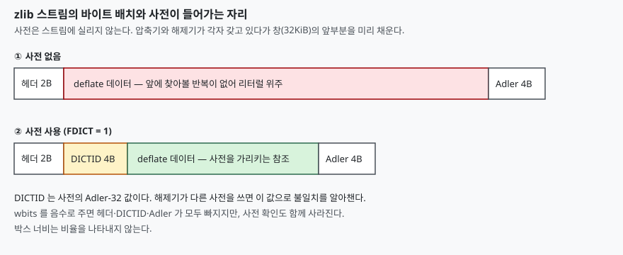

## 들어가며

이벤트 로그를 메시지 큐에 실어 보내는 중이다. 메시지는 JSON 한 건에 70바이트쯤이고 초당 수천 건이 지나간다. 네트워크 비용이 걱정되어 `zlib.compress(message)` 를 한 줄 끼워 넣었는데, 모니터링 숫자가 거의 그대로다. 로그 파일을 통째로 gzip 으로 누르면 5분의 1로 줄던 것이 왜 안 줄까.

건 단위로 누르면 압축기가 볼 수 있는 데이터가 70바이트뿐이기 때문이다. 같은 키 이름이 수백 번 반복되는 것은 사실이지만 그 반복은 **메시지와 메시지 사이**에 있고, 한 건씩 누르는 압축기는 이전 메시지를 기억하지 못한다. 수준을 1에서 9로 올려도 이 문제는 풀리지 않는다. 해법은 압축기에게 "이런 데이터가 나온다"를 미리 알려 주는 사전이다.

## 개념

zlib 이 쓰는 deflate 는 **이미 지나간 바이트열 중에서 같은 것을 찾아 (거리, 길이) 참조로 바꾸는** 방식으로 줄인다. 찾아볼 수 있는 범위는 직전 32KiB 창이다. 데이터가 70바이트면 첫 바이트는 찾아볼 과거가 없고, 뒤로 갈수록 조금씩 찾을 거리가 생길 뿐이다.

사전(preset dictionary)은 이 창을 **압축을 시작하기 전에 채워 두는** 기능이다. 대표적인 메시지 몇 건을 이어 붙인 바이트열을 사전으로 주면, 첫 메시지의 첫 바이트부터 사전 안의 키 이름을 참조할 수 있다. 사전은 압축 결과에 실리지 않는다. 압축하는 쪽과 푸는 쪽이 **같은 사전을 각자 갖고** 있어야 한다. 이 규칙이 뒤에 나오는 주의점의 뿌리다.

## 구조



> **출처**: [RFC 1950 — ZLIB Compressed Data Format 2.2 Data format](https://www.rfc-editor.org/rfc/rfc1950.html#page-4)

## 동작 원리

zlib 형식은 deflate 데이터 앞뒤에 헤더 2바이트와 Adler-32 검사값 4바이트를 붙인다. 그래서 어떤 입력이든 **고정 6바이트가 더 든다.** 사전을 쓰면 헤더의 FDICT 비트가 켜지고 사전의 Adler-32 값(DICTID) 4바이트가 더 붙어 10바이트가 된다.

70바이트 입력에서 6바이트는 8%가 넘는다. deflate 데이터 자체가 줄지 않으면 이 고정 비용만으로 결과가 원본보다 커진다.

## 실습 예제

전체 소스: [`code/`](code/) · 수행 기록: [`code/output.txt`](code/output.txt)

사용자 번호·행동·페이지가 들어간 JSON 이벤트 500건을 시드를 고정해 만들었다. 평균 73.2바이트이고 합계 36,618바이트다. 사전은 같은 생성기로 **별도 시드**로 만든 30건(2,159바이트)이라 압축 대상과 겹치는 메시지가 없다.

```text
  방식                                    합계(B)    원본 대비
  한 건씩, zlib 헤더 포함                      37273   101.8%
  한 건씩, 헤더 없음(wbits=-15)                34273    93.6%
  한 건씩, 사전 2159B 사용                     11723    32.0%
  한 건씩, 사전 + 헤더 없음                       6723    18.4%
  전부 이어 붙여 한 번에                          3816    10.4%
```

한 건씩 누르면 합계가 원본보다 커졌다(101.8%). 헤더를 없애도 93.6% 로 겨우 줄었다. 건당 6바이트씩 500건이면 3,000바이트이고, 두 줄의 차이가 정확히 그 값이다. 사전을 주자 32.0% 로 내려갔고, 이어 붙여 한 번에 누른 10.4% 에는 못 미친다. 사전은 "전형적인 메시지" 30건까지만 알려 줄 뿐이라, 메시지 안의 사용자 번호처럼 매번 바뀌는 값은 그대로 실려야 하기 때문이다.

헤더를 없앤 두 줄의 차이(11,723 → 6,723)는 건당 10바이트다. 사전을 쓰는 스트림은 DICTID 4바이트를 더 갖기 때문이다.

메시지 한 건으로 보면 첫 메시지(72바이트)가 사전 없이 74바이트, 사전과 함께 23바이트가 되었다.

푸는 쪽 규칙도 확인했다.

```text
  같은 사전으로 풀기: True
  사전 없이 풀기   : Error 2 while decompressing data
  다른 사전으로 풀기: Error -3 while setting zdict: invalid input data
```

사전 없이 풀면 에러 2(사전이 필요함)가 나고, 길이만 같은 다른 사전을 주면 DICTID 불일치로 에러가 난다.

## 실무에서 주의할 점

**첫째, 사전은 프로토콜의 일부다.** 사전을 바꾸면 이전에 만든 메시지를 풀 수 없다. 사전에 버전 번호를 두고 메시지에 그 번호를 함께 실어, 풀 때 맞는 사전을 고르게 한다. 위의 에러 메시지 덕분에 불일치가 조용히 깨진 데이터가 아니라 예외로 드러나지만, 그것은 헤더가 있을 때의 이야기다.

**둘째, 헤더를 없애면 불일치 검사도 없어진다.** `wbits=-15` 로 건당 10바이트를 아낄 수 있지만 DICTID 와 Adler-32 가 함께 사라진다. 손상이나 사전 불일치를 다른 방법(체크섬 필드, 사전 버전)으로 잡을 수 있을 때만 쓴다.

**셋째, 사전은 32KiB 를 넘겨도 쓸모가 없다.** 창이 32KiB 이므로 더 긴 사전은 뒤쪽 32KiB 만 유효하다. 자주 나오는 문자열을 **사전의 끝쪽에** 두는 편이 거리가 짧아 유리하다. 위 실험의 2,159바이트는 한참 못 미치는 크기다.

**넷째, 메시지가 길면 효과가 작다.** 사전이 줄여 주는 것은 창이 비어 있는 첫 부분이다. 수 KB 이상 되는 메시지는 스스로 반복을 만들어 내므로 사전 없이도 잘 줄고, 사전을 관리하는 비용이 더 크다. 이번 측정은 73바이트 메시지 하나의 결과이고 길이별 손익 분기점은 재지 않았다.

**다섯째, 연결 단위로 스트림을 유지할 수 있으면 그쪽이 낫다.** 이어 붙여 누른 10.4% 가 사전의 32.0% 보다 작았다. 같은 연결에서 메시지가 줄줄이 오간다면 압축 스트림을 유지하며 `Z_SYNC_FLUSH` 로 메시지 경계만 끊는 방법이 있다. 다만 메시지를 독립적으로 풀어야 하거나 순서가 바뀔 수 있으면 쓸 수 없으므로, 그때가 사전의 자리다. 이 방법의 크기는 이번에 재지 않았다.

## 정리

- zlib 은 입력 길이와 무관하게 6바이트를 더한다. 70바이트 메시지를 한 건씩 누르면 합계가 원본의 101.8% 가 되었다
- 사전은 32KiB 창을 미리 채워, 첫 바이트부터 반복 참조를 가능하게 한다. 같은 입력이 32.0% 로 줄었다
- 사전은 결과에 실리지 않으므로 압축기와 해제기가 같은 것을 갖고 있어야 하고, 불일치는 DICTID 로 검출된다
- 헤더를 없애면 건당 6~10바이트를 아끼지만 검출 수단도 함께 없어진다
- 메시지가 길거나 연결이 유지되면 사전보다 스트림 유지가 먼저 검토 대상이다

## 참고 자료

- [RFC 1950 — ZLIB Compressed Data Format Specification version 3.3](https://www.rfc-editor.org/rfc/rfc1950)
- [RFC 1951 — DEFLATE Compressed Data Format Specification version 1.3](https://www.rfc-editor.org/rfc/rfc1951)
- [Python 문서 — zlib 모듈](https://docs.python.org/3/library/zlib.html)
- [zlib Manual — deflateSetDictionary](https://www.zlib.net/manual.html)
