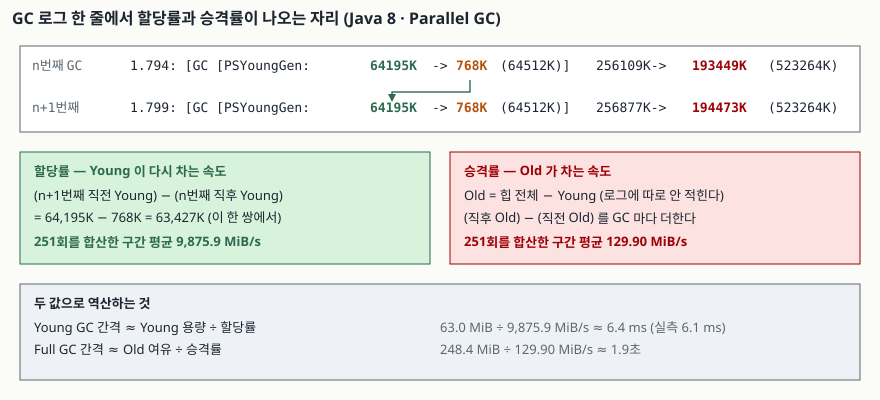

## 들어가며

운영 중인 자바 서비스가 가끔 멈춘다는 신고가 올라온다. GC 로그를 켜 보면 몇 만 줄이
쌓여 있고, 거기서 보통 하는 일은 **`Full GC`를 검색해 몇 번 났는지 세는 것**이다.
그다음은 대개 힙을 키우는 쪽으로 간다. `-Xmx`를 2배로 올리고 다시 지켜본다.

이 방법은 잘 맞지 않는다. 몇 번 났는지는 결과이고, 왜 났는지는 **얼마나 빨리 쌓이고
있었는가**이기 때문이다. GC 로그에는 그 속도가 적혀 있다. 다만 "할당률"이나 "승격률"이라는
이름으로 적혀 있지 않아서, 앞뒤 두 줄을 빼야 나온다. 그 뺄셈만 하면 다음 Full GC까지
몇 초가 남았는지가 계산된다.

## 개념

- **Young 영역 / Old 영역**: 대부분의 객체는 Young의 eden에서 만들어져 거기서 죽는다.
  Young이 차면 **minor collection**이 일어나 살아남은 것만 survivor로 복사되고, 복사를
  몇 번 넘긴 객체가 Old(tenured)로 **승격(promotion)** 된다. Old가 차면 힙 전체를
  거두는 **major collection**이 일어난다
  ([Java SE 8 HotSpot VM GC Tuning Guide, 3 Generations](https://docs.oracle.com/javase/8/docs/technotes/guides/vm/gctuning/generations.html)).
- **할당률(allocation rate)**: 단위 시간당 새로 만드는 바이트. Young이 다시 차는 속도다.
- **승격률(promotion rate)**: 단위 시간당 Old로 넘어가는 바이트. Old가 차는 속도다.

둘을 가르는 것이 중요하다. **Young GC 간격을 정하는 것은 할당률이고, Full GC 간격을
정하는 것은 승격률이다.** 힙을 키워서 해결되는 문제인지 아닌지가 여기서 갈린다.

## 구조



> **출처**: [Java SE 8 HotSpot Virtual Machine Garbage Collection Tuning Guide, 3 Generations](https://docs.oracle.com/javase/8/docs/technotes/guides/vm/gctuning/generations.html) — 세대 구분, minor/major collection, 승격의 정의와 `-XX:+PrintGCTimeStamps` 로그 예시

## 동작 원리

Java 8의 `-XX:+PrintGCDetails` 한 줄은 숫자 쌍을 둘 담는다.

```text
1.794: [GC (Allocation Failure) [PSYoungGen: 64195K->768K(64512K)] 256109K->193449K(523264K), 0.0004713 secs]
```

앞의 쌍은 Young 영역, 뒤의 쌍은 **힙 전체**다. **Old 영역은 로그에 따로 적히지 않는다.**
빼서 구한다.

| 구하려는 값 | 식 |
|---|---|
| GC 직전 Old | 힙 전체 직전 − Young 직전 (256,109K − 64,195K) |
| GC 직후 Old | 힙 전체 직후 − Young 직후 (193,449K − 768K) |
| 두 GC 사이 할당량 | 이번 GC 직전 Young − **지난** GC 직후 Young |
| 이번 GC의 승격량 | GC 직후 Old − GC 직전 Old |

마지막 둘을 전 구간에 대해 더하고 경과 시간으로 나누면 할당률과 승격률이 나온다.
이것을 하는 파서가 [`code/gc_report.py`](code/gc_report.py)다.

## 실습 예제

버리는 할당(64 KiB 배열 24만 개)과 오래 사는 할당(256 KiB 배열을 400칸짜리 배열에
돌려 담기)을 섞은 부하를 만들고, **힙 총량은 512m로 고정한 채 Young 크기만 바꿔**
두 번 돌렸다. 전체 소스는 [`code/`](code/)에, 돌린 기록은
[`code/output.txt`](code/output.txt)에 있다.

```bash
bash run.sh   # javac -> java -Xmn64m / -Xmn256m -> gc_report.py
```

```text
[probe_gc_young64.log]            (-Xms512m -Xmx512m -Xmn64m)
  Young GC             : 251회 · Full GC 0회
  정지 시간 합계       : 165.8 ms (구간의 10.79%)
  Young GC 정지        : 평균 0.66 ms · 최대 9.77 ms
  할당률               : 9,875.9 MiB/s
  승격률               : 129.90 MiB/s
  Young GC 간격        : 6.1 ms
  역산 — Old 용량 448.0 MiB 중 199.6 MiB 사용
  남은 248.4 MiB 를 지금 승격률로 채우는 데 1.9초

[probe_gc_young256.log]           (-Xms512m -Xmx512m -Xmn256m)
  Young GC             : 66회 · Full GC 0회
  정지 시간 합계       : 94.5 ms (구간의 6.20%)
  Young GC 정지        : 평균 1.43 ms · 최대 2.72 ms
  할당률               : 9,925.9 MiB/s
  승격률               : 129.43 MiB/s
  Young GC 간격        : 23.1 ms
  역산 — Old 용량 256.0 MiB 중 197.4 MiB 사용
  남은 58.6 MiB 를 지금 승격률로 채우는 데 0.5초
```

**예상과 달랐던 것은 승격률이다.** Young을 4배로 키우면 짧게 사는 객체가 Old로 조기
승격되는 몫이 줄어 승격률도 내려갈 것으로 봤는데, 129.90과 129.43 MiB/s로 사실상
같았다. 이유는 부하가 알려 준다. 프로그램이 "오래 사는 할당"으로 만든 양은 200.0 MiB,
구간은 약 1.55초다. 200 ÷ 1.55 ≈ **129 MiB/s** — 측정된 승격률과 같은 값이다.

즉 **이 부하에는 조기 승격이 없었다.** 버리는 블록은 Young GC 한 번을 못 넘기고 죽었고,
Old로 넘어간 것은 실제로 오래 사는 객체뿐이었다. 그래서 승격률은 Young 크기가 아니라
**오래 사는 객체를 만드는 속도**가 정했다. 이것이 승격률을 Old 크기를 정하는 근거로
쓰는 이유다. Young을 어떻게 잡든 흔들리지 않는 값이기 때문이다.

바뀐 것은 따로 있다. Young GC가 251회에서 66회로 줄고, 정지 시간 합계가 165.8 ms에서
94.5 ms로 줄었다. 대신 한 번의 평균 정지는 0.66 ms에서 1.43 ms로 늘었다. **횟수가 줄고
한 번이 길어지는 교환**이고, 전체 정지 비율로는 10.79%에서 6.20%로 내려갔다.

그리고 세 번째 줄이 함정이다. 힙 총량이 고정이므로 **Young을 키운 만큼 Old가 줄었다**
(448.0 → 256.0 MiB). 승격률은 그대로인데 Old의 남은 자리가 248.4 MiB에서 58.6 MiB로
줄었으니, 다음 Full GC까지의 시간은 1.9초에서 0.5초로 **짧아졌다.** Young을 키워
Young GC를 줄였더니 Full GC가 앞당겨지는 교환이 여기 있다.

도식의 역산도 맞는지 확인했다. 63.0 MiB ÷ 9,875.9 MiB/s ≈ 6.4 ms인데 실측 Young GC
간격은 6.1 ms였다. 살아남아 복사되는 몫만큼 차이가 난다.

## 실무에서 주의할 점

- **Full GC 횟수부터 세지 않는다.** 위 두 실행은 Full GC가 0회인데도 설정의 좋고 나쁨이
  갈린다. 승격률과 Old 여유를 먼저 보면 "지금은 안 났지만 0.5초 뒤에 난다"가 보인다.
- **힙을 키우는 것이 답이 아닐 때가 많다.** 승격률이 높은 원인이 조기 승격이면 Young을
  키우거나 `-XX:MaxTenuringThreshold`를 손대는 쪽이고, 실제로 오래 사는 객체가 많아서면
  Old를 키우거나 **그 객체를 안 만드는 쪽**이다. 둘은 로그에서 구분된다. Young 크기를
  바꿔 봤을 때 승격률이 따라 내려가면 전자, 안 움직이면 후자다.
- **Young을 키우면 같은 힙에서 Old가 줄어든다.** `-Xmn`을 올릴 때 `-Xmx`를 같이 올리지
  않으면 Full GC 간격이 짧아진다. 위 실측이 그 경우다. 참고로 튜닝 가이드는 `-Xmn`이
  아니라 `NewSize`/`MaxNewSize`로 설명하는데, 로그 머리말이 둘의 관계를 보여 준다 —
  `-Xmn64m`으로 띄우면 `CommandLine flags:` 줄에 `-XX:MaxNewSize=67108864
  -XX:NewSize=67108864`로 찍힌다. `-Xmn`은 둘을 같은 값으로 고정하는 약칭이다.
- **할당률이 비정상으로 높으면 설정이 아니라 코드 문제다.** 초당 10 GiB를 할당하는 코드는
  어떤 GC 설정으로도 정지를 없애지 못한다. 로그가 가리키는 곳은 힙 플래그가 아니다.
- **측정 구간을 기동 직후로 잡지 않는다.** 클래스 로딩과 JIT 컴파일이 도는 동안의 할당은
  정상 운영 상태와 다르다. 위 파서는 첫 GC와 마지막 GC 사이만 구간으로 잡는다.
- **Java 9 이상은 로그 형식이 다르다.** 통합 로깅(`-Xlog:gc*`)으로 바뀌어 한 줄의 모양이
  달라졌다. 여기 쓴 파서의 정규식은 Java 8의 `PrintGCDetails` 전용이다. 지표를 구하는
  뺄셈 자체는 같지만, 뽑아내는 자리가 달라진다.

## 정리

- GC 로그에서 Old 영역은 따로 적히지 않는다. **힙 전체 − Young**으로 구한다.
- 할당률 = Σ(이번 GC 직전 Young − 지난 GC 직후 Young) ÷ 구간. Young GC 간격을 정한다.
- 승격률 = Σ(GC 직후 Old − GC 직전 Old) ÷ 구간. Full GC 간격을 정한다.
- 같은 부하에서 Young을 64m에서 256m으로 키웠더니 Young GC 251→66회, 정지 합계
  165.8→94.5 ms, 한 번의 평균 정지 0.66→1.43 ms로 바뀌었다.
- **승격률은 129.90과 129.43 MiB/s로 거의 그대로였다.** 조기 승격이 없는 부하에서는
  승격률이 오래 사는 객체의 생성 속도(200 MiB ÷ 1.55초 ≈ 129 MiB/s)와 같다.
- 힙 총량이 고정이면 Young을 키운 만큼 Old가 줄어, 다음 Full GC까지가 1.9초에서
  0.5초로 **짧아졌다.** 한쪽만 보고 조정하면 다른 쪽이 나빠진다.

## 참고 자료

- [Java SE 8 HotSpot Virtual Machine Garbage Collection Tuning Guide, 3 Generations](https://docs.oracle.com/javase/8/docs/technotes/guides/vm/gctuning/generations.html) — 세대 구분, minor/major collection, 승격의 정의, GC 로그 예시
- [같은 가이드, 4 Sizing the Generations](https://docs.oracle.com/javase/8/docs/technotes/guides/vm/gctuning/sizing.html) — `NewRatio`·`NewSize`/`MaxNewSize`·`SurvivorRatio`로 세대 크기를 정하는 방법. 이 가이드는 `-Xmn`을 다루지 않는다
- [같은 가이드, 6 The Parallel Collector](https://docs.oracle.com/javase/8/docs/technotes/guides/vm/gctuning/parallel.html) — 이 글의 실행이 쓴 수집기. Java 8의 서버급 머신 기본값이다
- [JEP 158: Unified JVM Logging](https://openjdk.org/jeps/158) — Java 9에서 `-Xlog`로 로그 형식이 바뀐 근거
