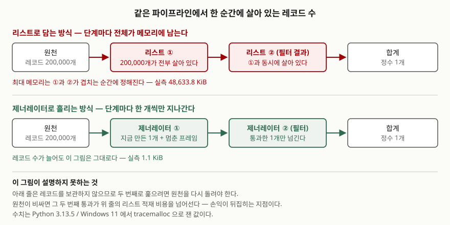

## 들어가며

로그 파일에서 오류 줄의 바이트 수를 합산하는 스크립트를 짠다고 하자. 손이 먼저 쓰는 모양은
대개 이렇다. 전부 읽어서 리스트에 담고, 거기서 오류 줄만 걸러 또 리스트에 담고, 합한다.
스무 줄짜리 파일로 테스트했을 때는 아무 문제가 없다.

그러다 운영 로그를 물린다. 20만 줄이다. 프로세스 메모리가 50 MiB 가까이 솟고,
동시에 몇 개를 돌리면 장비가 스왑을 시작한다. 여기서 보통 꺼내는 처방이
"리스트 컴프리헨션을 제너레이터 표현식으로 바꾸면 메모리를 아낀다"는 한 줄짜리 조언인데,
**얼마나 아끼는지**와 **언제 손해인지**는 거의 같이 말해 주지 않는다.
그래서 직접 재 봤다.

## 개념

리스트 컴프리헨션은 결과를 전부 만들어 메모리에 쌓는다. 제너레이터 표현식은 쌓지 않고
요청이 올 때마다 한 개씩 내놓는다. 제너레이터 표현식을 도입한 PEP 289는 이 차이를
"많은 경우 메모리에 전체 리스트를 만들 필요가 없고, 한 번에 하나씩만 순회하면 된다"는
뜻으로 적는다.

재는 도구는 `tracemalloc` 이다. 공식 문서는 이 모듈을 "파이썬이 할당한 메모리 블록을
추적하는 디버그 도구"라고 정의하고, `get_traced_memory()` 가 현재 크기와 **최대 크기**를
한 쌍으로 돌려준다고 적는다. 최대 크기가 중요하다. 끝나고 남은 양이 아니라
**중간에 가장 많이 들고 있던 순간**이 장비를 터뜨리기 때문이다.

주의할 점이 하나 있다. `tracemalloc` 이 세는 것은 파이썬이 잡은 메모리뿐이다.
인터프리터 자체나 C 확장이 직접 잡은 메모리는 빠지므로 프로세스의 RSS 와는 다른 값이다.
"이 코드가 무엇을 들고 있는가"를 보는 데는 맞고, 장비의 실제 사용량을 대신하지는 않는다.

## 구조



> **출처**: [PEP 289 — Generator Expressions, Rationale](https://peps.python.org/pep-0289/), [PEP 255 — Simple Generators, Specification: Yield](https://peps.python.org/pep-0255/), [tracemalloc — Trace memory allocations](https://docs.python.org/3/library/tracemalloc.html)

## 동작 원리

차이를 만드는 것은 **한 순간에 몇 개가 살아 있는가**다.

리스트로 담으면 단계마다 결과가 통째로 남는다. 원본 리스트를 다 만든 다음 필터 결과
리스트를 만들므로, 최대 메모리는 둘이 겹치는 순간에 정해진다. 필터가 아무리 많이
걸러 내도 원본은 그대로 살아 있다.

제너레이터로 흘리면 각 단계가 들고 있는 것은 지금 지나가는 레코드 하나와 멈춰 있는
실행 상태뿐이다. 제너레이터를 도입한 PEP 255는 `yield` 에서 함수의 상태가 얼어붙고
지역 변수의 현재 바인딩과 명령 포인터를 포함한 모든 지역 상태가 유지된다고 적는다.
유지되는 것은 그 한 틀이지 지나간 레코드가 아니다.
레코드 수가 20만이든 2천만이든 이 그림은 바뀌지 않는다.

대신 잃는 것이 있다. **흘려보낸 것은 남지 않는다.** 두 번째로 훑어야 하면 원천을
다시 돌리거나, 어디엔가 보관해 두어야 한다. 이 지점이 손익을 가른다.

## 실습 예제

레코드 20만 개(키 3개짜리 dict)를 만들어 오류 줄의 바이트를 합산했다. 전체 소스는
[`code/generator_memory.py`](code/generator_memory.py) 에, 아래 출력을 그대로 담은
수행 기록은 [`code/output.txt`](code/output.txt) 에 있다.

```python
def with_list() -> int:
    records = [r for r in make_records(RECORD_COUNT)]
    errors = [r for r in records if r["level"] == "ERROR"]
    return sum(r["bytes"] for r in errors)

def with_generator() -> int:
    records = make_records(RECORD_COUNT)
    errors = (r for r in records if r["level"] == "ERROR")
    return sum(r["bytes"] for r in errors)
```

### 한 번만 훑을 때

```text
  리스트로 전부 담고 처리                          최대   48,633.8 KiB     303.5 ms
  제너레이터로 흘리며 처리                          최대        1.1 KiB     121.2 ms
  두 방식의 결과가 같은가: True  (합계 14,211,642)
  최대 메모리 비율: 42,931.9배
```

메모리는 4만 배 넘게 갈린다. 조언이 말하던 그대로다. 같이 눈에 띄는 것은 시간인데,
제너레이터 쪽이 2.5배 빠르다. 리스트 20만 칸을 늘려 가며 할당하는 비용이
한 개씩 흘리는 비용보다 크다.

### 두 번 훑어야 할 때 — 여기서 예상이 빗나갔다

합계를 구한 뒤 그 평균을 넘는 레코드 수를 세는, 두 번 훑어야 하는 작업으로 바꿨다.
제너레이터는 한 번 소진되면 다시 못 쓰므로 원천을 새로 만들어야 한다.
**그 두 번째 통과 비용 때문에 제너레이터가 느릴 것**이라고 보고 쟀는데, 결과는 반대였다.

```text
  리스트로 담고 두 번 훑기                         최대   48,387.3 KiB     297.4 ms
  제너레이터를 두 번 만들기                         최대        0.8 KiB     239.3 ms
  itertools.tee 로 갈라 쓰기                  최대   48,556.1 KiB     309.9 ms
  세 방식의 결과가 같은가: True  (99480900, 99902)
  리스트 대비 소요 시간 — 재생성 0.80배 · tee 1.04배
```

두 번 생성하고도 20% 빨랐다. 원천이 `range` 위의 dict 생성이라 한 번 더 도는 비용이
리스트 20만 칸을 적재하는 비용보다 쌌기 때문이다. 손해의 조건은 "두 번 훑는다"가
아니라 **"원천이 비싸다"** 였다.

`tee` 는 메모리 이점을 통째로 잃었다. 첫 번째 이터레이터가 데이터를 다 쓴 뒤에야
두 번째가 시작하므로 그 사이의 값을 전부 버퍼에 쌓는다. 공식 문서도 이 도구가
"상당한 보조 저장 공간을 요구할 수 있다"고 적으며, 한쪽이 데이터 대부분을
먼저 써 버리는 경우에는 `tee` 보다 `list()` 가 빠르다고 안내한다.

### 원천이 비싸지면 뒤집힌다

레코드 하나를 만들 때 약간의 계산이 붙도록 바꾸고(파싱·복호화·원격 호출 자리로 보면 된다)
같은 비교를 했다.

```text
  리스트로 담고 두 번 훑기                         최대   11,355.5 KiB     351.9 ms
  제너레이터를 두 번 만들기                         최대        1.5 KiB     599.8 ms
  두 방식의 결과가 같은가: True  (12327850, 13732)
  리스트 대비 소요 시간 — 재생성 1.70배
  리스트 대비 최대 메모리 — 재생성 0.00013배
```

같은 코드 모양인데 0.80배에서 1.70배로 뒤집혔다. 메모리는 여전히 1만분의 1 수준이다.
**시간을 1.7배 내주고 메모리를 1만분의 1로 줄이는 거래**가 맞는지는 상황이 정한다.
배치 작업이라면 당연히 맞고, 응답 시간이 걸린 경로라면 아니다.

### 제너레이터 객체 자체의 크기

```text
  제너레이터 객체     sys.getsizeof = 216 바이트
  dict 한 개          sys.getsizeof = 184 바이트
  빈 리스트           sys.getsizeof = 56 바이트
  200,000칸 리스트  sys.getsizeof = 1,600,056 바이트  (칸만 센 값. 안에 든 dict 는 따로다)
```

20만 칸 리스트의 1.6 MB 는 **포인터만 센 값**이다. 실측 48 MiB 와의 차이가 안에 든
dict 20만 개다. `sys.getsizeof` 로 컨테이너 크기를 재고 "리스트가 1.6 MB밖에 안 되네"라고
읽으면 두 자릿수를 놓친다.

## 실무에서 주의할 점

**`len()` 이 필요하면 제너레이터로는 안 된다.** 길이를 알려면 끝까지 소진해야 하고,
소진하면 데이터가 사라진다. 위 예제의 리스트 판은 `len(records)` 로 평균을 구했지만
제너레이터 판은 개수를 상수로 따로 들고 있어야 했다. 평균·중앙값·분위수처럼
전체를 봐야 나오는 통계는 이 제약에 바로 걸린다.

**`tee` 는 메모리 대책이 아니다.** 두 이터레이터가 비슷한 속도로 나란히 나아갈 때만
버퍼가 작게 유지된다. 한쪽을 먼저 다 돌리는 흔한 패턴에서는 전부 쌓이므로,
그럴 바에는 처음부터 `list()` 로 받는 편이 낫다고 공식 문서가 적는다.

**`tracemalloc` 자체가 비용이다.** 추적을 켜면 모든 할당에 후처리가 붙어 느려진다.
측정 코드를 그대로 운영에 두지 않는다. 시간을 재는 구간과 메모리를 재는 구간을
같은 실행에서 재면 시간 쪽이 오염되므로, 둘 중 하나만 보고 싶을 때는 나눠서 돌린다.

**예외가 중간에 나면 그때까지의 작업이 사라진다.** 리스트 판은 재료가 남아 있어
다시 걸러 볼 수 있지만, 제너레이터 판은 이미 흘려보낸 것을 되찾을 수 없다.
부분 실패를 복구해야 하는 파이프라인이면 중간 결과를 어딘가에 적어 두는 설계가 필요하다.

## 정리

- 제너레이터가 아끼는 것은 **최대 메모리**다. 같은 처리에서 48,633 KiB 대 1.1 KiB 가 나왔다
- 한 번만 훑는 작업이면 메모리도 시간도 제너레이터가 낫다. 리스트 적재 비용이 공짜가 아니다
- 두 번 훑는다고 바로 손해가 아니다. 손익은 **원천을 다시 만드는 비용**이 가른다.
  싼 원천에서는 0.80배(이득), 비싼 원천에서는 1.70배(손해)가 나왔다
- `itertools.tee` 는 한쪽을 먼저 소진하는 패턴에서 메모리 이점을 전부 잃는다
- `len()`·평균·분위수가 필요하면 어디선가는 전체를 들고 있어야 한다

## 참고 자료

- [PEP 289 — Generator Expressions](https://peps.python.org/pep-0289/) — Rationale 절의 메모리 절약 근거
- [PEP 255 — Simple Generators](https://peps.python.org/pep-0255/) — 제너레이터가 프레임을 멈추고 재개하는 방식
- [tracemalloc — Trace memory allocations](https://docs.python.org/3/library/tracemalloc.html) — `get_traced_memory()` 의 반환값
- [itertools.tee](https://docs.python.org/3/library/itertools.html#itertools.tee) — 보조 저장 공간과 `list()` 권고
- [sys.getsizeof](https://docs.python.org/3/library/sys.html#sys.getsizeof) — 컨테이너가 참조하는 객체는 세지 않는다
