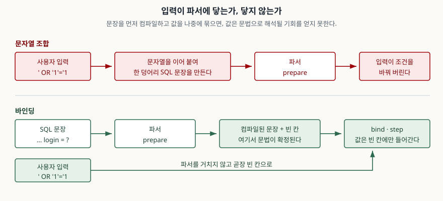

## 들어가며

개인 프로젝트로 만든 게시판이든 사내 관리 도구든, 검색창 하나를 붙이는 일은
보통 이렇게 시작한다. 입력값을 받아 질의문 문자열에 끼워 넣는다. f-string 한 줄이면
끝나고, 테스트해 보면 잘 돈다.

그러다 어느 날 이름에 아포스트로피가 들어간 사람이 가입한다. `O'Brien`. 검색이
문법 오류로 터진다. 이때 대부분이 택하는 수습은 따옴표를 두 개로 바꾸는 것이다.
`value.replace("'", "''")` 한 줄. 오류가 사라지고 테스트가 통과한다.

문제는 이 수습이 **공격의 일부만** 막는다는 것이다. 막힌 쪽만 보고 안심하면,
안 막힌 쪽은 발견될 때까지 열려 있다. 아래는 같은 입력을 세 가지 코드에 넣어
돌려 본 기록이다.

## 개념

SQL 인젝션은 "사용자가 넣은 값이 데이터가 아니라 **문법**으로 해석되는 것"이다.
핵심은 따옴표가 아니다. 따옴표는 값과 문법을 가르는 여러 경계 중 하나일 뿐이다.

이스케이프는 **경계 문자를 무력화하는 접근**이다. 따옴표가 경계라면 따옴표를 고친다.
그러면 따옴표가 경계가 아닌 자리에서는 아무 일도 하지 않는다.

바인딩은 **경계를 아예 없애는 접근**이다. 값이 들어갈 자리를 문장 안에 표시해 두고,
문장을 먼저 컴파일한 뒤 값을 따로 넘긴다. 값은 파서를 거치지 않으므로 문법이 될
기회 자체가 없다.

## 구조



> **출처**: [SQLite C Interface — Prepared Statement Object, 생애주기 5단계](https://www.sqlite.org/c3ref/stmt.html) · [SQLite Expressions §4 Parameters](https://www.sqlite.org/lang_expr.html#parameters)

SQLite의 준비된 문장(prepared statement) 생애주기는 다섯 단계다.
`sqlite3_prepare_v2()`로 문장을 만들고 → `sqlite3_bind_*()`로 값을 묶고 →
`sqlite3_step()`으로 실행하고 → `sqlite3_reset()`으로 되돌리고 →
`sqlite3_finalize()`로 버린다. 파싱이 **1단계**, 값 전달이 **2단계**다.
순서가 뒤집히지 않는다는 것이 보장의 근거다.

표현식 문서의 파라미터 항목(§4)은 `?`를 "실행 시점에 채워지는 값의 자리표시자"로
정의한다. SQL 텍스트 안에 값을 담지 않는다고 못 박는다.

## 동작 원리

왜 이스케이프가 부분적으로만 듣는지는 "경계가 어디인가"로 설명된다.

문자열 리터럴 자리에서는 작은따옴표가 경계다. 그래서 `''`로 바꾸면 값 안의 따옴표가
리터럴의 일부가 되고 공격 문자열이 그냥 긴 이름이 된다.

숫자 자리에는 그 경계가 없다. `WHERE member_id = 0 OR 1=1`에는 따옴표가 하나도
없고, 따옴표를 아무리 고쳐도 `OR`은 그대로 남는다. 정렬 컬럼이나 테이블 이름을
문자열로 끼워 넣는 자리도 마찬가지다. **이스케이프는 자기가 아는 경계에서만 작동한다.**

## 실습 예제

전체 소스: [`code/`](code/) · 돌린 기록: [`code/output.txt`](code/output.txt)

가상의 `member` 표에 네 행을 넣고 같은 입력을 세 가지 코드에 넣었다.

**1. 문자열 조합 + `' OR '1'='1`**

```text
  SQL   : SELECT login, role FROM member WHERE login = '' OR '1'='1'
  결과  : 4행 [('kim', 'admin'), ('lee', 'member'), ('park', 'member'), ('choi', 'member')]
```

이름 하나를 찾는 질의가 표 전체를 돌려줬다.

**2. 이스케이프 + 같은 입력**

```text
  이스케이프 결과: "'' OR ''1''=''1"
  SQL   : SELECT login, role FROM member WHERE login = ''' OR ''1''=''1'
  결과  : 0행 []
```

막혔다. 여기까지만 보면 이스케이프로 충분해 보인다.

**3. 이스케이프 + 숫자 자리**

```text
  입력  : '0 OR 1=1'  (이스케이프해도 그대로: '0 OR 1=1')
  SQL   : SELECT login, role FROM member WHERE member_id = 0 OR 1=1
  결과  : 4행 [('kim', 'admin'), ('lee', 'member'), ('park', 'member'), ('choi', 'member')]
```

같은 이스케이프 함수를 그대로 통과했는데 다시 뚫렸다. 입력에 따옴표가 없으니
고칠 것도 없었던 것이다.

**4. 바인딩 — 세 입력 모두**

```text
  SQL   : SELECT login, role FROM member WHERE login = ?
  바인딩: ("' OR '1'='1",)
  결과  : 0행 []

  SQL   : SELECT login, role FROM member WHERE member_id = ?
  바인딩: ('0 OR 1=1',)
  결과  : 0행 []
```

`'0 OR 1=1'`이라는 이름의 회원이 없으니 0행이다. 공격 문자열이 **그냥 찾는 값**이
됐다. 막은 것이 아니라 공격이 성립할 자리를 없앤 것이다.

### 곁가지로 확인된 것 하나

`"x'; DROP TABLE member; --"`를 넣었더니 파이썬 `sqlite3`는 다른 데서 멈췄다.

```text
  결과  : ProgrammingError: You can only execute one statement at a time.
```

`execute()`가 한 문장만 받기 때문이다. 이것을 보고 "우리 코드는 안전하다"고
읽으면 안 된다. 2번과 3번처럼 **한 문장 안에서 조건만 바꾸는** 공격은 그대로 통하고,
값을 훔쳐 가는 쪽은 대부분 그 방식이다.

## 실무에서 주의할 점

- **식별자는 바인딩되지 않는다.** `ORDER BY ?`는 에러도 안 나고 정렬도 안 된다.
  바인딩된 값이 컬럼이 아니라 문자열 상수 하나로 해석되어 모든 행의 정렬 키가
  같아지기 때문이다. `FROM ?`은 아예 구문 오류다. 테이블·컬럼 이름이 입력에서
  와야 하면 **허용 목록으로 거른 뒤** 문자열에 넣는다. 이스케이프로 처리하지 않는다.
- **ORM을 쓴다고 자동으로 안전하지 않다.** 대부분의 ORM이 raw SQL 통로를 열어 두고,
  거기서 f-string을 쓰면 결과는 같다. `LIKE` 패턴을 조립하는 자리, `IN (...)` 목록을
  문자열로 만드는 자리가 특히 자주 샌다.
- **`IN` 목록은 개수만큼 `?`를 만든다.** `",".join("?" * len(values))`로 자리표시자를
  먼저 만들고 값을 묶는다. 값 자체를 join 하지 않는다.
- **입력 검증은 바인딩의 대체재가 아니다.** 길이 제한이나 문자 종류 검사는 해 두면
  좋지만, 그것만으로 막겠다는 선택은 "무엇이 위험한지 전부 알고 있다"는 가정에 기댄다.
  바인딩은 그 가정이 필요 없다.
- **에러 메시지를 그대로 노출하지 않는다.** 질의문이 섞인 오류 문구는 공격자에게
  스키마를 알려 준다. 로그에는 남기고 화면에는 일반 문구를 돌려준다.
- **계정 권한을 줄여 둔다.** 애플리케이션 계정에 `DROP` 권한이 없으면 같은 결함이
  훨씬 덜 아프다. 바인딩이 1차 방어이고 이쪽은 피해 범위를 줄이는 2차 방어다.

## 정리

- SQL 인젝션은 값이 문법으로 해석되는 문제다. 따옴표는 그 경계의 하나일 뿐이다.
- 이스케이프는 자기가 아는 경계에서만 작동한다. 숫자 자리, 식별자 자리는 닿지 않는다.
- 바인딩은 문장을 먼저 컴파일하고 값을 나중에 묶는다. 값이 파서를 지나지 않는다.
- 식별자는 바인딩할 수 없으므로 허용 목록으로 처리한다.
- `execute()`가 다중 문장을 막는 것은 방어가 아니다. 조건을 바꾸는 공격은 그대로 통한다.

## 참고 자료

- [SQLite C Interface — Prepared Statement Object](https://www.sqlite.org/c3ref/stmt.html)
- [SQLite — SQL Language Expressions §4 Parameters](https://www.sqlite.org/lang_expr.html#parameters)
- [Python 3.13 — sqlite3, Placeholders and SQL injection](https://docs.python.org/3/library/sqlite3.html#how-to-use-placeholders-to-bind-values-in-sql-queries)
- [OWASP — SQL Injection Prevention Cheat Sheet](https://cheatsheetseries.owasp.org/cheatsheets/SQL_Injection_Prevention_Cheat_Sheet.html)
