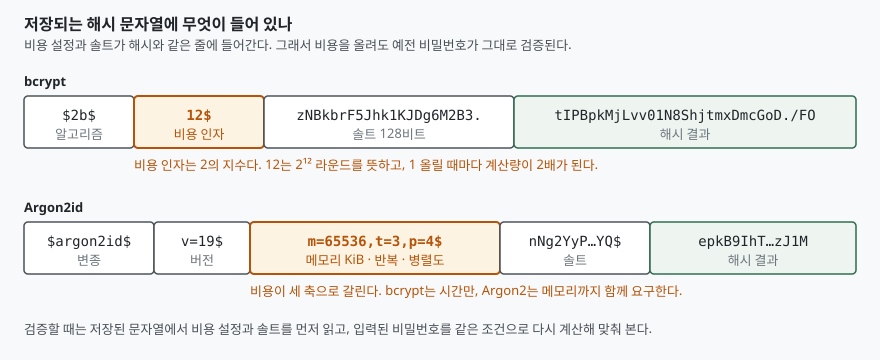

## 들어가며

회원가입을 받는 토이 프로젝트를 만들다 보면 비밀번호를 어디에 어떻게 넣을지 정해야
하는 순간이 온다. 평문으로 넣으면 안 된다는 것까지는 다들 안다. 그래서 대개
`hashlib.sha256(password.encode()).hexdigest()` 를 쓰고, 조금 더 아는 사람은
솔트를 앞에 붙인다. 한 줄로 끝나고, 빠르고, 되돌릴 수도 없으니 충분해 보인다.

여기서 빠진 것이 "빠르다"가 왜 단점인가다. 공격자는 유출된 해시 목록을 들고 후보
비밀번호를 하나씩 넣어 보는데, 이때 **해시 한 번이 빠를수록 1초에 더 많이 시도한다.**
아래에서 재 보면 이 환경의 SHA-256은 초당 260만 번이다. 흔한 비밀번호 1,000만 개
목록을 전부 훑는 데 4초가 걸린다는 뜻이다. 비밀번호 해시 전용 알고리즘은
이 숫자를 의도적으로 몇 자릿수 끌어내린다.

## 개념

일반 해시 함수(SHA-256, SHA-3)는 **빠르게 설계된다.** 파일 무결성 검사나 서명처럼
대량의 데이터를 한 번에 처리해야 하는 용도가 본령이기 때문이다.

비밀번호 해시 함수는 반대 방향으로 설계된다. 셋을 요구한다.

- **솔트**: 사용자마다 다른 무작위 값을 섞어, 미리 계산해 둔 표(레인보우 테이블)와
  해시 하나로 여러 계정을 동시에 뚫는 것을 막는다
- **조절 가능한 비용**: 하드웨어가 빨라지면 설정만 올려 대응할 수 있어야 한다
- **메모리 요구**(Argon2 계열): 계산량뿐 아니라 메모리도 요구해, 메모리가 적은
  연산 장치를 대량으로 붙이는 공격을 비싸게 만든다

솔트는 **공격 비용을 곱하지 않고 나눠 준다.** 해시 하나를 깨는 비용은 그대로인데,
같은 해시로 여러 계정을 한꺼번에 뚫지 못하게 될 뿐이다. 아래 측정에서 솔트를 붙인
SHA-256이 안 붙인 것보다 1.1배밖에 안 느린 이유다. **느리게 만드는 일은 솔트가
아니라 비용 인자가 한다.**

## 구조

bcrypt와 Argon2가 저장하는 것은 해시 값만이 아니다. 어떤 설정으로 계산했는지가
같은 문자열에 함께 들어간다.



> **출처**: [RFC 9106 §3.1 Argon2 Inputs and Outputs](https://www.rfc-editor.org/rfc/rfc9106.html#section-3.1), [P-H-C/phc-winner-argon2 — Argon2 레퍼런스 구현의 인코딩 예시](https://github.com/P-H-C/phc-winner-argon2), [OpenBSD crypt_newhash(3) — rounds는 2의 로그값](https://man.openbsd.org/crypt_newhash.3)

이 구조가 중요한 이유가 있다. 2년 뒤 하드웨어가 빨라져 비용 인자를 12에서 14로 올리고
싶어졌다고 하자. 기존 사용자의 해시는 여전히 `$2b$12$` 로 시작하므로, 검증할 때
**그 문자열에 적힌 12를 읽어** 같은 조건으로 계산한다. 로그인에 성공한 순간 새 비용으로
다시 해시해 덮어쓰면, 사용자가 들어올 때마다 조금씩 올라간다. 비용을 바꿀 때마다
전체 사용자 비밀번호를 리셋해야 한다면 아무도 비용을 올리지 않을 것이다.

## 동작 원리

bcrypt의 비용 인자는 **라운드 수가 아니라 2의 지수**다. OpenBSD `crypt_newhash(3)` 는
이 값을 "라운드 수의 밑 2 로그"로 정의한다. 12는 2¹² = 4,096 라운드를 뜻하고,
13으로 올리면 8,192 라운드가 된다.

Argon2는 비용이 세 축으로 갈린다. RFC 9106의 **입출력 정의 절**(§3.1)이 다음 셋을 정한다.

| 파라미터 | 뜻 | 올리면 |
|---|---|---|
| `m` (memory size) | 쓰는 메모리, KiB 단위 | 공격 장치의 메모리 요구가 커진다 |
| `t` (number of passes) | 메모리를 훑는 횟수 | 메모리 크기와 무관하게 시간만 늘릴 수 있다 |
| `p` (degree of parallelism) | 동시에 도는 레인 수 | 같은 시간에 더 많은 메모리를 요구할 수 있다 |

RFC 9106의 **서론**(§1)은 Argon2id를 "모든 구현이 지원해야 하는(MUST)" 변종으로 두고,
Argon2d와 Argon2i는 선택(MAY)으로 둔다. Argon2id는 첫 패스의 전반부를 데이터 비의존
방식(Argon2i)으로, 나머지를 데이터 의존 방식(Argon2d)으로 돈다.

## 실습 예제

전체 소스: [`code/`](code/) · 실행 기록: [`code/output.txt`](code/output.txt)

```python
cases = [
    ("SHA-256 (솔트 없음)", FAST_ROUNDS, lambda: hashlib.sha256(PASSWORD).digest()),
    ("SHA-256 + 솔트", FAST_ROUNDS, lambda: hashlib.sha256(salt + PASSWORD).digest()),
    ("PBKDF2-HMAC-SHA256 600k", SLOW_ROUNDS,
     lambda: hashlib.pbkdf2_hmac("sha256", PASSWORD, salt, 600_000)),
    ("bcrypt cost=12", SLOW_ROUNDS, lambda: bcrypt.hashpw(PASSWORD, bcrypt_salts[12])),
    ("argon2id 기본값", SLOW_ROUNDS, lambda: argon_default.hash(PASSWORD)),
]
```

```text
  알고리즘                           측정 횟수      총 초      1회 마이크로초         초당 횟수
  ------------------------------------------------------------------------
  SHA-256 (솔트 없음)          200,000    0.076           0.4     2,616,948
  SHA-256 + 솔트               200,000    0.084           0.4     2,382,561
  PBKDF2-HMAC-SHA256 600k           20    4.053     202,636.2             5
  bcrypt cost=8                     20    0.286      14,281.8            70
  bcrypt cost=10                    20    1.184      59,213.0            17
  bcrypt cost=12                    20    4.746     237,291.9             4
  argon2id 기본값                   20    1.386      69,277.9            14
  argon2id 8MiB·1회                 20    0.156       7,808.5           128
```

초당 260만 번이 **초당 4번**이 된다. bcrypt cost=12는 SHA-256보다 62만 배 느리다.
앞에서 든 1,000만 개 목록을 생각하면, SHA-256으로 4초면 끝나던 것이
bcrypt cost=12에서는 같은 장비로 29일이 걸린다.

**비용 인자가 2의 지수라는 설명이 측정으로 확인된다.** cost=8의 14.3ms가 cost=10에서
59.2ms(4.1배), cost=12에서 237.3ms(4.0배)가 됐다. 2씩 올릴 때마다 4배, 즉 1 올릴 때마다
2배다. 설명과 측정이 맞는지를 이렇게 직접 볼 수 있다.

예상과 달랐던 것은 **Argon2id 기본값이 bcrypt cost=10과 거의 같은 시간**(69.3ms 대
59.2ms)에 들어온 점이다. 메모리 64MiB를 쓰는데도 그렇다. 걸린 시간이 비슷하다고 보호
수준이 같은 것은 아니다. bcrypt의 바탕인 Blowfish 키 스케줄은 원논문의 표현대로
"S-Box가 4KB의 계속 접근·수정되는 메모리를 요구"하는 정도인 반면, Argon2id 기본값은
한 번 계산할 때마다 64MiB를 요구한다. 공격자가 전용 장치를 1,000개 병렬로 돌리려면
Argon2id 쪽은 메모리가 64GB 필요하고, bcrypt 쪽은 수 MB면 된다. **같은 시간에 서로 다른
자원을 요구한다**는 것이 Argon2의 설계 의도다.

마지막 줄은 그 점을 뒤집어 보인 것이다. 메모리를 64MiB에서 8MiB로 줄이고 반복을 3에서
1로 낮추자 초당 14번이 128번이 됐다. **파라미터를 임의로 낮추면 알고리즘 이름만 남는다.**

측정된 argon2-cffi의 기본값은 `m=65536`(64MiB), `t=3`, `p=4` 였다. RFC 9106의
**파라미터 선택 절**(§4)이 드는 **두 번째 권장안**(t=3, p=4, m=2¹⁶ KiB)과 정확히 같다. 라이브러리 기본값을 그냥 쓰는 것이
이 경우에는 표준 권장안을 따르는 것이 된다.

## 실무에서 주의할 점

**bcrypt는 입력을 72바이트까지만 본다.** 그보다 긴 비밀번호는 뒷부분이 무시된다.
OWASP 비밀번호 저장 지침은 이 때문에 72바이트 상한을 명시적으로 강제하라고 권고한다.
긴 비밀번호를 받아 놓고 뒤를 잘라 버리면, 사용자는 더 안전해졌다고 믿지만 실제로는
아니다. 이를 우회하려고 비밀번호를 미리 SHA-256으로 줄여 bcrypt에 넣는 방식이 흔히
쓰이는데, 같은 지침은 해시 결과의 널 바이트 문제와 "password shucking" 때문에
**위험하다**고 경고한다.

**비용은 서버의 로그인 처리량과 맞바꾸는 것이다.** cost=12면 로그인 한 번에 237ms가
든다. 초당 100명이 동시에 로그인하는 서비스라면 이 계산에만 코어 24개가 필요하다.
비용을 정할 때는 "얼마나 안전한가"가 아니라 **"로그인 지연으로 얼마를 쓸 수 있는가"**
에서 거꾸로 내려오는 편이 현실적이다. Argon2라면 메모리도 같이 계산해야 한다 —
동시 100건이면 64MiB × 100 = 6.4GiB다.

**측정은 그 장비의 숫자일 뿐이다.** 위 값은 일반 노트북 CPU에서 나온 것이고, 공격자는
GPU나 전용 하드웨어를 쓴다. SHA-256은 그런 장비에서 수십억 배로 벌어지고, Argon2는
메모리 요구 때문에 덜 벌어진다. **알고리즘을 고르는 근거는 내 장비의 절대 속도가 아니라
공격 장비에서의 비용 구조**다.

**이미 SHA-256으로 저장해 둔 것이 있다면 전체를 한 번에 옮기지 않아도 된다.** 기존
해시를 bcrypt로 한 겹 더 감싸 저장해 두고(`bcrypt(sha256_hash)`), 로그인에 성공할 때
새 방식으로 다시 저장하는 방법이 쓰인다. 다만 이 중첩은 위에 적은 널 바이트·shucking
문제를 그대로 안고 가므로, 쓴다면 중간 단계를 평문 해시가 아니라 **페퍼를 키로 쓴
HMAC**으로 두라는 것이 OWASP의 권고다.

## 정리

- 비밀번호 해시가 느려야 하는 이유는 공격자의 **초당 시도 횟수**가 그 속도에 반비례하기
  때문이다. 이 환경에서 SHA-256은 초당 260만 번, bcrypt cost=12는 초당 4번이었다.
- **느리게 만드는 것은 솔트가 아니라 비용 인자다.** 솔트를 붙인 SHA-256은 안 붙인 것보다
  1.1배 느렸을 뿐이다. 솔트의 역할은 해시 하나로 여러 계정을 뚫는 것을 막는 데 있다.
- bcrypt의 비용 인자는 2의 지수다. 1 올릴 때마다 계산량이 2배가 되는 것을 측정으로
  확인했다(cost 8→10→12에서 각각 4.1배, 4.0배).
- Argon2는 시간뿐 아니라 메모리를 요구한다. 걸린 시간이 bcrypt와 비슷해도 공격 장치에
  요구하는 자원이 다르다. 파라미터를 낮추면 그 차이가 사라진다.
- 비용 설정이 해시 문자열에 함께 저장되므로, 나중에 비용을 올려도 기존 해시가 그대로
  검증된다. 이것이 비용을 "조절 가능"하게 만드는 장치다.

## 참고 자료

- [RFC 9106 — Argon2 Memory-Hard Function for Password Hashing and Proof-of-Work Applications](https://www.rfc-editor.org/rfc/rfc9106.html) — §1 변종, §3.1 파라미터, §4 권장 설정
- [P-H-C/phc-winner-argon2 — Argon2 레퍼런스 구현](https://github.com/P-H-C/phc-winner-argon2) — 인코딩된 해시 문자열 예시
- [OpenBSD — crypt_newhash(3)](https://man.openbsd.org/crypt_newhash.3) — bcrypt rounds가 2의 로그값이라는 정의
- [Provos & Mazières — A Future-Adaptable Password Scheme (USENIX 1999)](https://www.usenix.org/legacy/events/usenix99/provos/provos_html/) — bcrypt 원논문, 128비트 솔트와 비용 저장, Blowfish S-Box의 4KB 메모리
- [OWASP — Password Storage Cheat Sheet](https://cheatsheetseries.owasp.org/cheatsheets/Password_Storage_Cheat_Sheet.html) — 알고리즘 선택 순서, bcrypt 72바이트 상한, 사전 해시 경고
- [Python — hashlib.pbkdf2_hmac](https://docs.python.org/3/library/hashlib.html#hashlib.pbkdf2_hmac)
