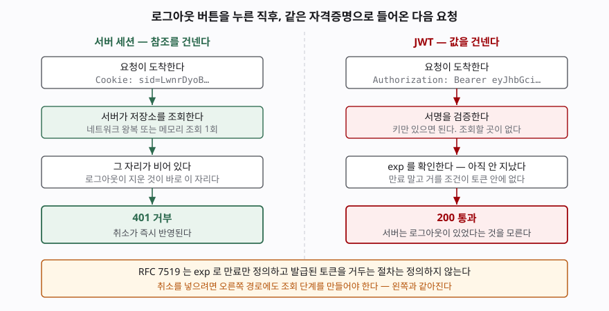

## 들어가며

로그인을 처음 붙일 때 JWT를 고르는 이유는 대개 비슷하다. 서버에 세션 저장소를
따로 두지 않아도 되고, 서버를 여러 대로 늘려도 세션을 공유할 걱정이 없다.
토큰 하나만 검증하면 끝이니 코드도 짧다. 여기까지는 전부 맞는 말이다.

그러다 운영 몇 달째에 문의가 들어온다. **"방금 탈퇴 처리한 계정이 아직
글을 쓰고 있다."** 또는 **"비밀번호를 바꿨는데 도난당한 세션이 그대로 살아
있다."** 로그를 봐도 이상한 것이 없다. 서명도 맞고 만료도 안 됐으니 서버
입장에서는 정상 요청이다.

이때 흔히 택하는 수습이 거부 목록을 Redis에 올리는 것이다. 한 시간이면
붙는다. 그런데 그 한 시간이 지나면 **처음에 JWT를 고른 이유가 절반쯤
사라져 있다.** 무엇을 내주고 무엇을 되돌려 받은 것인지, 직접 돌려 가며
세어 봤다.

## 개념

차이는 한 줄로 끊어진다. **세션은 참조를 건네고, JWT는 값을 건넨다.**

세션 방식에서 클라이언트가 들고 있는 것은 32바이트짜리 식별자다. 그 자체로는
아무 뜻이 없고, 서버가 자기 저장소에서 찾아봐야 누구인지 알 수 있다. 로그인
상태는 **서버에 있다.**

JWT 방식에서 클라이언트가 들고 있는 것은 주장(claim)이 담긴 데이터 자체다.
"나는 kim이고 역할은 admin이다"가 토큰 안에 적혀 있고, 서명이 그것을 위조하지
못하게 묶는다. 로그인 상태는 **클라이언트에 있다.**

여기서 따라오는 결론이 이 글의 전부다. 값을 이미 건네줬으면 **되돌려 받을
방법이 없다.** 서버가 할 수 있는 일은 "언제까지만 유효하다"고 미리 적어
보내는 것뿐이다.

## 구조

로그아웃 버튼을 누른 직후, 같은 자격증명으로 들어온 요청이 어떻게 처리되는지
나란히 보면 이렇다.



> **출처**: [RFC 7519 §4.1.4 "exp" (Expiration Time) Claim](https://www.rfc-editor.org/rfc/rfc7519.html#section-4.1.4) · [RFC 7519 §7.2 Validating a JWT](https://www.rfc-editor.org/rfc/rfc7519.html#section-7.2)

왼쪽에서 로그아웃은 **저장소의 한 자리를 지우는 일**이다. 다음 요청이 그
자리를 읽으러 오고, 비어 있으니 거부된다. 취소가 즉시 반영된다.

오른쪽에서 로그아웃은 **클라이언트가 토큰을 버리는 일**이다. 서버는 아무것도
하지 않는다. 그래서 버려지지 않은 사본이 하나라도 남아 있으면 그것은 계속
유효하다.

## 동작 원리

RFC 7519의 검증 절차(§7.2)는 파싱, JOSE 헤더 확인, 서명 검증, 클레임 집합
파싱으로 이루어진다. **여기에 "이 토큰이 아직 거둬지지 않았는가"를 묻는
단계는 없다.** 만료는 `exp` 클레임(§4.1.4)이 "이 시각 이후로는 처리를 위해
받아들여서는 안 된다"고 정의하고, 그것이 전부다.

`jti` 클레임(§4.1.7)이 있긴 하다. 명세는 이것을 "JWT의 고유 식별자"로 정의하고
재전송 방지에 쓸 수 있다고 적지만, **그 검사를 어떻게 구현하는지는 정의하지
않는다.** 식별자를 어디에 모아 두고 요청마다 대조할지는 전부 애플리케이션
몫이다. 즉 명세 차원에서 **취소 절차는 없다.**

그래서 "서명이 유효하다"와 "이 토큰을 아직 받아도 된다"가 다른 질문이 된다.
JWT 검증은 앞의 질문에만 답한다. 뒤의 질문에 답하려면 **토큰 바깥의 상태를
읽어야 하고, 그 순간 무상태가 아니게 된다.**

## 실습 예제

전체 소스: [`code/`](code/) · 돌린 기록: [`code/output.txt`](code/output.txt)

**1. 로그아웃 직후의 다음 요청**

```text
  [세션] 로그아웃 -> 서버에서 세션을 지운다
  [세션] 요청     -> None

  [JWT ] 로그아웃 -> 클라이언트가 토큰을 버린다. 서버는 할 일이 없다
  [JWT ] 요청     -> {'sub': 'kim', 'role': 'admin', 'iat': ..., 'exp': ...}
    (그대로 통과한다. exp 까지 899초 남았다)
```

15분짜리 토큰이면 로그아웃 뒤 **최대 15분간 유효하다.** 사용자는 로그아웃
버튼을 눌렀고 화면도 로그인 화면으로 돌아갔지만, 토큰 사본을 가진 쪽은
그대로 들어온다.

**2. 권한을 내렸을 때도 같다**

```text
  [세션] 강등 후 요청 -> {'user': 'kim', 'role': 'member'}
  [JWT ] 강등 후 요청 -> role=admin
```

관리자에서 일반 사용자로 내렸는데 토큰에 박힌 `role`은 `admin` 그대로다.
**이쪽이 로그아웃보다 위험하다.** 로그아웃은 사용자가 의도한 동작이지만
권한 강등은 보통 사고 대응이고, 그때 15분은 길다.

**3. 보완책 세 가지 — 각각 무엇을 내주는가**

```text
  (가) 거부 목록(jti)  -> 서명 통과: True · 거부 목록에 있음: True
       되돌려 받는 것: 즉시 취소
       내주는 것: 매 요청마다 저장소 조회. 무상태가 아니게 된다

  (나) 짧은 수명(1초)  -> 발급 직후 True · 1.2초 뒤 False
       되돌려 받는 것: 취소가 반영되기까지의 창이 짧아진다
       내주는 것: 재발급 토큰을 서버가 보관해야 한다. 역시 상태다

  (다) 토큰 버전       -> 토큰 ver=1 · 현재 ver=2 · 낡은 토큰인가: True
       되돌려 받는 것: 사용자 단위 일괄 취소
       내주는 것: 매 요청마다 사용자 표 조회. 세션 조회와 같은 비용이다
```

세 가지가 다 작동한다. 다만 **셋 다 상태를 다시 들여온다.** (가)는 토큰 단위,
(다)는 사용자 단위로 조회할 뿐 조회가 생긴다는 점은 같다. (나)만 조회 없이
창을 줄이는데, 그 대신 재발급 토큰을 서버가 보관해야 하므로 결국 저장소가 는다.

**4. 검증 비용**

```text
  20000회 반복
    세션 조회(메모리 딕셔너리)  0.005초
    JWT 검증 HS256             0.202초
    JWT 검증 RS256             0.790초

  요청마다 실려 가는 크기
    세션 ID          32바이트
    JWT (HS256)     224바이트
    JWT (RS256)     440바이트
```

**여기가 예상과 달랐던 부분이다.** JWT 검증이 조회보다 쌀 것이라고 막연히
생각했는데, 메모리 조회의 40배(HS256), 160배(RS256)가 걸렸다.

다만 이 비교를 그대로 "세션이 빠르다"로 읽으면 안 된다. **실제 세션 저장소는
메모리 딕셔너리가 아니라 Redis나 DB이고, 거기에는 네트워크 왕복이 붙는다.**
요청당으로 환산하면 HS256 검증은 10마이크로초, RS256은 40마이크로초인데,
Redis 왕복은 보통 그보다 한 자릿수 크다. 그러니까 **JWT는 여전히 이 축에서
유리하다.** 틀린 것은 "검증이 공짜"라는 전제이지 방향이 아니다.

크기는 다른 이야기다. 32바이트가 224~440바이트가 되고, 이것이 **모든 요청의
헤더에 실린다.** 클레임을 몇 개 더 넣으면 쉽게 1KB를 넘어가고, 쿠키에 담는
경우 브라우저의 쿠키 크기 제한에 걸린다.

**5. `alg`를 `none`으로 바꾼 토큰**

```text
  algorithms=['HS256'] 으로 검증:
    거부: InvalidAlgorithmError: The specified alg value is not allowed
```

PyJWT 2.10.1은 허용 목록에 없는 알고리즘을 거부한다. 다만 이것은 **`decode`에
`algorithms`를 명시했을 때**의 이야기다. 토큰이 들고 온 `alg`를 그대로
믿는 코드는 이 방어가 없다.

## 실무에서 주의할 점

- **"무상태"는 구현 방식이 아니라 요구사항에서 정해진다.** 즉시 로그아웃이나
  즉시 권한 회수가 요구사항이면 무상태는 처음부터 선택지가 아니다. 나중에
  거부 목록을 붙이는 것은 무상태를 포기하면서 JWT의 복잡도만 남기는 선택이다.

- **접근 토큰은 짧게, 갱신 토큰으로 잇는다.** 보완책 (나)가 현실적인 타협점이다.
  접근 토큰 5~15분, 갱신 토큰은 서버에 저장해 회수 가능하게 둔다. 조회가
  매 요청이 아니라 갱신 시점에만 일어나므로 비용이 다르다.

- **토큰에 자주 바뀌는 값을 넣지 않는다.** `role`, 구독 상태, 요금제처럼 운영
  중에 바뀌는 값을 토큰에 박으면 바꿀 때마다 같은 문제가 생긴다. 변하지 않는
  식별자만 넣고 나머지는 읽는 쪽에서 조회한다.

- **`decode`에 `algorithms`를 반드시 명시한다.** 비워 두거나 토큰의 `alg`를
  따라가면 알고리즘 혼동 공격이 성립한다. RSA 공개키를 HMAC 비밀키로
  해석하게 만드는 수법이 대표적이다. 검증 쪽에서 쓸 알고리즘은 **서버가
  정하는 것**이지 토큰이 알려 주는 것이 아니다.

- **로컬 스토리지에 토큰을 두지 않는다.** XSS 한 번이면 그대로 읽힌다.
  세션 ID든 토큰이든 `HttpOnly` 쿠키가 낫고, 쿠키를 쓰면 CSRF 대책이
  따로 필요하다. "JWT를 쓰면 CSRF가 없다"는 말은 토큰을 헤더에 직접 실을
  때만 성립한다.

- **시계 오차를 고려한다.** `exp` 판정은 서버 시각 기준이다. 서버 간 시각이
  어긋나면 한쪽에서는 유효하고 다른 쪽에서는 만료다. RFC 7519의 만료 시각
  클레임 항목(§4.1.4)도 약간의 여유를 둘 수 있다고 적는다. NTP 동기화가
  전제 조건이다.

## 정리

- 세션은 참조를, JWT는 값을 건넨다. 건넨 값은 되돌려 받을 수 없다.
- RFC 7519는 `exp`로 만료만 정의하고 취소 절차는 정의하지 않는다.
  `jti`는 식별자를 줄 뿐 검사 방법은 애플리케이션 몫이다.
- 거부 목록·토큰 버전은 취소를 되돌려 주지만 매 요청 조회를 들여온다.
  짧은 수명 + 갱신 토큰은 조회 시점을 갱신 때로 미룬다.
- 검증은 공짜가 아니다. 메모리 조회의 40배(HS256)가 걸렸다. 다만 실제 세션
  저장소의 네트워크 왕복보다는 여전히 싸다.
- 자주 바뀌는 값을 토큰에 넣지 않는다. 바뀔 때마다 같은 문제가 반복된다.

## 참고 자료

- [RFC 7519 — JSON Web Token (JWT)](https://www.rfc-editor.org/rfc/rfc7519.html)
- [RFC 7519 §4.1.4 "exp" (Expiration Time) Claim](https://www.rfc-editor.org/rfc/rfc7519.html#section-4.1.4)
- [RFC 7519 §7.2 Validating a JWT](https://www.rfc-editor.org/rfc/rfc7519.html#section-7.2)
- [RFC 8725 — JSON Web Token Best Current Practices](https://www.rfc-editor.org/rfc/rfc8725.html)
- [RFC 6749 §1.5 Refresh Token](https://www.rfc-editor.org/rfc/rfc6749.html#section-1.5)
- [PyJWT — Usage Examples](https://pyjwt.readthedocs.io/en/stable/usage.html)
