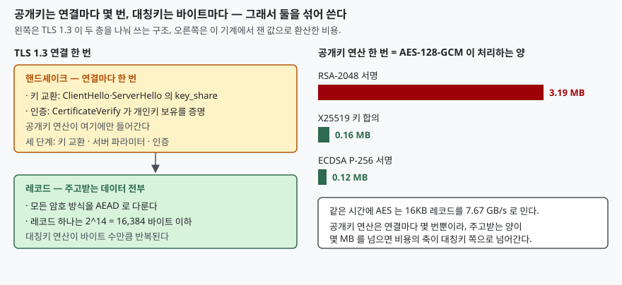

## 들어가며

API 서버 앞단에 HTTPS 를 붙이고 부하 시험을 돌리면 처음 보는 그래프가 나온다.
요청당 응답 바이트는 몇 KB 밖에 안 되는데 CPU 가 꽉 차고, 커넥션 수를 늘리면
처리량이 오히려 떨어진다. 그래서 흔히 내리는 결론이 "암호화가 비싸다"이고,
다음 수순은 TLS 종료를 앞단으로 빼거나 암호 스위트를 바꿔 보는 것이다.

그런데 이때 바꾸는 것이 보통 대칭키 쪽이다. AES-256 을 AES-128 로 내려 보고,
ChaCha20 으로 바꿔 보고. 정작 CPU 를 먹고 있던 것은 연결마다 한 번씩 도는
공개키 연산인데, 그쪽은 손대지 않는다. 두 연산의 비용이 몇 배나 차이 나는지를
숫자로 가지고 있지 않으면 어디를 고쳐야 할지 고를 수가 없다.

OpenSSL 에는 그 숫자를 직접 재는 도구가 딸려 온다. 따로 설치할 것이 없다.

## 개념

`openssl speed` 는 알고리즘을 정해진 시간 동안 반복 수행하고 처리량을 찍는다.
대칭키·해시는 **초당 처리 바이트**로, 공개키는 **초당 연산 횟수**로 나온다.
단위가 다르다는 점이 중요하다. 둘은 재는 대상 자체가 다르기 때문이다.

- **대칭키**는 바이트마다 일한다. 1MB 를 보내면 1MB 어치를 돌린다
- **공개키**는 연결마다 몇 번 일한다. 1MB 를 보내든 1바이트를 보내든 횟수가 같다

그래서 "어느 쪽이 빠른가"는 질문이 성립하지 않는다. 성립하는 질문은
**"공개키 연산 한 번 하는 시간에 대칭키는 몇 바이트를 처리하는가"**다.
이 숫자가 나오면 둘을 같은 자로 잴 수 있다.

## 구조



> **출처**: [RFC 8446 (TLS 1.3) §2 Protocol Overview](https://www.rfc-editor.org/rfc/rfc8446.html#section-2), [§4.4.3 CertificateVerify](https://www.rfc-editor.org/rfc/rfc8446.html#section-4.4.3), [§5.1 Record Layer](https://www.rfc-editor.org/rfc/rfc8446.html#section-5.1), [§5.2 Record Payload Protection](https://www.rfc-editor.org/rfc/rfc8446.html#section-5.2)

TLS 1.3 은 이 둘을 층으로 갈라 둔다. 핸드셰이크는 키 교환·서버 파라미터·인증의
세 단계로 돌고, 개인키 보유를 증명하는 서명은 `CertificateVerify` 가 나른다.
그 뒤로 오가는 데이터는 전부 레코드에 담겨 AEAD 로 보호되고, 레코드 하나의
평문은 2^14 = 16,384 바이트를 넘지 못한다.

`openssl speed` 의 대칭키 표에 `16384 bytes` 칸이 있는 것이 우연이 아니다.
그 칸이 TLS 레코드 하나를 미는 속도에 해당한다.

## 동작 원리

측정은 이렇게 돌렸다. 전체 소스: [`code/`](code/) · 수행 기록:
[`code/output.txt`](code/output.txt)

```bash
openssl speed -seconds 2 -evp aes-128-gcm
openssl speed -seconds 2 rsa2048 rsa3072 rsa4096
openssl speed -seconds 2 ecdsap256 ecdsap384 ecdsap521
```

처음에는 `-seconds 1` 로 돌렸는데, 다른 작업이 함께 도는 동안 RSA-3072 서명이
792회/s 와 262회/s 사이에서 흔들렸다. **짧게 재면 절대값만이 아니라 항목 사이의
비율까지 틀린다.** 2초로 올리고, 같은 측정을 여러 번 돌리지 않고 한 번 받아
파일에 두고 모든 절에서 그 값을 쓰도록 고쳤다.

대칭키 쪽 결과다. 단위는 1000 바이트/초다.

```text
type             16 bytes     64 bytes    256 bytes   1024 bytes   8192 bytes  16384 bytes
AES-128-GCM     105866.19k   398590.27k  1365738.11k  3738205.95k  7603345.25k  7666978.00k
AES-256-GCM      91990.59k   325588.81k  1239472.36k  3301131.68k  6492998.23k  6825905.20k
ChaCha20-Poly1305   503022.15k   720979.40k  1479038.99k  2587854.70k  2693051.08k  2808837.87k
sha256          123442.34k   415925.31k  1078419.46k  1770389.50k  2204486.55k  2236284.93k
```

같은 AES-128-GCM 인데 16바이트 블록에서는 105.9 MB/s, 16KB 블록에서는 7.67 GB/s 다.
**72배 차이가 알고리즘이 아니라 호출 단위에서 나온다.** 블록이 작으면 키 스케줄과
GCM 태그 계산 같은 건당 고정 비용이 전부를 차지한다. 작은 메시지를 많이 보내는
프로토콜이 느린 이유가 여기 있고, 레코드를 꽉 채워 보내라는 조언의 근거이기도 하다.

ChaCha20-Poly1305 는 16바이트에서 AES 보다 4.8배 빠르지만 16KB 에서는 2.7배 느리다.
이 기계의 AES 는 CPU 명령으로 처리되고 ChaCha20 은 일반 연산으로 처리되기 때문에,
블록이 커져 고정 비용이 묻히면 순위가 뒤집힌다. **"어느 암호가 빠른가"의 답이
블록 크기에 따라 달라진다.**

AES-256 은 AES-128 보다 16KB 블록에서 11% 느렸다. 키가 두 배인데 비용은 11%만
는다. 대칭키에서는 키 길이를 올리는 비용이 이 정도다.

## 실습 예제

공개키 쪽이다.

```text
                   sign    verify    encrypt   decrypt   sign/s verify/s  encr./s  decr./s
rsa  2048 bits 0.000427s 0.000013s 0.000013s 0.000412s   2343.9  77075.5  75170.5   2426.0
rsa  3072 bits 0.001239s 0.000026s 0.000026s 0.001170s    807.3  37835.6  37803.2    854.6
rsa  4096 bits 0.002806s 0.000045s 0.000047s 0.002746s    356.4  22124.5  21467.5    364.2

                              sign    verify    sign/s verify/s
 256 bits ecdsa (nistp256)   0.0000s   0.0000s  64754.3  20172.6
 384 bits ecdsa (nistp384)   0.0005s   0.0004s   2068.5   2434.5
 521 bits ecdsa (nistp521)   0.0011s   0.0009s    919.4   1132.3

                              op      op/s
 256 bits ecdh (nistp256)   0.0000s  26372.1
 253 bits ecdh (X25519)   0.0000s  48190.0
```

여기서 예상과 가장 달랐던 것은 **비대칭의 방향이 알고리즘마다 반대**라는 점이다.
RSA-2048 은 검증이 서명보다 32.9배 빠른데, ECDSA P-256 은 **서명이 검증보다
3.2배 빠르다.** 공개 지수가 작아 공개키 연산이 싼 RSA 와, 서명·검증의 연산량이
구조적으로 다른 ECDSA 의 차이다.

이것이 배포에 영향을 준다. 서버 인증서의 서명은 서버가 연결마다 한 번씩 하고,
검증은 클라이언트가 한다. 서버 쪽 CPU 만 보면 RSA 에서 ECDSA 로 옮기는 것이
27.6배 이득이지만, 검증 쪽만 보면 RSA 가 3.8배 빠르다. 어느 쪽이 병목인지를
먼저 정해야 고를 수 있다.

이제 단위를 맞춘다. AES-128-GCM 의 16KB 처리량으로 공개키 연산 한 번을 환산한
값이다.

```text
AES-128-GCM 16KB 블록   7666978.00 kB/s
RSA-2048 서명           2343.9 회/s
ECDSA P-256 서명        64754.3 회/s
X25519 키 합의          48190.0 회/s

RSA-2048 서명 1회 시간 동안 AES 처리량        3.19 MB
ECDSA P-256 서명 1회 시간 동안 AES 처리량     0.12 MB
X25519 키 합의 1회 시간 동안 AES 처리량       0.16 MB
```

**RSA-2048 서명 한 번이 3.19 MB 를 암호화하는 것과 같다.** 응답이 10KB 인 API 를
새 연결로 때릴 때마다 서명이 한 번 돈다면, 암호화 비용의 99.7% 는 데이터가 아니라
핸드셰이크에서 나오는 셈이다. 세션 재개와 연결 재사용이 왜 그렇게 큰 차이를
만드는지가 이 한 줄로 설명된다. ECDSA·X25519 로 내려오면 0.12~0.16 MB 로
25배 가까이 줄어든다.

## 실무에서 주의할 점

**첫째, 키 길이를 올리는 비용이 대칭키와 공개키에서 전혀 다르다.** AES 는
128→256 비트에 11% 였지만, RSA 는 이렇게 는다.

```text
  2048 → 3072 비트: 비트 1.50배, 서명 비용 2.90배  (비트비의 세제곱 3.38)
  3072 → 4096 비트: 비트 1.33배, 서명 비용 2.27배  (비트비의 세제곱 2.37)
```

실측한 배수가 비트비의 세제곱과 가깝다. RSA 개인키 연산이 모듈러 지수승이라
모듈러스 비트 수에 대해 세제곱 꼴로 늘어나는 것과 들어맞는다.
"보안 강도를 올리자"며 RSA-4096 으로 바꾸면 서명 처리량이 6.6분의 1이 된다.

**둘째, 곡선을 바꿀 때 비트 수로 비용을 추정하면 안 된다.** ECDSA P-256 에서
P-384 로 가면 비트는 1.5배인데 서명 처리량은 31.3배 떨어졌다. RSA 처럼
세제곱으로 설명되는 폭이 아니다. OpenSSL 소스 트리를 보면 곡선마다 구현 파일이
따로 있고, P-256 은 거기에 더해 `ecp_nistz256.c` 와 760KB 짜리 사전 계산
테이블(`ecp_nistz256_table.c`)을 따로 가진다. 구현이 곡선마다 다르다는 사실까지는
확인했지만, 31배라는 숫자의 원인을 파일 목록만으로 단정할 수는 없다.
**결론은 하나다 — 쓸 곡선을 쓸 기계에서 직접 재 본다.**

**셋째, 짧게 재면 비율까지 틀린다.** `-seconds 1` 로 돌린 결과와 2초로 돌린
결과에서 RSA-3072 서명이 3배 차이가 났다. 다른 프로세스가 도는 개발 기계에서
1초는 너무 짧다. 숫자를 근거로 쓸 생각이면 `-seconds` 를 넉넉히 주고
여러 번 재서 흔들림의 폭부터 본다.

**넷째, 이 숫자는 암호 연산만 잰 값이다.** 실제 TLS 핸드셰이크에는 인증서 파싱,
체인 검증, 난수 생성, 네트워크 왕복이 더 붙는다. `openssl speed` 의 값은
**상한**이지 실제 연결 처리량이 아니다. 연결 단위 처리량을 보려면
`openssl s_time` 같은 다른 도구를 써야 한다.

**다섯째, 숫자는 기계에 붙어 있다.** AES-NI 가 없는 CPU 에서는 AES 와 ChaCha20 의
순위가 통째로 바뀐다. 모바일·임베디드 대상 서비스가 ChaCha20 을 우선 순위에
두는 이유이고, 이 글의 비율을 그대로 옮겨 쓰면 안 되는 이유이기도 하다.

## 정리

- 대칭키는 바이트마다, 공개키는 연결마다 일한다. 같은 자로 재려면
  **공개키 1회를 대칭키 바이트로 환산**한다
- 이 기계에서 RSA-2048 서명 한 번은 AES-128-GCM 3.19 MB 에 해당했다.
  ECDSA P-256 은 0.12 MB, X25519 는 0.16 MB 였다
- 같은 AES 라도 16바이트 블록과 16KB 블록이 72배 차이 난다.
  알고리즘보다 호출 단위가 먼저다
- 비대칭의 방향이 반대다. RSA 는 검증이 32.9배 빠르고,
  ECDSA P-256 은 서명이 3.2배 빠르다
- 키 길이 비용은 대칭키 11%, RSA 는 비트 수의 세제곱, 타원곡선은 곡선마다 제각각이다

## 참고 자료

- [OpenSSL — `openssl-speed` 매뉴얼](https://docs.openssl.org/3.5/man1/openssl-speed/)
- [RFC 8446 — The Transport Layer Security (TLS) Protocol Version 1.3](https://www.rfc-editor.org/rfc/rfc8446.html)
- [RFC 8446 §5.1 Record Layer](https://www.rfc-editor.org/rfc/rfc8446.html#section-5.1)
- [RFC 8446 §5.2 Record Payload Protection](https://www.rfc-editor.org/rfc/rfc8446.html#section-5.2)
- [OpenSSL 3.5 소스 트리 — `crypto/ec`](https://github.com/openssl/openssl/tree/openssl-3.5/crypto/ec)
