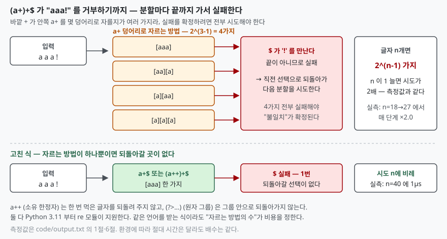

## 들어가며

회원 가입 폼에 들어오는 값을 검사하는 정규식은 대개 누군가 예전에 짜 둔 것을
그대로 쓴다. 이메일, 전화번호, 태그 목록처럼 "단어를 구분자로 이어 받는" 식이
여기저기 깔려 있고, 테스트 입력으로는 다 통과한다. 그러다 어느 날 API 서버의
워커가 하나씩 100% CPU 로 굳는다. 로그에는 에러가 없다. 요청이 끝나지 않을
뿐이다. 재시작하면 잠깐 풀렸다가 같은 클라이언트가 같은 요청을 보내면 다시 굳는다.

이때 보통 하는 일은 요청 본문 크기를 줄이는 것이다. 몇 KB 로 막아 놓으면
안심이 되는데, 아래에서 보겠지만 **지수로 폭발하는 식은 30자도 못 버틴다.**
크기 제한은 다른 종류의 폭발을 막는다. 무엇이 무엇을 막는지 재지 않고 고치면
막힌 쪽만 보고 안심하게 된다.

## 개념

ReDoS(Regular expression Denial of Service)는 정규식 엔진이 **실패를 확정하기
위해 시도해야 하는 경우의 수**가 입력 길이에 대해 지수나 고차 다항으로 느는
현상을 이용한 서비스 거부다. OWASP 는 입력에 따라 엔진이 멈출 수 있는 식을
"Evil Regex" 라 부르고, 그 조건을 **반복되는 그룹** 안에 **반복**이나 **겹치는
선택**이 있는 것으로 든다. `(a+)+$`, `([a-zA-Z]+)*$`, `(a|aa)+$`, `(a|a?)+$`
가 그 예다.

핵심은 식이 받아들이는 **언어**가 아니라 엔진이 답에 이르는 **경로의 수**다.
`(a+)+$` 와 `a+$` 는 같은 문자열을 받지만, 전자는 `aaa` 를 `[aaa]`, `[aa][a]`,
`[a][aa]`, `[a][a][a]` 네 가지로 자를 수 있고 후자는 한 가지뿐이다. 매칭에
성공하면 첫 경로에서 끝나므로 차이가 없다. **실패를 확정하려면 모든 경로를
가 봐야 하므로** 거부되는 입력에서만 폭발한다.

## 구조



> **출처**: [Python HOWTO — Regular Expression HOWTO, Repeating Things](https://docs.python.org/3/howto/regex.html#repeating-things) · [Python re — Possessive quantifiers](https://docs.python.org/3/library/re.html#re-syntax-possessive-quantifiers) · [Russ Cox, Regular Expression Matching Can Be Simple And Fast (2007-01)](https://swtch.com/~rsc/regexp/regexp1.html)

## 동작 원리

Python 의 `re` 는 백트래킹 엔진이다. HOWTO 는 반복 한정자를 설명하면서 뒤쪽이
안 맞으면 **엔진이 되돌아가 더 적은 반복으로 다시 시도한다**고 적는다. 이것이
`*`·`+` 가 가능한 한 많이 먹고 필요하면 뱉는 "탐욕" 동작의 실체다.

`(a+)+$` 에 `aaa…a!` 를 넣으면 이렇게 된다. 안쪽 `a+` 가 `a` 를 전부 먹고,
바깥 `+` 는 한 번으로 끝낸 뒤 `$` 를 본다. `!` 가 있어 실패. 안쪽이 한 글자를
뱉고, 바깥이 두 번째 반복으로 그 한 글자를 먹고, 다시 `$` 실패. 이렇게 `a`
열을 몇 덩어리로 자를지의 모든 조합이 시도된다. n 글자를 자르는 방법은 글자
사이 n−1 곳에 경계를 둘지 말지이므로 2^(n−1) 가지다. Cox 의 글은 `a?^n a^n`
예제로 같은 구조를 설명하면서 **"그런 선택이 n 개 있어 총 2^n 가지"** 라고 적는다.

측정값이 정확히 그 비율로 나온다.

```text
  식: '(a+)+$'   입력: 'a'×n 뒤에 '!' (끝이 안 맞아 실패하는 입력)
       n      시간(초)     직전 대비  결과
      18     0.0067         -  불일치
      19     0.0140     × 2.1  불일치
      20     0.0268     × 1.9  불일치
      21     0.0558     × 2.1  불일치
      22     0.1063     × 1.9  불일치
      23     0.2140     × 2.0  불일치
      24     0.4226     × 2.0  불일치
      25     0.8522     × 2.0  불일치
      26     1.7059     × 2.0  불일치
      27     3.4518     × 2.0  불일치
```

n 이 1 늘 때마다 ×2.0 이다. 같은 식에 `!` 없이 `a` 만 넣으면 n=28 에서도
측정 한계 아래(0.000000초)로 끝난다. 첫 경로에서 매칭이 성공하기 때문이다.

RE2 처럼 백트래킹을 쓰지 않는 엔진은 매칭 시간이 입력 길이에 선형임을 보장하는
대신, 역참조처럼 백트래킹으로만 구현되는 기능을 빼 버린다. Python `re` 는
역참조를 지원하는 쪽을 택했고, 그 대가가 이 폭발이다.

## 실습 예제

전체 소스: [`code/`](code/) · 수행 기록: [`code/output.txt`](code/output.txt)

실무에서 흔한 모양은 `(\w+\s?)*$` 다. 단어를 공백으로 이어 받되 공백을
선택(`?`)으로 두었다. 공백이 없어도 다음 `\w+` 로 넘어갈 수 있으니 `aaaa` 를
단어 몇 개로 볼지가 겹친다. 결과는 `(a+)+` 와 똑같이 매 단계 ×2.0 이다.

```text
  식: '(\\w+\\s?)*$'
      22     0.2028     × 2.0  불일치
      23     0.4100     × 2.0  불일치
      24     0.8262     × 2.0  불일치
      25     1.6449     × 2.0  불일치
      26     3.2922     × 2.0  불일치
```

폭발에는 다항도 있다. 끝 공백을 찾는 `\s+$` 에 공백 n 개 뒤 `x` 를 주면
엔진은 첫 공백부터 `\s+` 를 시작해 `$` 에서 실패하고, 둘째 공백부터 다시
시작한다. 시작점 n 개 × 각 시도 길이 n 이라 n² 이다.

```text
  식: '\s+$'   입력: 공백×n 뒤에 'x'
    5000     0.0648         -
   10000     0.2611     × 4.0
   20000     1.0401     × 4.0
   40000     4.1645     × 4.0
```

### 길이 제한이 막는 것

두 종류의 폭발에 **같은 길이 제한 30자**를 걸어 보면 길이 제한의 한계가 드러난다.

```text
  지수 식 + 길이 30          54.6836초
  다항 식 + 길이 30           0.0000초
```

다항 식은 30자에서 측정이 안 될 만큼 빠르다. 길이 제한이 실제로 막는다. 지수
식은 **30자에 55초**다. 20자 아래로 막아야 1초 안에 들어오는데, 그 길이로는
이메일 하나도 못 받는다. 길이 제한은 다항 폭발의 대책이지 지수 폭발의 대책이
아니다.

### 식을 고친다

실제로 막는 것은 **자르는 방법의 수를 하나로 줄이는 것**이다. 네 가지를 같은
입력(n=40)으로 돌렸다.

```text
  a+$              n=40  0.000001초  — 중첩을 푼다: (a+)+ 와 같은 언어를 받는다
  (a++)+$          n=40  0.000001초  — 소유 한정자 a++ (Python 3.11+)
  (?>a+)+$         n=40  0.000002초  — 원자 그룹 (?>...) (Python 3.11+)
  \w+(\s\w+)*$     n=40  0.000002초  — (\w+\s?)* 를 고친 것: 공백을 필수로
```

`a++` 는 `re` 문서가 3.11 에서 추가했다고 적는 **소유 한정자**다. 한 번 먹은
글자를 되돌려 주지 않으므로 안쪽 `a+` 가 전부 먹고 나면 바깥 `+` 가 두 번째
반복을 시도할 글자가 없다. 원자 그룹 `(?>…)` 은 같은 일을 그룹 단위로 한다.
`(\w+\s?)*` 는 공백을 **필수**로 바꿔 `\w+(\s\w+)*` 로 쓰면 "단어 다음에는
반드시 공백" 이 되어 단어 경계가 하나로 정해진다. 받는 문자열은 공백 없는
`aaa` 를 포함해 전과 같다.

### 타임아웃이 막는 척만 하는 자리

식을 고칠 수 없는 경우(사용자가 식을 넣는 검색 기능 등) 타임아웃을 생각한다.
표준 `re` 에는 `timeout` 인자가 없다. 그래서 스레드에서 돌리고
`join(timeout=0.1)` 로 기다리는 코드를 쓰는데, 재 보면 이렇다.

```text
  join(timeout=0.1) 이 실제로 돌아오기까지 1.704초
```

0.1초를 요청했는데 **1.7초 뒤에야 돌아왔다.** 매칭 루프가 C 안에서 GIL 을
쥔 채 돌고, 그 루프는 바이트코드 경계가 아니라서 인터프리터가 다른 스레드로
넘어갈 틈을 주지 않는다. 주 스레드는 매칭이 끝나야 깨어난다. 타임아웃으로
감쌌다는 사실이 코드 리뷰에서는 안심이 되고 운영에서는 아무 일도 하지 않는다.

`regex` 모듈(2026.9.29)은 매칭 함수에 `timeout` 을 받는다. 다만 이 모듈로
바꾸면 폭발 자체가 사라진다고 생각하면 안 된다.

```text
  식              n     re(초)   regex(초)
  (a+)+$        26    1.7179     0.0015
  (a|a)*$       24    0.8613     2.1716
  regex.fullmatch((a|a)*$, timeout=0.1) → TimeoutError: regex timed out  (0.100초 만에 중단)
```

`(a+)+$` 는 `regex` 가 0.0015초에 끝낸다. 중첩 반복을 접는 최적화가 있는
것이다. 그런데 **겹치는 선택** `(a|a)*$` 는 `re` 보다 오히려 느리게 폭발한다.
엔진이 여전히 백트래킹이고, 접을 수 있는 모양만 접는다. 대신 `timeout=0.1` 은
정확히 0.100초에 `TimeoutError` 를 던졌다. 이것이 **유일하게 "어떤 식이든"
막아 준 장치**다. 엔진이 매칭 루프 안에서 시계를 보기 때문이다.

## 실무에서 주의할 점

**첫째, 거부되는 입력으로 테스트한다.** 통과하는 입력은 첫 경로에서 끝나므로
아무리 많이 넣어도 폭발이 보이지 않는다. 식을 바꿀 때는 "거의 맞지만 끝이
틀린" 입력을 길이를 늘려 가며 넣고, 직전 대비 배수를 본다. ×2 가 보이면 지수,
×4 가 보이면 n² 이다.

**둘째, 길이 제한은 다항 폭발용이다.** 요청 본문을 몇 KB 로 막아도 지수 식은
30자에서 1분을 쓴다. 길이 제한을 걸었다고 ReDoS 대책이 끝났다고 적지 않는다.

**셋째, 스레드 타임아웃은 `re` 에서 동작하지 않는다.** `join(timeout)` 은
돌아올 뿐 매칭을 끊지 못하고, 그나마 돌아오는 시점도 매칭이 끝난 뒤다. 프로세스
풀로 격리하면 죽일 수는 있지만 그동안 워커 하나가 통째로 잠긴다. 매칭 루프
안에서 시계를 보는 엔진(`regex` 의 `timeout`)이나 백트래킹을 하지 않는 엔진(RE2
계열)이어야 시간 상한이 실제로 걸린다.

**넷째, 엔진을 바꿔도 식은 검토한다.** `regex` 가 `(a+)+` 를 접는다고 해서
`(a|a)*` 까지 접지는 않았다. 최적화는 특정 모양에만 걸리므로, 무엇이 접히는지는
그 엔진에서 재 봐야 안다.

**다섯째, 소유 한정자는 받는 언어를 바꿀 수 있다.** `a++` 와 `(?>…)` 는
되돌아가지 않으므로, 뒤쪽이 앞쪽에서 뱉은 글자를 필요로 하는 식에 붙이면
전에는 매칭되던 입력이 안 된다. 이 글의 예처럼 **중첩 반복의 안쪽**에 붙일
때는 언어가 같지만, 아무 데나 붙이는 것은 아니다.

## 정리

- 폭발은 "자르는 방법의 수" 에서 온다. `(a+)+$` 는 n 글자에 2^(n−1) 가지를
  시도하고, 측정도 n 당 정확히 ×2.0 이다. 매칭이 성공하는 입력에서는 보이지 않는다
- 지수 폭발은 길이 제한으로 못 막는다. 30자에 55초다. 길이 제한이 막는 것은
  `\s+$` 같은 n² 폭발이다
- 실제로 막는 것은 식 재작성이다. 중첩을 풀거나, 소유 한정자 `a++`·원자 그룹
  `(?>…)` 로 되돌아갈 길을 끊거나, 선택을 필수로 바꿔 경계를 하나로 만든다
- 표준 `re` 는 타임아웃이 없고 스레드로 감싸도 끊지 못한다. `regex` 의
  `timeout` 은 0.100초에 정확히 끊었다
- `regex` 는 `(a+)+` 를 접지만 `(a|a)*` 는 `re` 보다 느리게 폭발한다.
  엔진을 바꿨다고 식 검토를 생략하지 않는다

## 참고 자료

- [Python — Regular Expression HOWTO, Repeating Things](https://docs.python.org/3/howto/regex.html#repeating-things) — 뒤쪽이 안 맞으면 되돌아가 더 적은 반복으로 재시도한다는 서술
- [Python — re, Possessive quantifiers (3.11 추가)](https://docs.python.org/3/library/re.html#re-syntax-possessive-quantifiers) · [Atomic grouping](https://docs.python.org/3/library/re.html#re-syntax-atomic-group)
- [regex 2026.9.29 — PyPI](https://pypi.org/project/regex/) — 매칭 함수의 `timeout` 인자 (2026-09-29)
- [OWASP — Regular expression Denial of Service - ReDoS](https://owasp.org/www-community/attacks/Regular_expression_Denial_of_Service_-_ReDoS) — Evil Regex 의 조건과 예시 패턴
- [Russ Cox, Regular Expression Matching Can Be Simple And Fast (2007-01)](https://swtch.com/~rsc/regexp/regexp1.html) — 백트래킹이 2^n 이 되는 이유와 Thompson NFA
- [google/re2 — README](https://github.com/google/re2/blob/main/README.md) — 입력 길이에 선형인 매칭 시간 보장, 역참조 미지원
