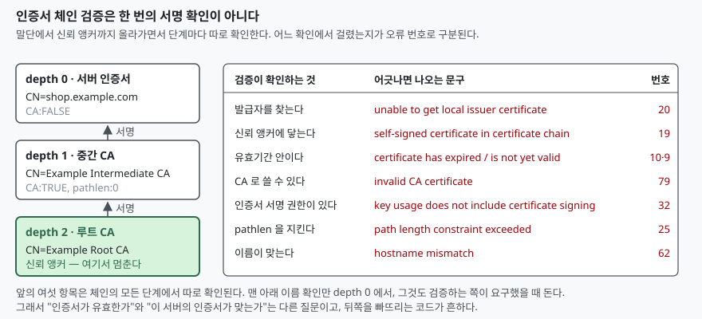

## 들어가며

사설 CA 로 발급한 인증서를 서버에 붙이면 거의 항상 한 번은 막힌다. 브라우저는
"이 사이트는 안전하지 않습니다"만 보여 주고, `curl` 은 `unable to get local issuer
certificate` 를 뱉고, 자바 클라이언트는 `PKIX path building failed` 를 던진다.
세 도구가 서로 다른 말을 하니 무엇이 틀렸는지 알 수가 없다.

이때 흔히 하는 일은 검색해서 나온 조치를 순서대로 다 해 보는 것이다. 인증서를
OS 신뢰 저장소에 넣어 보고, 체인 파일을 다시 합쳐 보고, 안 되면 검증을 끄는 옵션을
찾는다. 다섯 번쯤 시도하면 하나는 통과하는데, **무엇이 고쳐졌는지는 끝내 모른다.**
같은 문제가 다음 서버에서 또 나고, 다시 다섯 번을 시도한다.

검증이 **한 번의 서명 확인이 아니라 일곱 가지쯤 되는 별개의 확인**이라는 것을 알면
이 반복이 끝난다. 여기서는 체인을 직접 만든 뒤 한 군데씩 망가뜨려, 어떤 고장이
어떤 문구로 나타나는지를 모았다.

## 개념

X.509 인증서는 "이 공개키는 이 이름의 것이다"라는 주장을 누군가의 서명으로 보증한
문서다. 보증한 쪽이 또 다른 인증서를 갖고 있으면 그 인증서의 보증자를 다시 따라
올라가게 되고, 이 사슬이 **인증서 체인**이다.

사슬은 어딘가에서 멈춰야 한다. 멈추는 자리가 **신뢰 앵커**(trust anchor)이고, 보통은
OS 나 브라우저가 들고 있는 루트 CA 목록이다. 검증하는 쪽이 "이것은 묻지 않고 믿는다"고
미리 정해 둔 인증서다.

실무에서 세 단계(루트 → 중간 → 서버)를 쓰는 이유는 루트의 개인키를 평소에 꺼내지
않기 위해서다. 루트는 중간 CA 하나를 서명하고 금고로 들어가고, 날마다 발급하는 일은
중간 CA 가 한다. 중간 CA 키가 새면 그 중간 인증서만 폐기하면 되고 루트는 살아 있다.

## 구조



> **출처**: [RFC 5280 §6.1 Basic Path Validation / §4.2.1.3 Key Usage / §4.2.1.6 Subject Alternative Name / §4.2.1.9 Basic Constraints](https://www.rfc-editor.org/rfc/rfc5280), 오류 번호는 아래 예제를 실제로 돌려 얻은 값이다 ([code/output.txt](code/output.txt))

표의 오른쪽 열은 지어낸 것이 아니라 아래 예제를 돌려 받은 문구를 그대로 옮긴 것이다.

## 동작 원리

검증하는 쪽은 받은 인증서부터 시작해 발급자를 거슬러 올라가며 체인을 만들고,
만들어진 체인의 **모든 단계에 대해** 같은 확인을 반복한다. 그래서 오류 메시지에
항상 `depth` 가 붙는다. `depth=0` 은 서버 인증서, 올라갈수록 상위 CA다.

여기서 갈라지는 지점이 두 가지 있다.

**첫째, 체인을 만드는 일과 체인을 검사하는 일은 다르다.** 발급자 인증서를 못 찾으면
검사까지 가지도 못하고 "체인을 만들 수 없다"로 끝난다. 사설 CA 에서 가장 흔한 실패가
이쪽이다.

**둘째, 이름 확인은 체인 검증에 들어 있지 않다.** 인증서가 유효한지와 그 인증서가
내가 접속하려는 서버의 것인지는 다른 질문이다. 검증하는 쪽이 따로 요구해야 돌고,
요구하지 않으면 남의 유효한 인증서도 통과한다. 이름을 무엇으로 확인하는지는 RFC 9525
가 정하는데, 이 문서는 CN(common name)을 서비스 식별에 쓰지 말라고 못 박는다.
CN 이 아니라 `subjectAltName` 이 기준이다.

## 실습 예제

openssl 하나로 루트 → 중간 → 서버를 만들고 여덟 가지 상황을 돌린다.
전체 소스: [`code/`](code/) · 아래 출력은 전부 돌린 기록인
[code/output.txt](code/output.txt)에서 가져왔다.

```bash
openssl req -x509 -newkey ec -pkeyopt ec_paramgen_curve:P-256 -noenc \
    -keyout "${WORK_DIR}/root.key" -out "${WORK_DIR}/root.pem" -days 3650 \
    -subj "/C=KR/O=Example Trust/CN=Example Root CA" \
    -addext "basicConstraints=critical,CA:TRUE" \
    -addext "keyUsage=critical,keyCertSign,cRLSign"
```

중간 CA 에는 `pathlen:0` 을 걸어 두었다. 이 CA 아래로 CA 를 하나 더 두지 못한다는
뜻이고, 8번 시나리오에서 이것이 걸린다.

### 정상 체인 — 무엇이 쌓였는지 먼저 본다

```text
  $ openssl verify -CAfile probe_work/root.pem -untrusted probe_work/inter.pem -show_chain probe_work/server.pem
      probe_work/server.pem: OK
      Chain:
      depth=0: C=KR, O=Example Service, CN=shop.example.com (untrusted)
      depth=1: C=KR, O=Example Trust, CN=Example Intermediate CA (untrusted)
      depth=2: C=KR, O=Example Trust, CN=Example Root CA
```

`depth=2` 에만 `(untrusted)` 가 없다. `-CAfile` 로 준 것은 루트 하나뿐이고 나머지
둘은 "재료로 쓰라고 준 것"이지 믿는 대상이 아니라는 구분이 출력에 그대로 드러난다.

### 중간 인증서를 빠뜨렸을 때

```text
  $ openssl verify -CAfile probe_work/root.pem probe_work/server.pem
      C=KR, O=Example Service, CN=shop.example.com
      error 20 at 0 depth lookup: unable to get local issuer certificate
```

서버 설정에서 가장 흔한 실수다. 루트는 클라이언트가 이미 갖고 있지만 **중간은
서버가 같이 보내 줘야 한다.** 발급기관이 준 파일 중 하나만 올리고 번들을 안 올리면
이 오류가 난다.

`at 0 depth` 가 단서다. 서버 인증서 단계에서 발급자를 못 찾았다는 뜻이므로,
빠진 것은 그 바로 위, 즉 중간 인증서다.

### 루트를 신뢰하지 않을 때

```text
  $ openssl verify -no-CAfile -no-CApath -untrusted probe_work/inter.pem -untrusted probe_work/root.pem probe_work/server.pem
      C=KR, O=Example Trust, CN=Example Root CA
      error 19 at 2 depth lookup: self-signed certificate in certificate chain
```

루트를 `-untrusted` 로 **주기는 했다.** 체인은 끝까지 만들어졌고 서명도 전부 맞는다.
그런데도 실패한다. 자기가 자기를 서명한 인증서에 닿았는데 그것이 신뢰 목록에 없기
때문이다.

`self-signed certificate` 라는 문구 때문에 "자체 서명 인증서를 쓴 게 잘못"으로 읽히기
쉬운데, 실제 뜻은 **"신뢰 앵커에 닿지 못했다"**다. 사설 CA 를 쓰는 환경에서 이 문구를
보면 인증서를 바꿀 게 아니라 루트를 신뢰 저장소에 넣어야 한다.

### 기간이 지났을 때 — 시계를 되돌리면 상위가 걸린다

고정된 과거 날짜로 서버 인증서를 하나 더 발급했다.

```text
  notBefore=Jan  1 00:00:00 2024 GMT
  notAfter=Apr  1 00:00:00 2024 GMT

  $ openssl verify -CAfile ... probe_work/expired.pem
      error 10 at 0 depth lookup: certificate has expired
```

여기까지는 예상대로다. 그런데 `-attime` 으로 검증 시각을 유효기간 안인 2024년 3월 1일로
되돌리면 결과가 이렇게 나온다.

```text
  $ openssl verify -CAfile ... -attime 1709251200 probe_work/expired.pem
      C=KR, O=Example Trust, CN=Example Root CA
      error 9 at 2 depth lookup: certificate is not yet valid
```

**이번엔 루트가 걸렸다.** 루트는 방금 만든 인증서라 2024년 3월에는 아직 존재하지
않았다. 유효기간 확인이 말단 인증서만의 일이 아니라 체인 전체에 걸린다는 것이
이렇게 드러난다.

실무에 그대로 옮겨지는 함정이다. 만료로 막혔을 때 서버 시계를 뒤로 돌려 급한 불을
끄려는 시도가 종종 나오는데, 체인 위쪽 인증서가 최근에 갱신된 것이면 그쪽이 대신
걸려서 결국 안 된다.

### 중간 인증서가 CA 가 아닐 때

같은 키·같은 주체로 `CA:FALSE` 짜리 중간 인증서를 하나 더 발급했다. 서명은 그대로
맞으므로 서버 인증서의 서명 검증은 통과한다.

```text
      error 79 at 1 depth lookup: invalid CA certificate
      error 32 at 1 depth lookup: key usage does not include certificate signing
```

**두 개가 한꺼번에 나왔다.** `basicConstraints` 의 `CA:FALSE` 와 `keyUsage` 에
`keyCertSign` 이 없는 것은 별개의 확인이고, 검증은 첫 실패에서 멈추지 않고 그 단계의
확인을 마저 돌린다. 오류가 둘이라고 고장이 둘인 것은 아니다 — 여기서는 확장 하나를
바꾼 결과다.

### pathlen 을 넘겼을 때

중간 CA(`pathlen:0`) 아래에 또 하나의 CA 를 끼우고 그 밑에서 서버 인증서를 발급했다.

```text
      error 25 at 2 depth lookup: path length constraint exceeded
```

`at 2 depth` 는 중간 CA 자리다. 제약을 어긴 쪽(끼워 넣은 하위 CA)이 아니라
**제약을 건 쪽**에서 걸린다. 오류 위치를 범인으로 읽으면 엉뚱한 인증서를 들여다보게 된다.

### 이름이 다를 때

```text
    X509v3 Subject Alternative Name:
        DNS:shop.example.com, DNS:www.shop.example.com

  $ openssl verify ... -verify_hostname app.example.com probe_work/server.pem
      error 62 at 0 depth lookup: hostname mismatch

  $ openssl verify ... -verify_hostname example.com probe_work/server.pem
      error 62 at 0 depth lookup: hostname mismatch
```

두 번째가 중요하다. `shop.example.com` 의 상위 도메인인 `example.com` 도 맞지 않는다.
SAN 은 포함 관계가 아니라 **목록**이고, 적혀 있는 이름만 맞는다.

그리고 `-verify_hostname` 을 빼면 같은 인증서가 `OK` 로 통과한다. 이름 확인은
요구해야 도는 확인이다.

## 실무에서 주의할 점

### 오류 번호를 먼저 본다

문구는 도구마다 다르게 번역되지만 번호는 같다. `unable to get local issuer certificate`
와 `PKIX path building failed` 는 같은 고장(발급자를 못 찾음)을 가리킨다.
**번호 20·19 는 체인을 못 만든 것이고, 10·9·79·32·25 는 만들어진 체인이 검사에서
떨어진 것이다.** 전자는 파일을 더 주면 풀리고, 후자는 인증서를 다시 발급해야 한다.

### depth 를 범인의 위치로 읽지 않는다

pathlen 사례처럼 **제약을 건 인증서에서 오류가 난다.** depth 는 "어느 인증서를 검사하다
걸렸는가"이지 "어느 인증서가 잘못됐는가"가 아니다. 체인 전체를 `-show_chain` 으로
한 번 찍어 놓고 보는 편이 빠르다.

### 서버는 중간 인증서를 반드시 같이 보낸다

브라우저는 중간 인증서를 캐시해 두거나 `authorityInfoAccess` 를 따라가 내려받는
경우가 있어서, **브라우저에서 되는데 `curl` 과 서버 간 호출에서만 깨지는** 모양이
자주 나온다. 번들을 제대로 올려 두는 것이 유일한 해결이다.

### 검증을 끄는 옵션으로 넘어가지 않는다

`-k`, `verify=none`, `InsecureSkipVerify` 는 위 일곱 가지 확인을 전부 끈다.
이름 확인 하나가 문제였더라도 체인·기간·CA 권한까지 같이 꺼진다. 사설 CA 환경이면
루트를 신뢰 저장소에 넣는 쪽이 작업량도 크게 다르지 않다.

### 이름은 CN 이 아니라 SAN 이다

RFC 9525 는 CN 을 서비스 식별에 쓰지 말라고 정하고 있고, 주요 클라이언트는 이미
그렇게 동작한다. CN 만 채우고 SAN 을 비운 인증서는 발급은 되지만 쓰이지 않는다.

## 정리

- 인증서 체인 검증은 하나의 확인이 아니라 **체인을 만드는 일 + 단계마다 도는 여섯
  가지 검사 + (요구했을 때만 도는) 이름 확인**이다
- 번호 20·19 는 체인 구성 실패, 10·9·79·32·25 는 구성된 체인의 검사 실패다
- 유효기간 확인은 체인 전체에 걸린다. 시계를 되돌리면 상위 인증서가 대신 걸린다
- `pathlen` 위반은 제약을 건 인증서의 depth 에서 보고된다
- 이름 확인은 별도 요구 사항이고, 기준은 CN 이 아니라 `subjectAltName` 목록이다

## 참고 자료

- [RFC 5280 — Internet X.509 PKI Certificate and CRL Profile (§6.1 Basic Path Validation, §4.2.1.3 Key Usage, §4.2.1.6 Subject Alternative Name, §4.2.1.9 Basic Constraints)](https://www.rfc-editor.org/rfc/rfc5280)
- [RFC 9525 — Service Identity in TLS (RFC 6125를 대체한다)](https://www.rfc-editor.org/rfc/rfc9525)
- [OpenSSL 3.5 — openssl-verify(1)](https://docs.openssl.org/3.5/man1/openssl-verify/) — `-verify_hostname`·`-attime`·`-show_chain`·`-no-CAfile` 의 설명이 있고, 오류 번호 목록은 `X509_STORE_CTX_get_error(3)` 에 있다고 안내한다
- [OpenSSL 3.5 — openssl-verification-options(1)](https://docs.openssl.org/3.5/man1/openssl-verification-options/) — 체인 구성과 체인 검증을 나눠 설명한다
