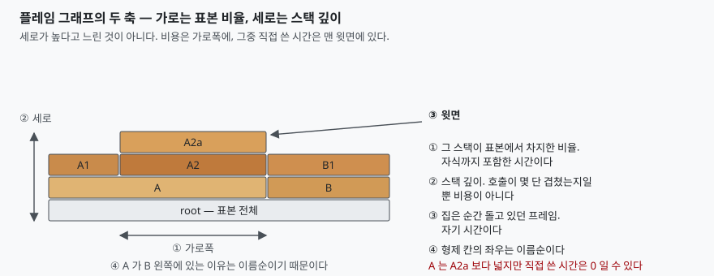
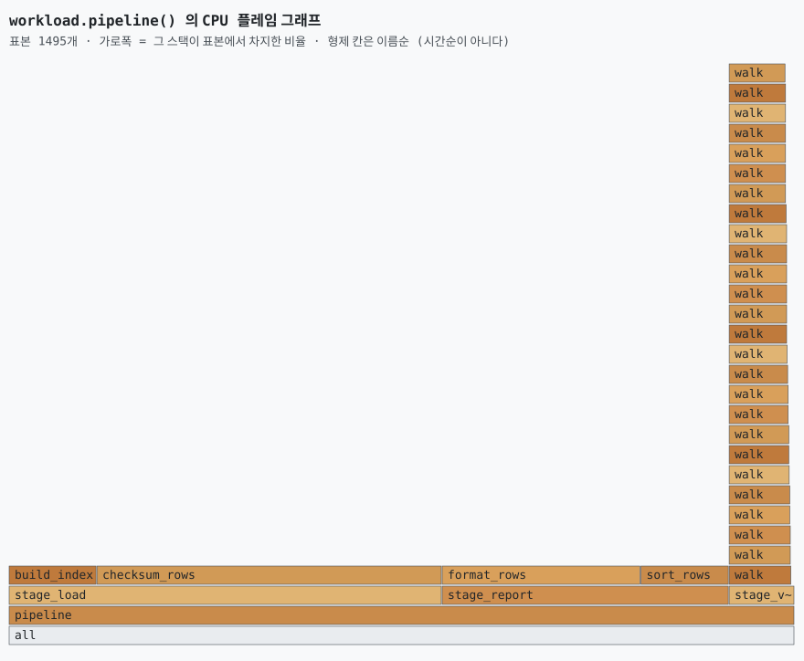

## 들어가며

운영 중인 서비스의 응답이 느려졌다는 이야기가 나오면 누군가 프로파일러를 붙여
플레임 그래프를 뽑아 온다. 알록달록한 산 모양 그림 한 장이 채널에 올라오고, 그걸
열어 본 사람들의 첫 반응은 대체로 같다. **가장 높이 솟은 봉우리를 손가락으로 가리킨다.**
"여기가 제일 깊으니까 여기가 문제 아닌가요."

그 다음은 보통 그 호출 경로를 따라 코드를 읽는 데 반나절이 간다. 봉우리가 25단짜리
재귀 함수였고, 실제로는 전체의 7%밖에 안 쓰고 있었다는 것을 알게 되는 건 그 반나절이
지난 뒤다. 같은 그림의 바닥 쪽에 아무 특징 없이 넓게 깔려 있던 칸 하나가 44%였는데,
눈에 안 띄어서 아무도 안 봤다.

이건 그림을 잘못 그려서가 아니라 **축을 잘못 읽어서** 생기는 일이다. 플레임 그래프의
두 축은 서로 다른 것을 재고, 그중 비용을 재는 쪽은 높이가 아니다.

## 개념 — 스택 표본을 접어 그린 그림

플레임 그래프는 **스택 표본(stack sample)의 모음을 넓이로 그린 그림**이다.
프로파일러가 일정 주기로 "지금 이 스레드의 호출 스택은 무엇인가"를 통째로 집어
모으고, 같은 스택끼리 묶어 개수를 센 다음, 그 개수를 가로폭으로 환산해 쌓아 올린다.

고안자 브렌던 그레그의 설명이 두 축을 한 문장씩으로 정리해 준다. 세로축은 "스택
깊이를 보여주며 바닥에서 0부터 센다"고 적고, 가로축에 대해서는 **"시간의 흐름이
아니다"**라고 괄호까지 붙여 못 박는다. 가로는 알파벳순으로 재배열된 것이고, 그렇게
하는 이유는 같은 프레임을 최대한 합치기 위해서다.

여기서 흔한 오해가 하나 정리된다. 왼쪽 칸이 먼저 실행되고 오른쪽 칸이 나중에
실행된 것이 아니다. **시간 순서를 보고 싶으면 플레임 그래프가 아니라 플레임
차트(flame chart)를 봐야 한다.** 그레그의 글은 이 둘을 명시적으로 가른다 —
플레임 차트는 "알파벳 대신 시간의 흐름을 x축에 놓는다".

## 구조



> **출처**: [Brendan Gregg — Flame Graphs §Summary](https://www.brendangregg.com/flamegraphs.html#Summary), [Brendan Gregg — Flame Graphs §Variations](https://www.brendangregg.com/flamegraphs.html#Variations)

그림에서 읽어야 할 것은 넷이다. **가로폭**은 그 스택이 표본에서 차지한 비율이고
자식까지 포함한 시간이다. **세로**는 스택 깊이일 뿐이다. **윗면**은 표본을 집은
순간 실제로 돌고 있던 프레임, 즉 자기 시간이다. 그리고 **형제 칸의 좌우 순서는
이름순**이다.

넷 중 비용을 재는 것은 가로폭과 윗면 둘이고, 세로와 좌우는 비용과 아무 상관이 없다.

## 동작 원리 — 집고, 접고, 그린다

플레임 그래프를 만드는 과정은 세 단계다. 바깥 도구(`perf` + `flamegraph.pl`,
`py-spy`)가 하는 일도 이 셋이다.

**① 집는다.** 일정 주기로 대상 스레드의 호출 스택을 통째로 읽는다. 파이썬에서는
`sys._current_frames()`가 살아 있는 모든 스레드의 현재 프레임을 돌려주므로, 거기서
`f_back`을 따라 올라가면 그 순간의 스택 전체가 나온다. 대상을 멈추지 않는다.

**② 접는다.** 같은 스택끼리 묶어 `a;b;c 횟수` 한 줄로 만든다. 이걸 **접힌
스택(collapsed stack)**이라고 부른다. 이 중간 산출물이 텍스트라는 점이 중요하다.
그림을 그리기 전에 숫자를 먼저 볼 수 있고, 그림에서 읽은 것이 맞는지 여기서 검산할
수 있다.

**③ 그린다.** 접힌 줄을 트리로 되돌리고, 각 노드의 표본 수에 비례해 가로폭을 준다.
형제 노드는 이름순으로 늘어놓는다. 이 정렬이 바로 가로축이 시간이 아닌 이유다.

색은 뜻이 없다. 그레그의 글은 원래 플레임 그래프가 "인접한 프레임을 눈으로 구분하려고
무작위 색을 쓴다"고 적는다. 빨간 칸이 위험하다는 뜻이 아니다.

## 실습 예제

전체 소스는 [code/](code/)에 있고, 돌린 기록은
[code/output.txt](code/output.txt)에 그대로 있다. 프로파일 대상은
[code/workload.py](code/workload.py)인데 **깊은 쪽이 싸고 얕은 쪽이 비싸도록
일부러 어긋나게** 짰다.

- `stage_validate` → `walk`는 25단을 재귀로 내려가지만 각 단이 하는 일은 거의 없다
- `stage_load` → `checksum_rows`는 깊이 3에서 끝나지만 그 안에서 대부분을 쓴다

2.59초 동안 1,495개의 표본이 잡혔다. 접힌 스택은 이렇게 나왔다.

```text
    657   43.9%  pipeline;stage_load;checksum_rows
    378   25.3%  pipeline;stage_report;format_rows
    168   11.2%  pipeline;stage_report;sort_rows
    167   11.2%  pipeline;stage_load;build_index
    108    7.2%  pipeline;stage_validate;walk*26
      6    0.4%  pipeline;stage_validate
      1    0.1%  pipeline;stage_validate;walk*5
```

`walk*26`은 같은 프레임이 26번 이어졌다는 뜻이다. **가장 깊은 스택이 7.2%이고, 깊이
3짜리 스택이 43.9%다.** 깊이를 기준으로 범인을 찾으면 정확히 반대로 간다.

그 숫자가 그대로 그림이 된다.



> **출처**: 이 글의 예제를 돌린 기록([code/output.txt](code/output.txt))에서 생성했다. 그리는 규칙(가로폭=표본 비율, 형제는 이름순)은 [Brendan Gregg — Flame Graphs §Summary](https://www.brendangregg.com/flamegraphs.html#Summary)를 따랐다.

오른쪽 끝에 28층짜리 탑이 솟아 있고, 왼쪽 중간에 `checksum_rows`가 넓게 깔려 있다.
그림만 봐도 눈이 먼저 가는 쪽은 탑이다. 숫자로는 그 탑이 전체의 7.2%다.

포함 시간과 자기 시간을 나란히 놓으면 윗면이 무엇인지가 분명해진다.

```text
  함수                     포함 표본     포함 %     자기 표본     자기 %
  pipeline                1495   100.0%         0     0.0%
  stage_load               824    55.1%         0     0.0%
  checksum_rows            657    43.9%       657    43.9%
  stage_validate           125     8.4%         6     0.4%
  walk                     119     8.0%       119     8.0%
```

`stage_load`는 55.1%를 차지하는 넓은 칸이지만 **자기 시간이 0이다.** 그 칸 자체는
아무 계산도 하지 않고, 아래에 깔린 `checksum_rows`와 `build_index`가 쓴 시간을
떠받치고 있을 뿐이다. 넓은 칸을 보고 "여기가 느리다"고 말하면 틀린다. 넓은 칸은
"이 아래 어딘가가 느리다"는 뜻이다.

### 예상과 달랐던 것 — 요청한 주기가 안 나온다

1ms 주기를 요청했는데 처음에는 **16ms마다 한 번씩만** 잡혔다. 원인은 GIL이었다.
수집기 스레드가 깨어나도 작업 스레드가 GIL을 쥐고 있으면 실행이 안 된다. GIL 전환
간격만 바꿔 가며 같은 1ms 요청으로 다시 재 봤다.

```text
  GIL 전환 간격             표본     측정 시간  실제 주기
     5.0ms (기본값)         64     1.00초    15.6ms
     1.0ms               64     1.00초    15.6ms
     0.2ms              645     1.00초     1.6ms
```

5ms와 1ms가 한 개도 안 다른 것이 뜻밖이었다. 전환 간격이 요청 주기 이상이기만 하면
실제 주기는 그 아래로 안 내려간다. 0.2ms로 내려야 비로소 요청한 1ms에 가까워진다.

이 차이가 그림을 바꾼다. 기본 설정으로 이 2.6초짜리 작업을 재면 표본은 160개
남짓이고, 전체의 7.2%인 `walk` 탑은 **열 개 안팎**으로 잡힌다. 몇 개만 어긋나도
비율이 두 배로 보이거나 아예 사라질 수 있는 양이다. 인프로세스 표본 수집기는
**주기를 적어 놓은 숫자가 아니라 실제로 몇 개를 집었는지로 판단해야 한다.**
전환 간격을 낮추는 것은 측정 대상도 느리게 만드는 교환이다.

## 실무에서 주의할 점

**오독 1 — 가로축을 시간으로 읽는다.** 왼쪽에서 오른쪽으로 실행된 것이 아니다.
형제 칸은 이름순이고, 그래서 코드를 고쳐 함수 이름만 바꿔도 칸의 위치가 움직인다.
두 개의 플레임 그래프를 좌우 위치로 비교하면 안 되는 이유다. 시간축이 필요하면
플레임 차트를 쓴다.

**오독 2 — 높은 탑을 병목으로 읽는다.** 세로는 스택 깊이다. 재귀 함수, 깊은 상속
체인, 데코레이터와 미들웨어가 겹겹이 쌓인 프레임워크는 아무 일을 안 해도 탑을
만든다. 위 측정에서 가장 높은 탑이 전체의 7.2%였다.

**오독 3 — 넓은 칸을 느린 함수로 읽는다.** 넓은 칸은 포함 시간이다. `stage_load`는
55.1%였지만 자기 시간이 0이었다. 눈으로 볼 곳은 **그래프의 윗면**이다. 그레그의
글도 "윗면이 CPU에 올라 있는 것을 보여주고 그 아래는 그것의 계보"라고 적는다.
평평하게 넓은 윗면을 찾는 것이 실제로 하는 일이다.

**오독 4 — 표본 수를 안 보고 비율을 믿는다.** 위 측정에서 64개 표본으로 그렸다면
11%짜리 칸은 표본 일곱 개다. 한두 개만 달라져도 비율이 크게 흔들린다. 그림을 열면
먼저 전체 표본 수를 확인하고, 세 자리 수에 못 미치면 **폭의 차이를 근거로 결론
내지 않는다.** 위 예제의 `walk*5`나 `walk*18` 같은 줄은 재귀가 내려가는 도중에
걸린 표본 한 개씩인데, 이런 줄이 결과의 상당 부분을 차지한다면 표본이 모자란 것이다.

**그리고 CPU 플레임 그래프는 켜져 있는 시간만 본다.** 디스크나 네트워크를 기다리며
블록된 시간은 CPU 표본에 잡히지 않는다. 응답이 느린데 CPU 플레임 그래프가
멀쩡하다면 그건 모순이 아니라 **다른 그래프를 봐야 한다는 신호**다. 그레그의 글은
오프 CPU(off-CPU) 플레임 그래프를 별도 변형으로 둔다.

## 정리

- 플레임 그래프의 **가로폭**은 그 스택이 표본에서 차지한 비율이고, 자식까지 포함한
  시간이다. **세로**는 스택 깊이일 뿐 비용이 아니다
- 형제 칸의 좌우 순서는 **이름순**이다. 시간 순서를 보려면 플레임 차트를 쓴다
- 실제로 봐야 할 곳은 **평평하게 넓은 윗면**이다. 그 아래 넓은 칸은 "여기 아래
  어딘가"라는 뜻이다
- 그림을 열면 **표본 수를 먼저 본다.** 수십 개짜리 그림의 폭 차이는 노이즈일 수 있다
- CPU 플레임 그래프에는 기다린 시간이 안 잡힌다. 그때는 오프 CPU 쪽을 본다

## 참고 자료

- [Brendan Gregg — Flame Graphs](https://www.brendangregg.com/flamegraphs.html)
- [Brendan Gregg — Flame Graphs §Summary](https://www.brendangregg.com/flamegraphs.html#Summary)
- [Brendan Gregg — Flame Graphs §Variations](https://www.brendangregg.com/flamegraphs.html#Variations)
- [Python 문서 — sys._current_frames()](https://docs.python.org/3/library/sys.html#sys._current_frames)
- [Python 문서 — sys.setswitchinterval()](https://docs.python.org/3/library/sys.html#sys.setswitchinterval)
