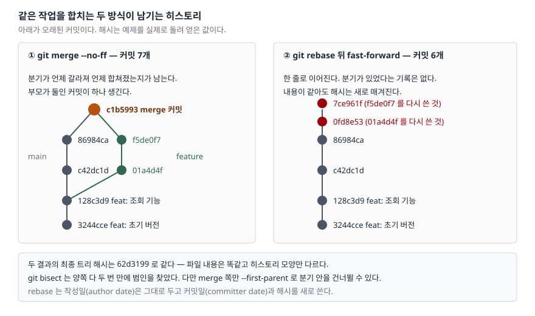

## 들어가며

브랜치를 따서 이틀쯤 작업하는 사이 main에도 커밋이 몇 개 쌓인다. 올릴 때가 되어
`git merge`를 치면 팀에서 누군가 "우리는 rebase 쓴다"고 하고, rebase로 바꾸면 다른
사람이 "머지 커밋이 있어야 뭘 언제 합쳤는지 안다"고 한다. 양쪽 다 근거가 있어
보이는데 무엇이 실제로 달라지는지는 아무도 설명해 주지 않는다.

이때 보통은 팀 관례를 그냥 따르고, 몇 달 뒤 장애가 나서 `git bisect`를 돌릴 때가
되어서야 히스토리 모양이 실제로 무언가를 바꾼다는 걸 알게 된다. 그때는 이미 커밋이
수백 개라 되돌릴 수 없다. 저장소 두 개를 만들어 같은 작업을 양쪽으로 한 번씩 합쳐
보면 10초면 끝날 확인이다.

## 개념

둘은 "합친다"는 말만 같고 하는 일이 다르다.

| | `git merge` | `git rebase` |
|---|---|---|
| 하는 일 | 두 갈래를 가리키는 **새 커밋 하나**를 만든다 | 내 커밋들을 **다른 베이스 위에 다시 적용**한다 |
| 기존 커밋 | 그대로 둔다 | 새 커밋으로 다시 쓴다 (해시가 바뀐다) |
| 결과 모양 | 갈라졌다 합쳐진 기록이 남는다 | 한 줄로 이어진다 |
| 부모가 둘인 커밋 | 생긴다 | 생기지 않는다 |

공식 문서는 rebase의 절차를 네 단계로 적는다. ① 분기 이후 내 커밋 목록을 만들고,
② upstream을 체크아웃하고, ③ **커밋을 하나씩 순서대로 다시 적용하고**(`git cherry-pick`을
각 커밋에 돌리는 것과 비슷하다), ④ 브랜치를 마지막 커밋으로 옮긴다. 세 번째 단계가
핵심이다. 원래 커밋을 옮기는 것이 아니라 **같은 변경을 새 부모 위에 다시 만든다.**
부모가 달라지면 커밋 해시도 달라진다.

## 구조



> **출처**: [git-rebase(1) — DESCRIPTION](https://git-scm.com/docs/git-rebase#_description) · [git-merge(1) — \-\-no-ff](https://git-scm.com/docs/git-merge#Documentation/git-merge.txt---no-ff)

왼쪽은 `--no-ff`로 합친 결과다. `c1b5993`이 부모를 둘 가진 머지 커밋이고, 그 아래로
분기가 갈라졌다 합쳐진 모양이 그대로 남는다. 오른쪽은 rebase로 올린 결과다.
같은 변경이 `0fd8e53`·`7ce961f`라는 **다른 해시**로 다시 쓰였고, 분기가 있었다는
기록은 남지 않는다. 도식의 해시는 전부 예제를 실제로 돌려 얻은 값이다.

## 동작 원리

rebase가 커밋을 다시 쓸 때 **작성일(author date)은 보존하고 커밋일(committer date)만
새로 쓴다.** 공식 문서는 이것을 직접 말하는 대신 옵션 설명으로 드러낸다 —
`--committer-date-is-author-date`는 "현재 시각을 커밋일로 쓰는 대신 원래 커밋의
작성일을 커밋일로 쓴다"고 적고, `--reset-author-date`는 "원래 커밋의 작성일을 쓰는
대신 현재 시각을 작성일로 쓴다"고 적는다. 즉 기본값이 그 반대라는 뜻이다.
예제에서 직접 확인한 값이 이렇다.

```text
-- rebase 전 feature 의 커밋
f5de0f7 2026-01-04 2026-01-04 refactor: 공통 모듈 정리
01a4d4f 2026-01-03 2026-01-03 feat: 공통 모듈

-- rebase 후 같은 커밋 (작성일은 그대로, 커밋일과 해시가 바뀐다)
7ce961f 2026-01-04 2026-01-07 refactor: 공통 모듈 정리
0fd8e53 2026-01-03 2026-01-07 feat: 공통 모듈
```

해시가 바뀐다는 것이 rebase의 모든 제약을 설명한다. 이미 공유한 브랜치를 rebase하면
남들이 가진 커밋과 내 커밋이 **내용은 같은데 다른 객체**가 된다. 문서가
`RECOVERING FROM UPSTREAM REBASE` 절 첫 문장에서 "다른 사람이 작업의 바탕으로 삼은
브랜치를 rebase하는 것은 나쁜 생각"이라고 적는 이유다.

반대로 merge는 기존 커밋을 하나도 건드리지 않는다. 대신 부모가 둘인 커밋이 생기고,
그 뒤로 히스토리를 훑는 도구들이 "어느 쪽 부모를 따라갈 것인가"를 선택해야 한다.
`--first-parent`가 그 선택지다.

## 실습 예제

전체 소스: [`code/rebase_vs_merge.sh`](code/rebase_vs_merge.sh) · 실행 기록:
[`code/output.txt`](code/output.txt)

`mktemp -d`로 만든 임시 폴더에 저장소를 하나 만들고, main에 커밋 둘을 쌓은 뒤
feature를 따서 양쪽을 각각 두 커밋씩 진행시켰다. 그 저장소를 두 벌 복제해 한쪽은
merge, 한쪽은 rebase로 합쳤다. 작성자와 날짜를 고정했으므로 몇 번을 돌려도 같은
해시가 나온다.

**① merge 쪽 그래프** — 분기가 보인다.

```text
*   c1b5993 merge: 공통 모듈 반영
|\
| * f5de0f7 refactor: 공통 모듈 정리
| * 01a4d4f feat: 공통 모듈
* | 86984ca docs: 자주 묻는 질문
* | c42dc1d docs: 사용법
|/
* 128c3d9 feat: 조회 기능
* 3244cce feat: 초기 버전

전체 커밋 수            : 7
머지 커밋 수            : 1
first-parent 만 따라가면: 5 개
```

**② rebase 쪽 그래프** — 한 줄이다.

```text
* 7ce961f refactor: 공통 모듈 정리
* 0fd8e53 feat: 공통 모듈
* 86984ca docs: 자주 묻는 질문
* c42dc1d docs: 사용법
* 128c3d9 feat: 조회 기능
* 3244cce feat: 초기 버전

전체 커밋 수            : 6
머지 커밋 수            : 0
```

**③ 결과물은 같다.** 최종 작업 트리의 해시를 양쪽에서 뽑아 비교했다.

```text
merge  쪽 트리 : 62d3199db4eab8f42fe45e0825d0d6d9f6b7f463
rebase 쪽 트리 : 62d3199db4eab8f42fe45e0825d0d6d9f6b7f463
판정           : 같다 — 파일 내용은 똑같고 히스토리 모양만 다르다
```

**④ `git bisect`는 예상과 달리 양쪽이 같았다.** `lib.txt`에 `broken`이 들어온 커밋을
`git bisect run`으로 찾게 했더니 둘 다 **두 번 만에** 범인을 짚었다.

```text
-- merged 쪽
   Bisecting: 2 revisions left to test after this (roughly 2 steps)
   Bisecting: 0 revisions left to test after this (roughly 1 step)
   f5de0f77a58a376c5611f4c96550866fd9478c0d is the first bad commit

-- rebased 쪽
   Bisecting: 2 revisions left to test after this (roughly 1 step)
   Bisecting: 0 revisions left to test after this (roughly 1 step)
   7ce961fc2c65d8d634f72b46dcff0e240e9afb20 is the first bad commit
```

"선형 히스토리라야 bisect가 빠르다"는 말을 자주 보는데, 이 규모에서는 차이가 없었다.
양쪽 다 후보가 6~7개라 두 번이면 좁혀진다. 다만 **merge 쪽만 가진 선택지**가 하나
있다.

**⑤ `--first-parent`는 merge 쪽에서만 뜻이 있다.** 머지 커밋의 첫 번째 부모만 따라가면
분기 안으로 들어가지 않는다.

```text
   Bisecting: 1 revision left to test after this (roughly 1 step)
   Bisecting: 0 revisions left to test after this (roughly 0 steps)
   c1b5993bb102e2acb077e744938f42dad8c1abb6 is the first bad commit
       merge: 공통 모듈 반영
```

찾아낸 것이 `f5de0f7`(분기 안의 커밋)이 아니라 `c1b5993`(머지 커밋)이다. 훑을 후보가
줄었고, 답은 "어느 줄을 합친 게 문제냐"로 바뀌었다. 기능 단위로 되돌릴 거라면 이쪽이
바로 쓸 수 있는 답이다. rebase 쪽에는 머지 커밋이 없으니 이 선택지 자체가 없다.

## 실무에서 주의할 점

**① 공유한 브랜치는 rebase하지 않는다.** 해시가 바뀌므로 그 브랜치를 받아 간 사람은
히스토리를 손으로 고쳐야 한다. 공식 문서가 "나쁜 생각"이라고 명시한 몇 안 되는
항목이다. 내 로컬 브랜치를 올리기 전에 정리하는 용도로 쓴다.

**② `--no-ff`를 빼면 merge가 merge처럼 안 보일 수 있다.** 분기 이후 main에 커밋이
없으면 git은 머지 커밋을 만들지 않고 브랜치 포인터만 앞으로 옮긴다(fast-forward).
그러면 merge를 썼는데도 히스토리가 rebase 쪽과 똑같이 한 줄이 된다. 머지 기록을
남기는 것이 목적이면 `--no-ff`를 명시한다.

**③ 충돌 횟수가 다르다.** merge는 두 갈래의 최종 상태를 한 번 합치므로 충돌이
한 번 난다. rebase는 커밋을 **하나씩 다시 적용**하므로 같은 파일을 건드린 커밋이
셋이면 같은 충돌을 세 번 풀 수도 있다. 커밋이 쌓인 긴 브랜치를 rebase하기 전에
이 비용을 먼저 생각한다.

**④ 되돌리는 방법이 다르다.** 머지 커밋은 `git revert -m 1 <머지커밋>`으로 기능
전체를 한 번에 되돌릴 수 있다. rebase로 올린 커밋들은 그런 손잡이가 없어서 커밋을
하나씩 revert하거나 범위를 지정해야 한다.

**⑤ `bisect`가 빨라진다는 이유로 rebase를 고르지 않는다.** 위 측정대로 탐색 횟수는
같았다. 고를 이유는 "히스토리를 어떻게 읽고 싶은가"이지 속도가 아니다.

## 정리

- merge는 커밋을 보존하고 부모가 둘인 커밋을 하나 더한다. rebase는 같은 변경을
  새 부모 위에 **다시 써서** 해시를 바꾼다
- 두 방식의 최종 파일 내용은 완전히 같다. 달라지는 것은 남는 기록뿐이다
- rebase는 작성일을 보존하고 커밋일만 새로 쓴다. 해시가 바뀌므로 **공유한 브랜치에는
  쓰지 않는다**
- `git bisect` 탐색 횟수는 이 규모에서 양쪽이 같았다. 대신 merge 쪽에서만
  `--first-parent`로 분기 안을 건너뛸 수 있다
- 선택 기준은 "분기가 있었다는 사실을 기록으로 남길 것인가"다. 남길 거면 `merge --no-ff`,
  읽기 쉬운 한 줄을 원하면 rebase다

## 참고 자료

- [git-rebase(1) — DESCRIPTION](https://git-scm.com/docs/git-rebase#_description)
- [git-rebase(1) — RECOVERING FROM UPSTREAM REBASE](https://git-scm.com/docs/git-rebase#_recovering_from_upstream_rebase)
- [git-merge(1) — \-\-no-ff](https://git-scm.com/docs/git-merge#Documentation/git-merge.txt---no-ff)
- [git-bisect(1)](https://git-scm.com/docs/git-bisect)
