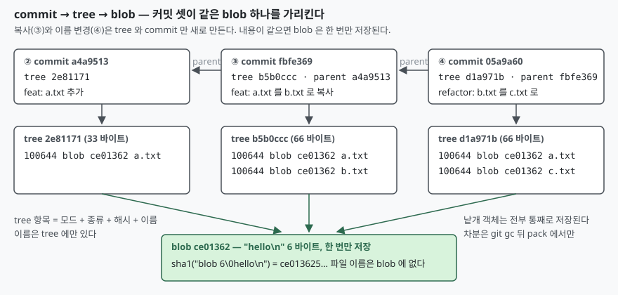

## 들어가며

실수로 커밋한 수백 MB 짜리 덤프 파일을 다음 커밋에서 지웠는데, `.git` 폴더
크기가 그대로다. 이때 대개는 `git gc` 를 한 번 돌려 보고, 그래도 안 줄면
저장소를 새로 받는다. 새로 받아도 크기는 같다. 파일을 지운 커밋이 **파일
내용을 지운 것이 아니라 목록에서 이름을 뺀 것**이기 때문인데, 이 사실을
모르면 다음에도 같은 일을 겪는다.

git 이 파일을 어떤 단위로, 어떤 이름으로, 언제 저장하는지는 `.git/objects`
를 직접 열어 보면 전부 드러난다. 명령 몇 개면 되고 10분이면 끝난다. 이 글은
커밋 다섯 개를 쌓으면서 객체가 언제 몇 개씩 생기는지를 센다.

## 개념

git 저장소의 본체는 `.git/objects` 아래의 **객체 저장소**다. 객체는 네 종류인데
이 글은 그중 셋을 다룬다.

| 객체 | 무엇을 담는가 | 이름(해시)은 무엇으로 정해지는가 |
|---|---|---|
| `blob` | 파일 **내용**. 파일 이름은 없다 | 내용 |
| `tree` | 한 폴더의 목록. 항목마다 모드·종류·해시·이름 | 목록 |
| `commit` | 최상위 tree 해시, 부모 commit 해시, 작성자, 메시지 | 그 전부 |

객체의 이름은 내용의 SHA-1 해시다. 정확히는 `"<종류> <바이트 수>\0"` 머리말을
붙인 전체의 해시이고, 그 값으로 `.git/objects/<앞 2자리>/<나머지 38자리>` 에
zlib 으로 압축해 저장한다. **같은 내용은 어디에서 몇 번 나오든 같은 이름을
갖고, 그래서 한 번만 저장된다.** 파일 이름이 blob 에 없는 것도 이 때문이다.
이름이 들어가면 `a.txt` 와 `b.txt` 의 같은 내용이 다른 객체가 된다.

## 구조



> **출처**: [Pro Git — 10.2 Git Internals: Git Objects, Tree Objects](https://git-scm.com/book/en/v2/Git-Internals-Git-Objects#_tree_objects), [같은 장 Commit Objects](https://git-scm.com/book/en/v2/Git-Internals-Git-Objects#_git_commit_objects)

## 동작 원리

실험은 임시 폴더에 저장소를 만들고 작성자·날짜를 고정해 돌렸으므로, 아래 해시는
독자 환경에서도 똑같이 나온다.

**① `git add` 만 해도 blob 은 생긴다.** 커밋 전인데 `.git/objects` 에 객체가 하나
있다. 종류 `blob`, 크기 6, 내용 `hello\n`.

```text
blob ce013625030ba8dba906f756967f9e9ca394464a 6

-- 해시를 손으로 계산한다: sha1("blob 6\0" + 내용)
ce013625030ba8dba906f756967f9e9ca394464a *-
-- 저장된 파일 경로 (앞 2자리가 폴더)
ce/013625030ba8dba906f756967f9e9ca394464a
-- 디스크 위 크기 (zlib 압축된 "blob 6\0hello\n")
21
```

`printf 'blob 6\0hello\n' | sha1sum` 이 `git hash-object` 와 같은 값을 낸다.
해시에 마법은 없다. 머리말을 붙인 내용의 SHA-1 일 뿐이다.

**② 커밋하면 tree 와 commit 이 더해진다.** 객체가 셋이 된다. commit 을 열면 tree
해시가, tree 를 열면 blob 해시와 파일 이름이 있다.

```text
-- git cat-file -p HEAD (commit)
tree 2e81171448eb9f2ee3821e3d447aa6b2fe3ddba1
author Example Author <author@example.com> 1767225600 +0900
committer Example Author <author@example.com> 1767225600 +0900

feat: a.txt 추가

-- git cat-file -p HEAD^{tree} (tree)
100644 blob ce013625030ba8dba906f756967f9e9ca394464a	a.txt
```

**③ 같은 내용의 파일을 복사해 커밋하면 blob 은 늘지 않는다.** `cp a.txt b.txt`
뒤 커밋했더니 tree 와 commit 만 하나씩 늘어 5개가 됐다. 새 tree 의 두 항목이 같은
blob 을 가리킨다.

```text
100644 blob ce013625030ba8dba906f756967f9e9ca394464a	a.txt
100644 blob ce013625030ba8dba906f756967f9e9ca394464a	b.txt
```

**④ 이름만 바꿔도 마찬가지다.** `git mv b.txt c.txt` 는 tree 와 commit 만 만든다.
git 은 "이름이 바뀌었다"는 사실을 **저장하지 않는다.** `git show --stat` 이
`b.txt => c.txt` 로 보여 주는 것은 두 tree 를 비교해 blob 이 같은 항목을 찾아
**그 자리에서 추정한** 결과다.

**⑤ 한 글자만 고쳐도 blob 은 통째로 새로 생긴다.** `hello\n` 을 `hello!\n` 으로
바꾸자 7바이트짜리 blob 이 따로 생겼다. 낱개(loose) 객체에는 차분 저장이 없다.
1 MB 파일에서 한 줄을 고치면 1 MB 가 또 저장된다.

**⑥ 폴더는 tree 가 tree 를 가리키는 모양이다.** 모드가 `040000` 인 항목이 하위
tree 다. 커밋 다섯 개를 쌓은 뒤 낱개 객체는 14개, blob 3 · tree 6 · commit 5 였다.
파일은 세 가지 내용뿐인데 tree 가 여섯인 이유는 **폴더 목록이 바뀔 때마다 그
폴더의 tree 가 새로 생기기** 때문이다.

**⑦ 차분은 `git gc` 뒤 pack 안에서만 쓰인다.** gc 를 돌리자 낱개 객체 0, pack
안 객체 14가 됐다. `git verify-pack -v` 로 pack 안을 보면 차분으로 저장된 객체는
**하나뿐**이다.

```text
8cc573fc07ceb3ae583f666126a56b1c36a08bc6 tree   4 15 1010 1 54c0654d45b02e010808c0bc8501d746e447b941
```

이 줄은 ⑤의 최상위 tree(`8cc573f`)가 ⑥의 최상위 tree(`54c0654`)를 기준으로 한
차분(깊이 1)으로 저장됐다는 뜻이다. 내용이 한 글자 다른 blob 둘(`hello\n`,
`hello!\n`)은 차분 없이 각각 통째로 들어갔다. 글을 쓰기 전에는 비슷한 blob 끼리
묶일 줄 알았는데, git 은 이렇게 작은 객체에서는 차분의 이득이 없다고 보고
그대로 둔다. 차분은 "내용이 비슷하면 항상"이 아니라 **pack 을 만들 때 git 이
이득이 있다고 판단한 객체에만** 적용된다.

## 실습 예제

전체 소스: [`code/`](code/) · 수행 기록: [`code/output.txt`](code/output.txt)

위 일곱 단계가 그대로 스크립트다. 핵심 명령은 셋이다.

```bash
git cat-file -t <해시>    # 종류
git cat-file -s <해시>    # 크기
git cat-file -p <해시>    # 내용을 사람이 읽는 꼴로
```

낱개 객체를 한꺼번에 세는 데는 `--batch-check` 가 편하다. `.git/objects` 아래
파일 경로에서 해시를 복원해 표준 입력으로 넣으면 종류와 크기를 줄마다 돌려준다.

```bash
find .git/objects -type f -path '*/[0-9a-f][0-9a-f]/*' \
    | sed 's|.git/objects/||; s|/||' \
    | git cat-file --batch-check='%(objecttype) %(objectname) %(objectsize)'
```

## 실무에서 주의할 점

**첫째, 파일을 지우는 커밋은 blob 을 지우지 않는다.** 지우는 커밋은 새 tree 에서
항목을 뺄 뿐이고, 이전 커밋의 tree 가 여전히 그 blob 을 가리킨다. 커밋 이력에서
닿는 한 blob 은 남고 `git gc` 도 치우지 않는다. 큰 파일을 이력에서 빼려면 그 blob 을
가리키는 커밋을 전부 다시 써야 하고, 그래서 `git filter-repo` 같은 도구가 따로 있다.

**둘째, 이름 변경은 추정이다.** ④에서 본 대로 git 은 rename 을 저장하지 않는다.
이름을 바꾸면서 내용까지 많이 고치면 두 blob 이 달라져 추정이 실패하고, 삭제 하나와
추가 하나로 보인다. `git log --follow` 가 가끔 끊기는 이유다. 이름 변경과 내용 변경은
커밋을 나누는 편이 이력이 깨끗하다.

**셋째, 낱개 객체는 통째로 저장된다.** ⑤가 보여 주듯 한 글자를 고쳐도 파일 전체가
새 blob 이 된다. 큰 파일을 자주 고치는 저장소는 gc 전까지 `.git` 이 빠르게 커진다.
gc 뒤 pack 에서 차분이 쓰이지만, ⑦에서 본 것처럼 모든 객체가 차분이 되는 것도 아니다.

**넷째, 줄바꿈 변환은 blob 해시를 바꾼다.** blob 은 내용의 해시이므로 `core.autocrlf`
가 커밋 시점에 CRLF 를 LF 로 바꾸면 같은 파일이 다른 blob 이 된다. 이 실험이
`core.autocrlf false` 를 먼저 설정한 이유이고, 윈도우와 리눅스에서 같은 파일의
해시가 다르게 나오면 가장 먼저 의심할 설정이다.

**다섯째, 해시 함수는 저장소 형식이다.** git 2.54 의 `git init` 에는
`--object-format <sha1|sha256>` 옵션이 있다. 이 글의 해시는 전부 SHA-1 기준이고,
SHA-256 저장소에서는 같은 내용이 다른 이름을 갖는다.

## 정리

- git 은 파일을 `blob`(내용), `tree`(폴더 목록), `commit`(스냅샷과 부모)로 저장하고,
  이름은 `"<종류> <크기>\0"` 를 붙인 내용의 SHA-1 이다
- 같은 내용은 한 번만 저장된다. 복사(③)와 이름 변경(④)은 tree 와 commit 만 만들었다
- 파일 이름은 blob 이 아니라 tree 에 있다. 그래서 이름 변경은 저장되지 않고 추정된다
- 낱개 객체는 통째로 저장된다. 한 글자를 고쳐도 blob 이 새로 생긴다(⑤)
- 차분은 `git gc` 뒤 pack 에서만, 그것도 git 이 이득이 있다고 본 객체에만 쓰인다.
  이 실험에서는 14개 중 tree 하나뿐이었다(⑦)

## 참고 자료

- [Pro Git — 10.2 Git Internals: Git Objects](https://git-scm.com/book/en/v2/Git-Internals-Git-Objects)
- [Pro Git — 10.4 Git Internals: Packfiles](https://git-scm.com/book/en/v2/Git-Internals-Packfiles)
- [git-cat-file 매뉴얼 — --batch-check](https://git-scm.com/docs/git-cat-file#Documentation/git-cat-file.txt---batch-check)
- [git-hash-object 매뉴얼](https://git-scm.com/docs/git-hash-object)
- [gitrepository-layout 매뉴얼 — objects/[0-9a-f][0-9a-f]](https://git-scm.com/docs/gitrepository-layout#Documentation/gitrepository-layout.txt-objects0-9a-f0-9a-f)
- [git-verify-pack 매뉴얼](https://git-scm.com/docs/git-verify-pack)
- [git-count-objects 매뉴얼](https://git-scm.com/docs/git-count-objects)
